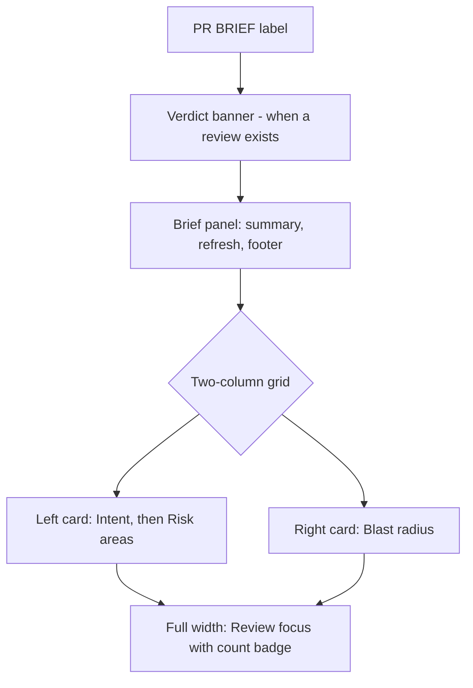

# Spec: PR Brief Overview layout
Spec ID: SPEC-05
Status: approved
Supersedes: SPEC-03 (client/specs/2026-10-11-pr-brief-polish.md), limited to its "Show details" disclosure design: the hiding of Risk areas and Review focus behind a toggle (SPEC-03 provenance line "details", OQ-1's clause "or when details are hidden", and OQ-13's idea "auto-open Show details"). All other SPEC-03 and SPEC-04 criteria stay in force. SPEC-03 and SPEC-04 are not edited.

## Problem and user
**Who:** a reviewer opening a pull request in the DevDigest studio and reading the Overview tab. The course homework (P1) requires that, after a brief is generated, the summary, Risk areas and Review focus are displayed (not hidden) next to the Intent and Blast radius blocks.

**What hurts today** (verified in code on 2026-10-11, see *Inputs and provenance*):
- Risk areas and Review focus render only after the user clicks a "Show details" toggle in the brief card footer, so the Overview does not show them by default (`PrBriefCard.tsx:51,166-175,195-228`).
- The brief is one compact panel above the Intent / Blast radius grid. The target design (`to_analyze/hmw_1.png`, `P_1.png`, `P_2.png`) has a different arrangement: one "PR BRIEF" section label on top; the verdict banner below it; a two-column grid where the left card holds Intent with a RISK AREAS list at its bottom and the right card holds Blast radius; and a full-width "REVIEW FOCUS - READ THESE FIRST" card with a count badge below the grid.
- Today the verdict banner sits above the brief with no label of its own (`OverviewTab.tsx:49-54`), the "PR Brief" label sits inside the brief card (`PrBriefCard.tsx:70`), and Intent renders its own card without any risk list (`IntentCard.tsx:113-206`).
- A collapsed risk row shows severity, kind and title, but not its file; file references appear only after expanding (`RiskArea.tsx:43-50,56-79`). The design shows name plus a mono file reference on every collapsed row.
- Already met and out of scope here: focus item rows already show `file:line` plus reason and navigate to Files changed (`ReviewFocusList.tsx:41-57`, SPEC-03); the empty texts exist (`brief.json` `section.noRisks`, `focus.empty`); the skeleton, Generate button, refresh and not-in-diff notice exist (SPEC-03).

Target Overview order (design `hmw_1.png`, with the deviation noted in OQ-1):

## Goals / Non-goals
**Goals**
- Risk areas and Review focus visible by default whenever a brief is displayed; the "Show details" toggle is removed.
- Placement per the target design: one section label, Risk areas at the bottom of the left (Intent) card, Review focus full width below the grid.
- Every risk row shows its name and a file reference without expanding; every focus row shows `file:line` and reason and opens that file in Files changed.
- Empty, no-brief, generating, failed and stale states keep working.

**Non-goals**
- Changing the brief contract, server, caching, grounding, or the vendored shared contracts.
- Changing navigation, not-in-diff, skeleton, banner-data or accessibility behavior defined by SPEC-03/SPEC-04 (referenced, not redefined).
- Redesigning Intent or Blast radius content.
- Adding the cost/token line to the verdict banner or moving the refresh action onto the banner (see OQ-2).
- Other tabs (Agent runs, Files changed).

## User stories
- **US-1** As a reviewer, I want Risk areas and Review focus shown on the Overview as soon as a brief exists, so that I do not have to click anything to see what to look at.
- **US-2** As a reviewer, I want risks listed inside the Intent card, each with its name and file, so that I see scope and risk together and can tell where each risk is.
- **US-3** As a reviewer, I want a "Review focus - read these first" list below the grid with a count, so that I know where to start reading the diff.
- **US-4** As a reviewer, I want clicking a focus item to open Files changed at that file, so that I go straight to the code.
- **US-5** As a reviewer, I want sensible empty, not-generated, generating, failed and stale states in the new layout, so that the page never looks broken or shows outdated content as current.
- **US-6** As a reviewer on a narrow window, I want the layout to stack, so that nothing is cut off.
- **US-7** As a keyboard or screen-reader user, I want the new regions labelled and operable, so that the layout is accessible.

## Acceptance criteria (EARS)

### Section and ordering
- **AC-1** [Ubiquitous] [MUST] The system (shall) render exactly one "PR Brief" section label on the Overview tab, placed above the verdict banner, the brief panel, the Intent/Blast radius grid and the Review focus card.
  Verify: integration — render Overview with a generated brief and a completed review; assert one element with the section title, preceding all other brief blocks in DOM order.
- **AC-2** [Ubiquitous] [MUST] The system (shall) place, below that label, in this order: the latest-review verdict banner (when one exists, per SPEC-03 AC-16 to AC-21), the brief panel, the two-column grid, then the Review focus card.
  Verify: integration — assert DOM order banner, brief panel, grid, Review focus; with no review assert the banner is absent and the order of the rest is unchanged.

### Visible by default; toggle removed
- **AC-3** [State-driven] [MUST] WHILE a brief is displayed and not generating, the system (shall) show the Risk areas and Review focus regions without any user action.
  Verify: integration — render with a brief containing 2 risks and 2 focus items; assert both regions and all 4 items are in the document with no click performed.
- **AC-4** [Ubiquitous] [MUST] The system (shall) provide no "Show details" or "Hide details" control anywhere on the Overview.
  Verify: integration — render with a brief; assert no control with either text (and no `aria-expanded` details toggle in the brief card footer).

### Risk areas (left card)
- **AC-5** [State-driven] [MUST] WHILE a brief is displayed and not generating, the system (shall) render the Risk areas list at the bottom of the left grid card, below Intent's in-scope / out-of-scope columns and separated from them, under a "Risk areas" label from the catalogue.
  Verify: integration — assert the Risk areas label and rows are inside the same card element as the Intent statement and follow the scope columns.
- **AC-6** [Unwanted] [MUST] IF the Intent card has no intent to show (loading, not analysed, provider not configured, generation failed, or request error), THEN the system (shall) still render the Risk areas list in the left grid column, in a card of its own.
  Verify: integration — mock the intent request to fail and, separately, to return "not generated"; assert Risk areas rows are present in the left column in both cases.
- **AC-7** [State-driven] [MUST] WHILE a risk row is collapsed, the system (shall) show the risk's title and the first entry of its file references as monospace text (`path` or `path:line`) without requiring expansion.
  Verify: integration — risk with refs `src/a.ts:12-18` style and `b.ts`; collapsed row text contains the title and the first ref only.
- **AC-8** [Event-driven] [MUST] WHEN the user expands a risk row, the system (shall) show its explanation and all of its file references as navigation controls with the behavior defined in SPEC-03 AC-5 to AC-7.
  Verify: integration — expand a risk with two refs; assert explanation present, both refs listed, clicking an in-diff ref switches to Files changed.
- **AC-9** [Unwanted] [MUST] IF the displayed brief has zero risks, THEN the system (shall) show the catalogue text "No specific risks identified." in the Risk areas region.
  Verify: integration — brief with `risks: []`; assert the text under the Risk areas label.
- **AC-10** [State-driven] [MUST] WHILE the grid is displayed, the system (shall) render Blast radius in the right column beside the left card, unchanged in content.
  Verify: integration — assert the Blast radius card is a sibling cell of the left card in the grid.

### Review focus (full width)
- **AC-11** [State-driven] [MUST] WHILE a brief with at least one focus item is displayed and not generating, the system (shall) render a full-width Review focus card below the grid, labelled "Review focus - read these first" from the catalogue, with a count badge equal to the number of items.
  Verify: integration — brief with 4 items; assert label, badge text "4", and 4 rows after the grid in DOM order.
- **AC-12** [State-driven] [MUST] WHILE the Review focus card is displayed, the system (shall) show for each item its `file:line` (or `file` when the line is null) followed by its reason on one row.
  Verify: integration — items `{src/config.ts, 12}` and `{src/x.ts, null}`; assert row text `src/config.ts:12` + reason and `src/x.ts` + reason.
- **AC-13** [Event-driven] [MUST] WHEN the user activates a focus item whose file is in the PR's file list, the system (shall) switch to the Files changed tab and navigate to that file as defined in SPEC-03 AC-1 to AC-4.
  Verify: integration — click an in-diff item; assert Files changed is active and that file's card is expanded and scrolled into view.
- **AC-14** [Unwanted] [MUST] IF the activated focus item's file is not in the PR's file list, THEN the system (shall) keep the Overview active and show the "File not in this PR's diff" notice next to that row (SPEC-03 AC-7).
  Verify: integration — item citing an absent file; click; assert notice beside the row, tab unchanged.
- **AC-15** [Unwanted] [MUST] IF the displayed brief has zero focus items, THEN the system (shall) show the catalogue text "No review-focus entries." in the Review focus card and no count badge.
  Verify: integration — brief with `review_focus: []`; assert the text, label present, no badge element.

### Other states
- **AC-16** [State-driven] [MUST] WHILE no brief exists for the PR, the system (shall) render the brief panel with the empty-state text and the "Generate brief" button, render no Risk areas list and no Review focus card, and keep the Intent and Blast radius cards displayed.
  Verify: integration — page with `brief: null`; assert button and empty text present, no risk/focus regions, Intent and Blast radius present.
- **AC-17** [State-driven] [MUST] WHILE a brief is generating or regenerating, the system (shall) show the generation skeleton (SPEC-03 AC-12, AC-15) and shall not display the previously stored risks or focus items.
  Verify: integration — existing brief, click refresh with a pending mutation; assert skeleton visible and no old risk titles or focus reasons in the document.
- **AC-18** [Event-driven] [MUST] WHEN a generation finishes successfully, the system (shall) replace the skeleton and show the new brief's risks and focus items in their regions without a page reload.
  Verify: integration — resolve the mutation with a page holding different risks; assert the new titles appear.
- **AC-19** [Unwanted] [MUST] IF a generation request fails while a previous brief exists, THEN the system (shall) keep the previous brief's risks and focus items displayed, with the failure status line and error toast of SPEC-03 AC-14.
  Verify: integration — reject the mutation; assert prior risk and focus rows still present plus status line.
- **AC-20** [State-driven] [MUST] WHILE the displayed brief has status "earlier_state" or "possibly_stale", the system (shall) show its risks and focus items in the same regions together with its status line.
  Verify: integration — page with status `possibly_stale`; assert regions populated and the stale text present.
- **AC-21** [State-driven] [MUST] WHILE the brief panel is displayed, the system (shall) keep in its footer the status or provenance line, the "Review not run yet" note when the PR has 0 agent runs, and the Run Review dropdown, and (shall) keep the refresh action that regenerates the brief.
  Verify: integration — assert these footer elements for 0 runs and for a generated brief; click refresh and assert one generate request with `regenerate: true`.

### Responsive, localization, accessibility
- **AC-22** [State-driven] [SHOULD] WHILE the viewport width is below 768 px, the system (shall) stack the grid into one column in the order Intent card (with Risk areas), Blast radius, Review focus.
  Verify: manual — resize the browser below 768 px and check order and absence of horizontal scroll (CSS media behavior is not reliably testable in jsdom).
- **AC-23** [Ubiquitous] [MUST] The system (shall) read every new label and message of this layout (the Review focus heading, the Risk areas label, any region accessible names) from the brief message catalogue, with no literal user-visible English string added to the components.
  Verify: unit — render with sentinel catalogue values; assert no default English remains in the new regions.
- **AC-24** [Ubiquitous] [MUST] The system (shall) expose the Risk areas and Review focus regions as labelled landmarks or headed groups, and (shall) keep risk toggles and focus rows reachable by Tab and operable by Enter and Space (SPEC-03 AC-26).
  Verify: integration — assert accessible names on both regions; tab to a risk header and a focus row, press Enter and Space, assert same effect as click.

### Traceability matrix
| Source | Covered by |
|---|---|
| US-1 | AC-3, AC-4 |
| US-2 | AC-5, AC-6, AC-7, AC-8, AC-9, AC-10 |
| US-3 | AC-1, AC-2, AC-11, AC-12, AC-15 |
| US-4 | AC-13, AC-14 |
| US-5 | AC-16, AC-17, AC-18, AC-19, AC-20, AC-21 |
| US-6 | AC-22 |
| US-7 | AC-23, AC-24 |
| EC-1 | AC-6 |
| EC-2 | AC-9, AC-15 |
| EC-3 | AC-16 |
| EC-4 | AC-17 |
| EC-5 | AC-19 |
| EC-6 | AC-20 |
| EC-7 | AC-7 |
| EC-8 | AC-7, OQ-5 |
| EC-9 | AC-12, OQ-3 |
| EC-10 | AC-14 |
| EC-11 | OQ-1 |
| NFR-1 | self (Verify given) |
| NFR-2 | self (Verify given) |
| NFR-3 | self (Verify given) |

## Edge cases
- **EC-1** Intent unavailable or failed while a brief with risks exists -> AC-6.
- **EC-2** Brief with no risks, or no focus items -> AC-9, AC-15.
- **EC-3** No brief generated yet -> AC-16.
- **EC-4** Regeneration in progress -> AC-17.
- **EC-5** Regeneration fails -> AC-19.
- **EC-6** Brief is earlier-state or possibly stale -> AC-20.
- **EC-7** Risk with several file references (collapsed row shows only the first) -> AC-7.
- **EC-8** Very long file paths or titles (must wrap without horizontal overflow) -> AC-7, OQ-5 (no truncation rule decided).
- **EC-9** Focus item with null line -> AC-12; very many focus items (no cap defined in this spec) -> OQ-3.
- **EC-10** Focus item file absent from the diff -> AC-14.
- **EC-11** No review exists, so no banner, while the mock shows a banner at the top of the section -> OQ-1.

## Non-functional requirements
- **NFR-1** [Cost] [MUST] The system (shall) issue 0 additional network requests and 0 LLM calls to display Risk areas and Review focus (they come from the already fetched brief page).
  Verify: integration — spy on fetch while rendering a generated brief; assert no request beyond the existing brief, intent, blast-radius, review and run queries.
- **NFR-2** [Accessibility] [MUST] The system (shall) satisfy this checklist: (a) both new regions have accessible names; (b) all risk toggles and focus rows are keyboard-operable with visible focus; (c) the count badge and severity are not conveyed by color alone (text present); (d) the expand state is exposed via `aria-expanded`.
  Verify: manual — keyboard and screen-reader pass; integration assertions in AC-24 (manual needed for real screen-reader output).
- **NFR-3** [Security] [MUST] The system (shall) render all brief text in the new regions as plain text or Markdown with raw HTML disabled and use brief paths only for exact matching against the PR file list (SPEC-03 AC-29, AC-30).
  Verify: unit — hostile fixture (``, `javascript:` path) in a risk title and a focus reason; assert no such element and no navigation.
- Performance, Observability: no new target; this is a client-side re-arrangement of already fetched data with no new events.

## Inputs and provenance
Read on 2026-10-11; no researcher subagents (launched as a subagent; research done directly). Paths relative to `C:\Projects\Agentic AI\dev-digest`.
- User task message (homework P1 requirement, target-design description, decisions to take) - requirement source.
- Target design screenshots, viewed: `to_analyze/hmw_1.png` (Overview: PR BRIEF label, verdict banner with refresh icon, PR score ring and cost, Intent card with RISK AREAS, Blast radius card, REVIEW FOCUS card with badge 4), `to_analyze/hmw_2.png` (Files changed after a click, webhooks.ts card highlighted), `to_analyze/P_1.png` (PR BRIEF block with the banner highlighted), `P_2.png` (Risk areas and Review focus highlighted), `P_3.png` (Files changed scrolled to `src/api/public/webhooks.ts` with blocker finding).
- `AGENTS.md`, `client/AGENTS.md` - conventions (UI via `@devdigest/ui` barrel, component tests mock fetch). `client/INSIGHTS.md` not read (layout-only change; existing component code and approved specs consulted instead).
- `client/src/app/repos/[repoId]/pulls/[number]/_components/PrBriefCard/PrBriefCard.tsx:51,70,121-193` (compact panel, own label, footer with detailsToggle), `:195-228` (risks/focus behind `showDetails`), `:178-189` Generate button when no brief, `:105-119` footer note logic.
- `.../PrBriefCard/RiskArea.tsx:43-50` (collapsed header: severity, kind, title, no refs), `:51-80` (expanded: explanation + refs); `.../PrBriefCard/ReviewFocusList.tsx:34-62` (rows `file:line` + reason, navigate or notice, empty text); `.../PrBriefCard/_components/BriefBody/BriefBody.tsx:10-36` (summary or what/why, missing-inputs note).
- `.../OverviewTab/OverviewTab.tsx:47-78` (banner, brief section, then grid of IntentCard and BlastRadiusCard); `.../OverviewTab/_components/IntentCard/IntentCard.tsx:20-31,113-206` (own title label, returns null on error, not-analysed states, scope columns); `.../OverviewTab/_components/LatestReviewBanner/LatestReviewBanner.tsx:21-45`.
- `client/messages/en/brief.json` - existing keys: `section.title/risks/focus/noRisks`, `focus.empty`, `details.show/hide`, `navigation.*`, `banner.*`, `reviewNotRun`; there is no key for "Review focus - read these first".
- `client/specs/2026-10-11-pr-brief-polish.md` (SPEC-03, approved) and `specs/2026-10-11-pr-brief-contract-gaps.md` (SPEC-04, approved) - behavior referenced, not redefined. SPEC-04 AC-4 ("summary above risks and review focus") remains satisfied by the DOM order of AC-2.
- **Not seen:** `PrBriefCard/styles.ts`, `useBriefNavigation`, `page.tsx` wiring, `VerdictBanner` internals (whether it can show cost), the current responsive CSS of the Overview grid, Figma interactions or prototypes (only the five static screenshots), behavior in a running browser.

## Untrusted inputs
- **Brief text and paths (LLM output):** risk titles, explanations, file refs, focus reasons and files. Assumption: server-grounded but treated as untrusted by the client. Handling: plain text / Markdown without raw HTML; paths only matched exactly against the PR file list, never used to build routes (NFR-3, SPEC-03 AC-29/30). Abuse: HTML/script injection, `../` or `javascript:` paths, extremely long strings (must wrap, EC-8), non-integer or huge line numbers.
- **PR file list (GitHub data):** used only for exact-match lookups, unchanged.
- **Intent text (LLM output):** already rendered as plain text by the existing card; unchanged.
- **Injection attempts found in design sources:** none (screenshots contain no instruction text).

## Open questions
Defaults were adopted without an interview (subagent run); each can be vetoed.
- **OQ-1** Where does the brief's own summary panel go relative to the verdict banner? The mock (`hmw_1.png`) shows only the banner under the "PR BRIEF" label and its summary text is the review summary; it has no separate brief panel. Default (recommended): keep the brief panel (brief summary, risk badge, refresh, Generate button, provenance, Run Review) directly under the banner, because the Generate button, skeleton, status lines and SPEC-04 summary have no other home, and the banner is absent when no review exists. Alternative: merge brief summary into the banner area. Resolver: product owner.
- **OQ-2** The mock banner shows a cost / token line and a refresh icon. The existing banner has neither; the refresh lives on the brief panel and regenerates the brief. Default: unchanged (not in scope); adding cost to the banner would be a separate change. Resolver: product owner.
- **OQ-3** Cap on the number of focus items or risks shown. Default: show all items the brief carries (the server already bounds them per SPEC-04's brief limits); no "show more". Resolver: product owner.
- **OQ-4** Remove the unused `details.show` / `details.hide` catalogue keys? Default: yes, as cleanup in the same change; low risk. Resolver: implementer / maintainer.
- **OQ-5** Truncation of long paths in collapsed risk rows. Default: wrap, no ellipsis. Alternative: ellipsis with full path in a tooltip.
- **OQ-6** Collapsed risk row shows only the first file ref and is not itself a navigation control (the whole row toggles the explanation; refs navigate after expansion, SPEC-03 AC-5). Default: keep. Alternative: make the visible ref clickable (needs a non-nested control layout, as in the mock's separate chevron).
- **OQ-7** Breakpoint for stacking the grid (AC-22 uses 768 px). Default: 768 px unless the existing Overview grid already defines one, which was not checked. Resolver: implementer.
- **OQ-8** Supersession scope: this spec supersedes only SPEC-03's "Show details" disclosure design as stated in the header; the SPEC-03 clause that the not-in-diff notice clears "when details are hidden" becomes moot (the notice then clears on the next successful navigation). Needs the owner's confirmation.
- **OQ-9** Unadopted UX ideas: highlight high-severity risks first in the list; show a risk count badge next to the "Risk areas" label (mirroring the focus badge); a "back to brief" affordance after navigating to Files changed.
