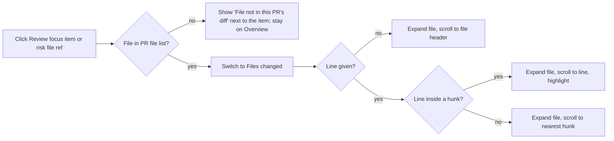

# Spec: PR Brief polish
Spec ID: SPEC-03
Status: approved
Supersedes: —

## Problem and user
**Who:** a reviewer opening a pull request in the DevDigest studio (Overview tab), reading the PR Brief ("what / why / risk areas / review focus") before or while reviewing the diff.

**What hurts today** (all verified in code on 2026-10-11, see *Inputs and provenance*):
- The brief already survives a reload without regeneration, and the Refresh button regenerates it (already met; not in scope).
- Clicking a "Review focus" item calls `onFocusFile(file, line)`, but the PR page wires it to a handler that only switches to the Files changed tab; file and line are discarded and the diff view has no way to receive a focus target. The reviewer lands at the top of the diff and must find the file by hand.
- A risk area expands its explanation on click, but its file references are external GitHub links only; there is no in-app navigation. The reviewer leaves the studio.
- No message exists for a file the brief mentions that is not part of this PR's diff (a risk may legitimately cite a downstream caller file, and model output may cite anything).
- The brief card shows a skeleton only for the initial fetch; while generating or regenerating, the card shows either the empty-state text or the stale body, so the user cannot tell work is in progress except via a small footer line.
- One user-visible string in the brief card (the generation-error toast fallback) is hard-coded instead of coming from the brief message catalogue.
- The verdict/score banner exists but is only rendered inside each run accordion on the Findings tab. The Overview shows no review outcome, so the reviewer must switch tabs to learn the verdict and PR score.

## Goals / Non-goals
**Goals**
- One consistent "go to this file/line in the diff" behavior for Review focus items and risk file references.
- A clear, non-breaking outcome when the target is not in the diff.
- A skeleton during every generation (first and regeneration).
- The latest review's verdict and PR score visible at the top of the Overview.
- No hard-coded user-visible text in the brief block.

**Non-goals**
- Adding a `summary` field to the brief contract (the brief keeps what/why; undecided, see OQ-2).
- Surfacing brief LLM calls in the run trace.
- Changing the server, model, token budget or SHA-based caching/staleness logic (already met).
- The Project Context and Onboarding Tour features.
- Any change to the vendored shared contracts (client and server copies stay untouched).
- Translating pre-existing hard-coded strings elsewhere on the PR page (diff toolbar, header, delete confirmations); see OQ-12.

## User stories
- **US-1** As a reviewer, I want clicking a Review focus item to open Files changed scrolled to the relevant line, so that I can start reading the code the brief pointed at without searching.
- **US-2** As a reviewer, I want clicking a file reference inside a risk to take me to that file in Files changed (while the risk still expands its explanation), so that I can verify a risk against the code.
- **US-3** As a reviewer, I want a clear message when the brief points at a file that is not in this PR's diff, so that I understand why nothing happened and the page does not break.
- **US-4** As a reviewer, I want a skeleton while the brief is generating or regenerating, so that I know work is in progress and do not read a stale body as current.
- **US-5** As a reviewer, I want the verdict and PR score of the latest review at the top of the Overview, so that I see the review outcome without opening another tab.
- **US-6** As a maintainer, I want all user-visible brief labels and messages to come from the message catalogue, so that text is consistent and translatable.
- **US-7** As a keyboard or screen-reader user, I want the navigation to be operable and announced without a mouse, so that the feature is accessible.
- **US-8** As a reviewer looking at an earlier-state or possibly-stale brief, I want its items to stay navigable against the PR's current diff, so that a stale brief is still useful.

## Acceptance criteria (EARS)

### Navigation to the diff
- **AC-1** [Event-driven] [MUST] WHEN the user activates a Review focus item whose file path exactly equals a path in the PR's current file list, the system (shall) switch the PR page to the Files changed tab.
  Verify: integration — render the PR page with a brief whose focus item cites file F present in the PR files; click the item; assert the Files changed tab is active and F's file card is rendered.
- **AC-2** [Event-driven] [MUST] WHEN the user activates a Review focus item (or risk file reference) with a non-null line that lies inside a hunk of a file in the PR, the system (shall) expand that file's card (including a card collapsed by default for size, and any collapsed group containing it), scroll the line into view, and visually highlight that line.
  Verify: integration — PR with a file above the auto-collapse size limit and a focus item at a line inside a hunk; click; assert the card is expanded, the line element was scrolled into view (scroll spy) and carries the highlight marker.
- **AC-3** [Event-driven] [MUST] WHEN the user activates a target whose line is null and whose file is in the PR, the system (shall) expand that file's card and scroll to the file's header without highlighting any line.
  Verify: integration — focus item with `line: null`; click; assert card expanded, header scrolled into view, no line highlighted.
- **AC-4** [Event-driven] [MUST] WHEN the user activates a target whose line is not inside any hunk of its file, the system (shall) expand the file's card and scroll to the start of the hunk nearest to that line without highlighting a line.
  Verify: unit — nearest-hunk resolution over a patch with hunks at known ranges and a line below, between and above them; integration — click and assert the nearest hunk is scrolled into view.
- **AC-5** [Event-driven] [MUST] WHEN the user activates a file reference of an expanded risk, the system (shall) perform the same navigation as AC-1 to AC-4 using that reference's file and line (a reference without a line behaves as a null line).
  Verify: integration — risk with refs `a.ts:12` and `b.ts`; expand, click each; assert the same tab switch/scroll/highlight outcomes as the focus-item cases.
- **AC-6** [Event-driven] [MUST] WHEN the user activates a risk's header, the system (shall) toggle that risk's explanation open or closed without changing the active tab.
  Verify: integration — click a risk header twice; assert `aria-expanded` flips, explanation appears then disappears, tab unchanged.
- **AC-9** [State-driven] [MUST] WHILE the Files changed tab is already active, the system (shall) apply the navigation of AC-2 to AC-4 without resetting the diff's other view state (order toggle, hidden-findings toggle, comment visibility, other cards' expansion).
  Verify: integration — mount the diff tab, toggle "show comments", trigger a focus request; assert scroll/highlight happened and comment visibility is unchanged.
- **AC-10** [Event-driven] [SHOULD] WHEN the user activates the same target again, the system (shall) scroll to it and highlight it again, leaving exactly one highlighted line.
  Verify: integration — click the same item twice after scrolling away; assert second scroll occurs and only one highlighted line exists.
- **AC-11** [Event-driven] [MUST] WHEN the user later reloads the page or returns to the Files changed tab after a navigation has completed, the system (shall) not re-apply that navigation.
  Verify: integration — navigate via a focus item, switch to Overview and back to Files changed; assert no new scroll/highlight is performed.

### Target not in the diff
- **AC-7** [Unwanted] [MUST] IF the target file path does not equal any path in the PR's current file list, THEN the system (shall) display the message "File not in this PR's diff" adjacent to the activated item, keep the Overview tab active, and leave the page functional.
  Verify: integration — focus item citing `x/y.ts` absent from `files`; click; assert the message text is present next to the item, the active tab is unchanged, no error boundary is shown, other items still navigate.
- **AC-8** [Unwanted] [SHOULD] IF the target file is in the PR but has no patch to render (binary, or patch omitted), THEN the system (shall) scroll to and focus that file's header and display a "no diff available for this file" message on that card.
  Verify: integration — PR file with `patch: null`; click a focus item for it; assert header scrolled/focused and the message is shown.
- **AC-24** [Ubiquitous] [MUST] The system (shall) take the text of the not-in-diff message (English: "File not in this PR's diff") and of the AC-8 message from the brief message catalogue.
  Verify: unit — the catalogue contains both keys; the rendered text equals the catalogue value.

### Generation skeleton
- **AC-12** [State-driven] [MUST] WHILE a brief is being generated or regenerated (request in flight or server status "generating"), the system (shall) display a skeleton in place of the brief body, replacing both the empty-state text and any previously stored body, while the section title and the Run Review control stay visible.
  Verify: integration — (a) no brief, click Generate; (b) existing brief, click Refresh; with a pending mutation assert skeleton visible and neither the old what/why nor the empty-state text present.
- **AC-13** [Event-driven] [MUST] WHEN a generation finishes successfully, the system (shall) replace the skeleton with the new brief body without a page reload.
  Verify: integration — resolve the mutation/poll with a generated page; assert skeleton gone and new what/why shown.
- **AC-14** [Unwanted] [MUST] IF a generation request fails, THEN the system (shall) remove the skeleton, show the previous brief (or the empty state when none existed) with the failure status line, and show an error toast.
  Verify: integration — reject the mutation with and without an `ApiError`; assert skeleton removed, prior body/empty state shown, status line present, toast raised.
- **AC-15** [State-driven] [MUST] WHILE the skeleton is displayed, the system (shall) expose the localized text "Generating the brief…" in a polite live region.
  Verify: integration — during generation assert an element with `role="status"` and `aria-live="polite"` contains the catalogue text.

### Latest-review banner
- **AC-16** [Ubiquitous] [MUST] The system (shall) display, at the top of the Overview tab above the PR Brief, the existing verdict banner populated with the verdict, finding count, blocker count, agent name, summary and PR score of the latest review.
  Verify: integration — PR with one completed review; render Overview; assert banner precedes the brief card and shows that review's verdict, score and agent.
- **AC-17** [Ubiquitous] [MUST] The system (shall) define the latest review as the review of kind "review" with a non-null verdict and the greatest creation time, across all agents.
  Verify: unit — a selector over reviews with mixed kinds, null verdicts, several agents and equal/unsorted timestamps returns the expected one.
- **AC-18** [State-driven] [MUST] WHILE the PR has no review with a verdict, the system (shall) render no verdict banner and shall not break the Overview layout.
  Verify: integration — empty reviews list; assert no banner, brief card and grid render, and the existing "Review not run yet" note remains.
- **AC-19** [Unwanted] [SHOULD] IF the newest review run for the PR failed, THEN the system (shall) keep showing the banner of the latest completed review and show an adjacent localized notice that the most recent run failed.
  Verify: integration — run history with a newest failed run and an older completed review; assert banner of the older review plus the notice.
- **AC-20** [Event-driven] [MUST] WHEN a review run completes while the Overview is open, the system (shall) update the banner to the new latest review without a page reload.
  Verify: integration — start with review A, invalidate/refetch reviews returning review B (newer); assert banner shows B.
- **AC-21** [Unwanted] [MUST] IF the latest review has a null score, THEN the system (shall) show the banner with the verdict and omit the score gauge.
  Verify: unit — render with `score: null`; assert verdict label present and no score element.

### Localization
- **AC-22** [Ubiquitous] [MUST] The system (shall) read every user-visible label and message of the PR Brief block (section labels, status lines, empty/skeleton accessibility text, risk labels, not-in-diff and no-diff messages, the failed-latest-run notice) from the brief message catalogue, with no literal user-visible English string in the brief components.
  Verify: unit — render the brief block with a catalogue whose values are replaced by sentinel strings; assert no default English text remains.
- **AC-23** [Ubiquitous] [MUST] The system (shall) take the generation-error toast fallback text (shown when the error is not an API error with a message) from the brief message catalogue.
  Verify: unit — reject the generate mutation with a plain `Error`; assert the toast receives the catalogue value (sentinel).

### Accessibility
- **AC-25** [Event-driven] [MUST] WHEN a navigation of AC-2 to AC-4 or AC-8 completes, the system (shall) move keyboard focus to the target (the highlighted line's container or the file header).
  Verify: integration — after click, assert `document.activeElement` is the target element.
- **AC-26** [Ubiquitous] [MUST] The system (shall) make every navigation control (focus items, risk file references, risk headers) reachable by Tab and operable with Enter and Space.
  Verify: integration — tab to each control, press Enter and Space, assert same effect as a click.
- **AC-27** [State-driven] [MUST] WHILE the user's system prefers reduced motion, the system (shall) scroll to the target instantly instead of animated.
  Verify: unit — mock `prefers-reduced-motion: reduce`; assert the scroll call uses non-smooth behavior; with no preference assert smooth is allowed.

### Stale briefs and untrusted text
- **AC-28** [Ubiquitous] [MUST] The system (shall) resolve navigation targets of earlier-state and possibly-stale briefs against the PR's current file list, using the same behavior as AC-1 to AC-8.
  Verify: integration — brief with status `earlier_state` citing a file still in the PR (navigates) and a file since removed (shows AC-7 message).
- **AC-29** [Ubiquitous] [MUST] The system (shall) create an in-app navigation target only from a brief-supplied path that exactly equals a path in the PR's current file list, and never build a URL or route from a raw brief string otherwise.
  Verify: unit — paths like `../x`, `javascript:alert(1)`, a path differing in case or by a trailing slash resolve to "not in diff".
- **AC-30** [Ubiquitous] [MUST] The system (shall) render brief text (what, why, risk titles, explanations, focus reasons, file strings) as plain text or Markdown with raw HTML disabled.
  Verify: unit — render a brief whose fields contain `` and `<script>`; assert no such element exists in the DOM.

### Traceability matrix
| Source | Covered by |
|---|---|
| US-1 | AC-1, AC-2, AC-3, AC-4, AC-9, AC-10, AC-11 |
| US-2 | AC-5, AC-6 |
| US-3 | AC-7, AC-8, AC-24 |
| US-4 | AC-12, AC-13, AC-14, AC-15 |
| US-5 | AC-16, AC-17, AC-18, AC-19, AC-20, AC-21 |
| US-6 | AC-22, AC-23, AC-24 |
| US-7 | AC-25, AC-26, AC-27 |
| US-8 | AC-28 |
| EC-1 | AC-7 |
| EC-2 | AC-7, OQ-10 |
| EC-3 | AC-8 |
| EC-4 | AC-2 |
| EC-5 | AC-3 |
| EC-6 | AC-4 |
| EC-7 | AC-10 |
| EC-8 | AC-9 |
| EC-9 | AC-25, AC-26 |
| EC-10 | AC-27 |
| EC-11 | AC-14 |
| EC-12 | AC-18 |
| EC-13 | AC-17 |
| EC-14 | AC-28 |
| EC-15 | AC-20 |
| EC-16 | AC-2 |
| EC-17 | AC-19, OQ-7 |
| EC-18 | AC-11 |
| AC-29, AC-30 | NFR-4 |
| NFR-1 | self (Verify given) |
| NFR-2 | self (Verify given) |
| NFR-3 | self (Verify given) |
| NFR-4 | self (Verify given) |
| NFR-5 | self (Verify given) |

## Edge cases
- **EC-1** Target file absent from the PR (a risk citing a downstream caller; a hallucinated path) -> AC-7.
- **EC-2** File renamed or deleted in the PR. The PR file entry carries only `path`, additions, deletions and an optional patch (no status or previous path), so a deleted file matches by its listed path and a renamed file matches only by its new path; an old path shows the not-in-diff message -> AC-7, OQ-10.
- **EC-3** Binary file or omitted patch -> AC-8.
- **EC-4** Very large diff file that is collapsed by default -> AC-2 (card is expanded).
- **EC-5** `line` is null -> AC-3.
- **EC-6** Line number outside every hunk (including a deleted file where no new-side line exists) -> AC-4.
- **EC-7** Repeated clicks on the same or different items -> AC-10.
- **EC-8** Files changed tab already active (for example the brief's host re-used while a request is pending) -> AC-9.
- **EC-9** Keyboard activation and focus management -> AC-25, AC-26.
- **EC-10** Reduced-motion preference -> AC-27.
- **EC-11** Regeneration fails (server error, refused, network) -> AC-14.
- **EC-12** No review has run yet -> AC-18.
- **EC-13** Several reviews from several agents and re-runs -> AC-17.
- **EC-14** Brief is `earlier_state` or `possibly_stale` -> AC-28.
- **EC-15** A review run finishes while the Overview is open -> AC-20.
- **EC-16** Target file sits in a collapsed smart-diff role group, or the diff is in Original order -> AC-2.
- **EC-17** Newest run failed while an older review completed -> AC-19, OQ-7.
- **EC-18** Reload after navigating -> AC-11.

## Non-functional requirements
- **NFR-1** [Performance] [SHOULD] The system (shall) start scrolling to a navigation target within ≤ 300 ms (p95) of the activation for a PR of up to 100 files and a target patch of up to 5,000 lines on a desktop browser.
  Verify: e2e — seeded PR of that size; measure from click to the first scroll offset change.
- **NFR-2** [Accessibility] [MUST] The system (shall) satisfy this checklist for the new behavior: (a) all controls keyboard-operable with visible focus; (b) focus moves to the target after navigation; (c) the not-in-diff and no-diff messages and the generating text are announced via `role="status"`; (d) the highlight is not conveyed by color alone (adds a non-color marker); (e) reduced-motion respected; (f) the skeleton is hidden from assistive tech while the live region carries the text.
  Verify: manual — keyboard and screen-reader pass over the checklist, plus integration assertions listed in AC-15, AC-25 to AC-27 (manual is needed for the real screen-reader announcement).
- **NFR-3** [Reliability] [MUST] The system (shall) raise 0 unhandled exceptions or error-boundary renders for each of EC-1 to EC-6 and EC-16.
  Verify: integration — run each edge case and fail on any console error or boundary render.
- **NFR-4** [Security] [MUST] The system (shall) satisfy this checklist: (a) brief-supplied paths are only matched, never used to build a URL or route (AC-29); (b) brief-supplied text is rendered without raw HTML (AC-30); (c) external repository-host links, where retained, carry `rel="noopener noreferrer"` and only the existing validated URL builder.
  Verify: unit — DOM assertions with hostile fixtures as in AC-29 and AC-30.
- **NFR-5** [Cost] [MUST] The system (shall) issue 0 additional network requests and 0 LLM calls when the user navigates from a brief item to the diff.
  Verify: integration — spy on fetch during a navigation; assert no calls.
- Observability: out of scope; this is client-only UI behavior with no new server events, and the existing toast/status lines are the user-visible signal.

## Inputs and provenance
Read on 2026-10-11 (all paths under `C:\Projects\Agentic AI\dev-digest`); no researcher subagents were used and Figma/design exports were not provided.
- User message (task brief and six-point checklist, non-goals, defaults) — requirement source.
- `AGENTS.md` and `client/AGENTS.md` — package conventions (UI via `@devdigest/ui` barrel; vendored shared contracts mirrored by hand; component tests mock fetch). `client/INSIGHTS.md` — diff viewer insights (render-prop findings API, rows keyed by path) via grep of brief/diff entries only; server/other modules' insights not read.
- `client/src/app/repos/[repoId]/pulls/[number]/page.tsx:158` — `onFocusFile={() => setTab("diff")}` discards file/line; `:82-83` reviews are newest-first and each is its own run; `:56-59`, `:181-187` run settle invalidates run history and refetches reviews; `:191-201` DiffTab props have no focus target; `:153-162` OverviewTab has no banner.
- `.../_components/PrBriefCard/PrBriefCard.tsx:36,199` (`onFocusFile` signature and pass-through), `:54` hard-coded "Couldn't generate the brief." fallback, `:46` generating = pending mutation or status "generating", `:62-74` skeleton only for `isLoading || !page`, `:109-140` body/empty state rendered while generating, `:174-203` details.
- `.../PrBriefCard/ReviewFocusList.tsx:26,42` click calls `onFocusFile(file, line)`; `.../PrBriefCard/RiskArea.tsx:35,48-59` header toggles explanation, file refs are `MonoLink` to GitHub via `githubBlobUrl`, no in-app navigation; `:3-6` comment: risks may cite downstream caller files without an in-app diff target.
- `.../VerdictBanner/VerdictBanner.tsx:12-57` (props verdict/summary/score/findingsCount/blockers/agentName; labels from the `prReview` namespace; score omitted when null); `.../ReviewRunAccordion/ReviewRunAccordion.tsx:138-148` the only render site.
- `.../DiffTab/DiffTab.tsx:29-165` no focus prop; smart-diff role groups vs flat `DiffViewer`. `client/src/components/diff-viewer/FileCard/FileCard.tsx:24-26,65` size-based auto-expand and local open state; `:98-110` existing scroll-to-finding pattern; `:68` patch parsed per file.
- `client/src/lib/hooks/brief.ts:23-28` brief GET polls every 3000 ms while status is "generating".
- `client/messages/en/brief.json` — existing keys (no key for the toast fallback or the not-in-diff message).
- `client/src/vendor/shared/contracts/brief.ts:101-130,168-182` (`ReviewFocusItem.line` nullable, `file_refs` encoding `"<path>"` / `"<path>:<line>"`, `BriefStatus`, `BriefPage`); `server/src/vendor/shared/contracts/brief.ts` contains the same `BriefPage`/`BriefStatus` symbols (presence checked by grep count, not diffed line by line). `client/src/vendor/shared/contracts/platform.ts:216-222` `PrFile` has path, additions, deletions, optional patch only. `client/src/vendor/shared/contracts/review-api.ts:24-38` `ReviewRecord` (kind, verdict, score, created_at, no run status).
- **Not seen:** `RoleGroup` internals and `DiffViewer`/`CodeLine` rendering details beyond grep hits; the run-history (`usePrRuns`) record shape (so the "failed run" signal in AC-19 is unverified); any Figma/prototype of the banner placement; end-to-end behavior in a browser.

## Untrusted inputs
- **Brief text and paths (LLM output):** `what`, `why`, risk `title`/`explanation`/`file_refs`, focus `file`/`line`/`reason`. The contract says refs are server-grounded (`brief.ts:76-82`), but the client treats them as untrusted. Handling: render as text / Markdown with raw HTML disabled (AC-30); match paths only by exact equality against the PR file list (AC-29). Abuse: HTML/script injection, `javascript:` or `../` strings in paths, extremely long strings (must wrap/truncate without breaking layout), line numbers that are huge, negative or non-integer (treated as outside any hunk, AC-4).
- **PR file list and patches (third-party GitHub data):** paths and diff content are already rendered by the existing diff viewer; this feature adds only lookups by path and line, so the same text-only rendering applies. Abuse: a path containing characters that are special in a DOM selector or id (lookups must not interpolate raw paths into selectors); oversized patches (see NFR-1).
- **Review fields (verdict, summary, agent name):** from stored LLM reviews; rendered as text by the existing banner. Abuse: HTML in summary (text-only rendering).
- **Route parameters (`repoId`, `number`):** unchanged by this feature.
- **Injection attempts found in design sources:** none.

## Open questions
Defaults below were adopted without an interview (non-interactive run); each can be vetoed.
- **OQ-1** Where does "File not in this PR's diff" appear? Default: inline, adjacent to the clicked item (focus item row or risk file ref), with no tab switch; it clears on the next successful navigation or when details are hidden. Alternative: switch to Files changed and show it there. Resolver: product owner.
- **OQ-2** Add a `summary` field to the brief contract? Default: no (non-goal); brief keeps what/why. Resolver: product owner; would be a mirrored client+server contract change in a later spec.
- **OQ-3** Highlight lifetime. Default: the highlight stays until the next navigation or until the user leaves the Files changed tab. Alternative: fade after about 3 s (must keep a non-color marker).
- **OQ-4** Line outside any hunk. Default: scroll to the nearest hunk start, no line highlight (AC-4).
- **OQ-5** Definition of "latest" with multiple agents. Default: single banner for the review (kind "review", non-null verdict) with the newest creation time across agents (AC-17). Alternative: one banner per agent.
- **OQ-6** No review yet. Default: no banner (AC-18), since the brief footer already says "Review not run yet". Alternative: a placeholder banner with a "Run review" prompt.
- **OQ-7** Review-failed state. Default: keep the last completed review's banner plus a short notice (AC-19, SHOULD). Needs confirmation that run history exposes a failed status usable on the Overview; if not, the notice is dropped.
- **OQ-8** Banner scope. Default: Overview tab only (the user wording was "PR page/Overview"); the existing banner inside run accordions on Findings stays. Alternative: show on every tab under the PR header.
- **OQ-9** Risk file refs not in the diff. Default: show the AC-7 message and keep the external repository-host link as a secondary action when repo and head sha are known; in-diff refs navigate in-app.
- **OQ-10** Renamed/deleted detection. The PR file contract has no status or previous path, so rename and delete cannot be told apart from ordinary files; an old (pre-rename) path shows the not-in-diff message. Improving this needs a contract change in both vendored copies, out of scope here.
- **OQ-11** Wording of the no-diff message (AC-8). Default English: "No diff available for this file."; the not-in-diff text is fixed by the requirement.
- **OQ-12** Strings that are hard-coded elsewhere on the PR page (diff toolbar, header, confirmations) and the banner's labels (which live in the `prReview` catalogue namespace, not `brief.json`) stay as is. Default: only the brief block moves to `brief.json`; the banner keeps its existing namespace.
- **OQ-13** Unadopted UX ideas: auto-open "Show details" when the brief has risks of high severity; a "back to brief" affordance after navigating; showing a count badge of in-diff vs out-of-diff refs.
