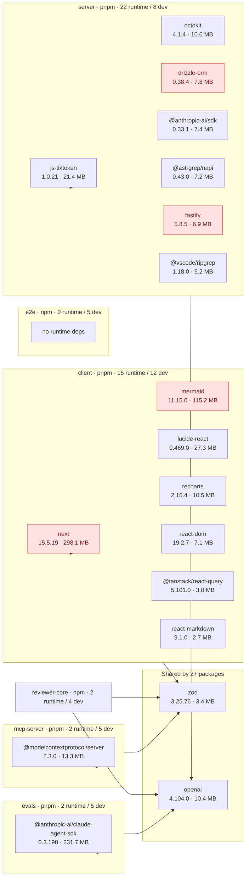

# Dependency Check

Generated 2026-10-12T23:05:12.150Z · audit: on · outdated: on

## 1. Scope

Packages analyzed: `client`, `e2e`, `evals`, `mcp-server`, `reviewer-core`, `server`. Standalone packages, no workspace — internal code sharing is via tsconfig path aliases, listed separately from external npm dependencies.

| Package | Manager | Runtime | Dev | Peer | Unique pkgs installed | Installed size | Lockfile |
|---|---|--:|--:|--:|--:|--:|---|
| `client` (@devdigest/web) | pnpm | 15 | 12 | 0 | 446 | 560.1 MB | pnpm-lock.yaml |
| `e2e` (@devdigest/e2e) | npm | 0 | 5 | 0 | 13 | 36.7 MB | package-lock.json |
| `evals` (@devdigest/evals) | pnpm | 2 | 5 | 0 | 98 | 301.5 MB | pnpm-lock.yaml |
| `mcp-server` (@devdigest/mcp-server) | pnpm | 2 | 5 | 0 | 69 | 71.1 MB | pnpm-lock.yaml |
| `reviewer-core` (@devdigest/reviewer-core) | npm | 2 | 4 | 0 | 87 | 72.3 MB | package-lock.json |
| `server` (@devdigest/api) | pnpm | 22 | 8 | 0 | 423 | 203.2 MB | pnpm-lock.yaml |

**Internal (cross-package) dependencies** — not npm packages:

None found in tsconfig `paths`.

## 2. Dependency map

Top runtime dependencies per package by installed size (own + transitive); shared dependencies in the middle cluster; thick arrows are internal package-to-package imports. Red = P0/P1 finding.

## 3. Size breakdown and inventory

### `client` — @devdigest/web

Manager **pnpm** · total installed 560.1 MB (446 packages)

| Dependency | Kind | Category | Declared | Resolved | Own size | With transitive | Trans. pkgs | License | Used (src/test/cfg) | Flags |
|---|---|---|---|---|--:|--:|--:|---|---|---|
| `next` | runtime | framework | `^15.1.3` | 15.5.19 | 133.0 MB | 298.1 MB | 16 | MIT | 28/0/1 | vuln×12, 1 major behind, heavy-dependency |
| `mermaid` | runtime | ui | `^11.15.0` | 11.15.0 | 72.8 MB | 115.2 MB | 110 | MIT | 1/1/0 | vuln×5, 1 major behind, heavy-dependency |
| `lucide-react` | runtime | ui | `^0.469.0` | 0.469.0 | 27.3 MB | 27.3 MB | 0 | ISC | 1/0/0 | 1 major behind, heavy-dependency |
| `recharts` | runtime | ui | `^2.15.0` | 2.15.4 | 4.4 MB | 10.5 MB | 40 | MIT | 2/0/0 | 1 major behind |
| `react-dom` | runtime | framework | `^19.0.0` | 19.2.7 | 7.0 MB | 7.1 MB | 1 | MIT | 1/0/0 | — |
| `zod` | runtime | validation | `^3.24.1` | 3.25.76 | 3.4 MB | 3.4 MB | 0 | MIT | 14/0/0 | 1 major behind |
| `@tanstack/react-query` | runtime | ui | `^5.62.8` | 5.101.0 | 839 KB | 3.0 MB | 1 | MIT | 15/10/0 | — |
| `react-markdown` | runtime | other | `^9.0.3` | 9.1.0 | 51 KB | 2.7 MB | 81 | MIT | 1/0/0 | 1 major behind |
| `next-intl` | runtime | other | `^3.26.0` | 3.26.5 | 356 KB | 2.3 MB | 11 | MIT | 107/42/1 | vuln×2, 1 major behind |
| `remark-gfm` | runtime | other | `^4.0.0` | 4.0.1 | 21 KB | 2.3 MB | 67 | MIT | 1/0/0 | — |
| `jszip` | runtime | other | `^3.10.2` | 3.10.2 | 677 KB | 1.6 MB | 12 | (MIT OR GPL-3.0-or-later) | 1/2/0 | — |
| `@dnd-kit/core` | runtime | other | `^6.3.1` | 6.3.1 | 1.0 MB | 1.2 MB | 3 | MIT | 3/0/0 | — |
| `@dnd-kit/sortable` | runtime | other | `^10.0.0` | 10.0.0 | 229 KB | 403 KB | 2 | MIT | 9/0/0 | — |
| `@dnd-kit/utilities` | runtime | other | `^3.2.2` | 3.2.2 | 86 KB | 175 KB | 1 | MIT | 3/0/0 | — |
| `react` | runtime | framework | `^19.0.0` | 19.2.7 | 168 KB | 168 KB | 0 | MIT | 162/10/0 | — |
| `vitest` | dev | test | `^2.1.8` | 2.1.9 | 1.6 MB | 24.2 MB | 43 | MIT | 0/77/1 | vuln×2, 3 major behind |
| `typescript` | dev | build/tooling | `^5.7.2` | 5.9.3 | 22.5 MB | 22.5 MB | 0 | Apache-2.0 | 0/0/0 | 2 major behind |
| `@tailwindcss/postcss` | dev | build/tooling | `^4.0.0` | 4.3.0 | 97 KB | 16.9 MB | 22 | MIT | 0/0/0 | — |
| `jsdom` | dev | test | `^25.0.1` | 25.0.1 | 3.0 MB | 13.2 MB | 59 | MIT | 0/0/0 | 5 major behind |
| `@vitejs/plugin-react` | dev | build/tooling | `^4.3.4` | 4.7.0 | 59 KB | 11.9 MB | 48 | MIT | 0/0/1 | 2 major behind |
| `@types/node` | dev | types | `^22.10.0` | 22.19.19 | 2.3 MB | 2.4 MB | 1 | MIT | 0/0/0 | 4 major behind |
| `@types/react` | dev | types | `^19.0.2` | 19.2.16 | 398 KB | 1.6 MB | 1 | MIT | 0/0/0 | — |
| `@testing-library/jest-dom` | dev | test | `^6.6.3` | 6.9.1 | 294 KB | 1021 KB | 9 | MIT | 0/1/0 | 1 major behind |
| `tailwindcss` | dev | build/tooling | `^4.0.0` | 4.3.0 | 737 KB | 737 KB | 0 | MIT | 0/0/0 | — |
| `@testing-library/react` | dev | test | `^16.1.0` | 16.3.2 | 329 KB | 571 KB | 1 | MIT | 0/60/0 | types-only |
| `postcss` | dev | build/tooling | `^8.4.49` | 8.5.15 | 201 KB | 376 KB | 3 | MIT | 0/0/0 | vuln×4 |
| `@types/react-dom` | dev | types | `^19.0.2` | 19.2.3 | 29 KB | 29 KB | 0 | MIT | 0/0/0 | — |

### `e2e` — @devdigest/e2e

Manager **npm** · total installed 36.7 MB (13 packages)

| Dependency | Kind | Category | Declared | Resolved | Own size | With transitive | Trans. pkgs | License | Used (src/test/cfg) | Flags |
|---|---|---|---|---|--:|--:|--:|---|---|---|
| `typescript` | dev | build/tooling | `^5.7.2` | 5.9.3 | 22.5 MB | 22.5 MB | 0 | Apache-2.0 | 0/0/0 | 2 major behind |
| `tsx` | dev | build/tooling | `^4.19.2` | 4.22.4 | 506 KB | 11.7 MB | 2 | MIT | 0/0/0 | — |
| `@types/cross-spawn` | dev | types | `^6.0.6` | 6.0.6 | 5 KB | 2.4 MB | 2 | MIT | 0/0/0 | — |
| `@types/node` | dev | types | `^22.10.0` | 22.19.21 | 2.3 MB | 2.4 MB | 1 | MIT | 0/0/0 | 4 major behind |
| `cross-spawn` | dev | other | `^7.0.6` | 7.0.6 | 16 KB | 46 KB | 5 | MIT | 1/0/0 | dev-dep-in-src |

### `evals` — @devdigest/evals

Manager **pnpm** · total installed 301.5 MB (98 packages)

| Dependency | Kind | Category | Declared | Resolved | Own size | With transitive | Trans. pkgs | License | Used (src/test/cfg) | Flags |
|---|---|---|---|---|--:|--:|--:|---|---|---|
| `@anthropic-ai/claude-agent-sdk` | runtime | ai/llm | `^0.3.198` | 0.3.198 | 3.5 MB | 231.7 MB | 1 | SEE LICENSE IN README.md | 1/0/0 | heavy-dependency |
| `openai` | runtime | ai/llm | `^4.77.0` | 4.104.0 | 4.0 MB | 10.4 MB | 38 | Apache-2.0 | 1/0/0 | 3 major behind |
| `vitest` | dev | test | `^2.1.0` | 2.1.9 | 1.6 MB | 24.3 MB | 43 | MIT | 3/1/1 | vuln×2, 3 major behind, dev-dep-in-src |
| `typescript` | dev | build/tooling | `^5.6.0` | 5.9.3 | 22.5 MB | 22.5 MB | 0 | Apache-2.0 | 0/0/0 | 2 major behind |
| `tsx` | dev | build/tooling | `^4.19.0` | 4.22.4 | 506 KB | 11.8 MB | 2 | MIT | 0/0/0 | — |
| `@types/node` | dev | types | `^22.0.0` | 22.20.0 | 2.3 MB | 2.4 MB | 1 | MIT | 0/0/0 | 4 major behind |
| `gray-matter` | dev | other | `^4.0.3` | 4.0.3 | 38 KB | 812 KB | 9 | MIT | 1/0/0 | dev-dep-in-src |

### `mcp-server` — @devdigest/mcp-server

Manager **pnpm** · total installed 71.1 MB (69 packages)

| Dependency | Kind | Category | Declared | Resolved | Own size | With transitive | Trans. pkgs | License | Used (src/test/cfg) | Flags |
|---|---|---|---|---|--:|--:|--:|---|---|---|
| `@modelcontextprotocol/server` | runtime | ai/llm | `2.3.0` | 2.3.0 | 6.2 MB | 13.3 MB | 2 | Apache-2.0 | 2/2/0 | — |
| `zod` | runtime | validation | `4.6.5` | 4.6.5 | 5.9 MB | 5.9 MB | 0 | MIT | 8/0/0 | — |
| `vitest` | dev | test | `3.2.7` | 3.2.7 | 1.3 MB | 25.4 MB | 50 | MIT | 0/14/1 | vuln×1, 2 major behind |
| `typescript` | dev | build/tooling | `5.9.3` | 5.9.3 | 22.5 MB | 22.5 MB | 0 | Apache-2.0 | 0/0/0 | 2 major behind |
| `@modelcontextprotocol/client` | dev | ai/llm | `2.3.0` | 2.3.0 | 6.6 MB | 14.2 MB | 12 | Apache-2.0 | 0/2/2 | — |
| `tsx` | dev | build/tooling | `4.23.15` | 4.23.15 | 388 KB | 11.7 MB | 2 | MIT | 0/0/0 | — |
| `@types/node` | dev | types | `22.20.5` | 22.20.5 | 2.3 MB | 2.4 MB | 1 | MIT | 0/0/0 | 4 major behind |

### `reviewer-core` — @devdigest/reviewer-core

Manager **npm** · total installed 72.3 MB (87 packages)

| Dependency | Kind | Category | Declared | Resolved | Own size | With transitive | Trans. pkgs | License | Used (src/test/cfg) | Flags |
|---|---|---|---|---|--:|--:|--:|---|---|---|
| `openai` | runtime | ai/llm | `^4.77.0` | 4.104.0 | 4.0 MB | 10.4 MB | 38 | Apache-2.0 | 2/0/0 | 3 major behind |
| `zod` | runtime | validation | `^3.24.1` | 3.25.76 | 3.4 MB | 3.4 MB | 0 | MIT | 1/1/0 | 1 major behind |
| `vitest` | dev | test | `^2.1.8` | 2.1.9 | 1.6 MB | 24.2 MB | 43 | MIT | 0/5/1 | vuln×1, 3 major behind |
| `typescript` | dev | build/tooling | `^5.7.2` | 5.9.3 | 22.5 MB | 22.5 MB | 0 | Apache-2.0 | 0/0/0 | 2 major behind |
| `tsx` | dev | build/tooling | `^4.19.2` | 4.22.4 | 506 KB | 11.7 MB | 2 | MIT | 0/0/0 | — |
| `@types/node` | dev | types | `^22.10.0` | 22.19.20 | 2.3 MB | 2.4 MB | 1 | MIT | 0/0/0 | 4 major behind |

### `server` — @devdigest/api

Manager **pnpm** · total installed 203.2 MB (423 packages)

| Dependency | Kind | Category | Declared | Resolved | Own size | With transitive | Trans. pkgs | License | Used (src/test/cfg) | Flags |
|---|---|---|---|---|--:|--:|--:|---|---|---|
| `js-tiktoken` | runtime | other | `^1.0.21` | 1.0.21 | 21.4 MB | 21.4 MB | 1 | MIT | 1/0/0 | heavy-dependency |
| `octokit` | runtime | git/vcs | `^4.0.3` | 4.1.4 | 50 KB | 10.6 MB | 32 | MIT | 1/0/0 | 1 major behind |
| `openai` | runtime | ai/llm | `^4.77.0` | 4.104.0 | 4.0 MB | 10.4 MB | 38 | Apache-2.0 | 1/0/0 | 3 major behind |
| `drizzle-orm` | runtime | database | `^0.38.3` | 0.38.4 | 7.8 MB | 7.8 MB | 0 | Apache-2.0 | 42/14/1 | vuln×1 |
| `@anthropic-ai/sdk` | runtime | ai/llm | `^0.33.1` | 0.33.1 | 1.0 MB | 7.4 MB | 38 | MIT | 1/0/0 | — |
| `@ast-grep/napi` | runtime | build/tooling | `0.43.0` | 0.43.0 | 352 KB | 7.2 MB | 1 | MIT | 1/0/0 | — |
| `fastify` | runtime | framework | `^5.2.0` | 5.8.5 | 2.6 MB | 6.9 MB | 47 | MIT | 1/0/0 | vuln×7 |
| `@vscode/ripgrep` | runtime | other | `^1.15.9` | 1.18.0 | 4 KB | 5.2 MB | 1 | MIT | 1/0/0 | — |
| `dependency-cruiser` | runtime | lint/format | `^17.4.3` | 17.4.3 | 963 KB | 4.3 MB | 42 | MIT | 2/0/0 | 1 major behind |
| `zod` | runtime | validation | `^3.24.1` | 3.25.76 | 3.4 MB | 3.4 MB | 0 | MIT | 24/1/0 | 1 major behind |
| `graphology` | runtime | other | `^0.26.0` | 0.26.0 | 2.6 MB | 2.7 MB | 1 | MIT | 1/0/0 | — |
| `simple-git` | runtime | git/vcs | `^3.27.0` | 3.36.0 | 929 KB | 1.1 MB | 6 | MIT | 1/0/0 | vuln×3, 1 major behind |
| `graphology-metrics` | runtime | other | `^2.4.0` | 2.4.0 | 123 KB | 756 KB | 7 | MIT | 1/0/0 | — |
| `@fastify/cors` | runtime | framework | `^10.0.2` | 10.1.0 | 113 KB | 567 KB | 3 | MIT | 1/0/0 | 1 major behind |
| `fastify-sse-v2` | runtime | other | `^4.2.1` | 4.2.2 | 21 KB | 393 KB | 15 | MIT | 1/0/0 | — |
| `@fastify/rate-limit` | runtime | framework | `^11.0.0` | 11.0.0 | 203 KB | 302 KB | 3 | MIT | 1/0/0 | — |
| `postgres` | runtime | database | `^3.4.5` | 3.4.9 | 293 KB | 293 KB | 0 | Unlicense | 2/0/0 | — |
| `fastify-type-provider-zod` | runtime | other | `^4.0.2` | 4.0.2 | 25 KB | 275 KB | 2 | MIT | 1/0/0 | 3 major behind |
| `@fastify/helmet` | runtime | framework | `^13.0.2` | 13.0.2 | 68 KB | 211 KB | 2 | MIT | 1/0/0 | — |
| `@fastify/autoload` | runtime | framework | `^6.0.3` | 6.3.1 | 171 KB | 171 KB | 0 | MIT | 0/0/0 | unused-runtime |
| `p-queue` | runtime | other | `^8.0.1` | 8.1.1 | 40 KB | 126 KB | 2 | MIT | 2/0/0 | 1 major behind |
| `dotenv` | runtime | other | `^16.4.7` | 16.6.1 | 75 KB | 75 KB | 0 | BSD-2-Clause | 3/0/1 | 2 major behind |
| `@testcontainers/postgresql` | dev | test | `^10.16.0` | 10.28.0 | 18 KB | 36.2 MB | 157 | MIT | 0/1/0 | 2 major behind |
| `testcontainers` | dev | test | `^10.16.0` | 10.28.0 | 379 KB | 36.2 MB | 156 | MIT | 0/0/0 | 2 major behind, unused-dev |
| `drizzle-kit` | dev | build/tooling | `^0.30.1` | 0.30.6 | 7.4 MB | 28.8 MB | 22 | MIT | 0/0/1 | — |
| `vitest` | dev | test | `^2.1.8` | 2.1.9 | 1.6 MB | 24.2 MB | 43 | MIT | 0/56/1 | vuln×2, 3 major behind |
| `typescript` | dev | build/tooling | `^5.7.2` | 5.9.3 | 22.5 MB | 22.5 MB | 0 | Apache-2.0 | 0/0/0 | 2 major behind |
| `tsx` | dev | build/tooling | `^4.19.2` | 4.22.4 | 506 KB | 11.7 MB | 2 | MIT | 0/0/0 | — |
| `@types/node` | dev | types | `^22.10.0` | 22.19.19 | 2.3 MB | 2.4 MB | 1 | MIT | 0/0/0 | 4 major behind |
| `pino-pretty` | dev | other | `^13.0.0` | 13.1.3 | 240 KB | 788 KB | 18 | MIT | 0/0/0 | — |

### Version drift across packages

| Dependency | Declared in | Status |
|---|---|---|
| `@types/node` | client `^22.10.0` →22.19.19 e2e `^22.10.0` →22.19.21 evals `^22.0.0` →22.20.0 mcp-server `22.20.5` →22.20.5 reviewer-core `^22.10.0` →22.19.20 server `^22.10.0` →22.19.19 | **resolved versions differ** |
| `tsx` | e2e `^4.19.2` →4.22.4 evals `^4.19.0` →4.22.4 mcp-server `4.23.15` →4.23.15 reviewer-core `^4.19.2` →4.22.4 server `^4.19.2` →4.22.4 | **resolved versions differ** |
| `vitest` | client `^2.1.8` →2.1.9 evals `^2.1.0` →2.1.9 mcp-server `3.2.7` →3.2.7 reviewer-core `^2.1.8` →2.1.9 server `^2.1.8` →2.1.9 | **resolved versions differ** |
| `zod` | client `^3.24.1` →3.25.76 mcp-server `4.6.5` →4.6.5 reviewer-core `^3.24.1` →3.25.76 server `^3.24.1` →3.25.76 | **resolved versions differ** |
| `openai` | evals `^4.77.0` →4.104.0 reviewer-core `^4.77.0` →4.104.0 server `^4.77.0` →4.104.0 | aligned |
| `typescript` | client `^5.7.2` →5.9.3 e2e `^5.7.2` →5.9.3 evals `^5.6.0` →5.9.3 mcp-server `5.9.3` →5.9.3 reviewer-core `^5.7.2` →5.9.3 server `^5.7.2` →5.9.3 | ranges differ |

_Sizes are on-disk install size (own files + transitive closure, nested `node_modules` excluded), **not** bundle size; rows overlap and are not additive. Usage is a static import scan — dynamic loading and CLI-only tools can look unused._

## 4. Findings & Priorities

4 × P0 · 6 × P1 · 36 × P2 · 22 × Info. Findings are rule-based candidates — verify each against the code before acting.

### P0 — fix now

| ID | Rule | Package | Dependency | Detail | Recommended action |
|---|---|---|---|---|---|
| P0-01 | vulnerability | client | `next` | 12 advisories (worst critical). critical: Next.js: Unauthenticated Remote Code Execution on windows-hosted servers (https://github.com/advisories/GHSA-p293-qw3h-jr36); critical: Next.js: Unauthenticated Remote Code Execution in Image Optimization API when AVIF files are used (https://github.com/advisories/GHSA-2xp9-vwfh-vxw4); high: Next.js: Denial of Service in App Router using Server Actions (https://github.com/advisories/GHSA-m99w-x7hq-7vfj); +9 more | Upgrade to a patched version (see advisories); if none exists, replace or isolate the dependency. |
| P0-02 | vulnerability | server | `drizzle-orm` | 1 advisories (worst high). high: Drizzle ORM has SQL injection via improperly escaped SQL identifiers (https://github.com/advisories/GHSA-gpj5-g38j-94v9) | Upgrade to a patched version (see advisories); if none exists, replace or isolate the dependency. |
| P0-03 | vulnerability | server | `fastify` | 7 advisories (worst high). high: fastify vulnerable to request body replacement via an async validation result collision (https://github.com/advisories/GHSA-667r-xxjv-c9mm); high: fastify vulnerable to authentication bypass via malformed URLs reaching encapsulated not-found handlers (https://github.com/advisories/GHSA-p68q-wchp-6fh7); high: fastify vulnerable to request validation bypass via skipped boolean false schemas (https://github.com/advisories/GHSA-hwr6-493r-vm6h); +4 more | Upgrade to a patched version (see advisories); if none exists, replace or isolate the dependency. |
| P0-04 | vulnerability | server | `simple-git` | 3 advisories (worst critical). critical: simple-git unsafe-operation guard does not block trailer command configuration (https://github.com/advisories/GHSA-x6jw-m9v5-85vh); high: simple-git allows command execution through unblocked Git configuration includes (https://github.com/advisories/GHSA-g4wm-2vf7-vfgr); high: simple-git: unsafe-operations plugin bypass via git long-option abbreviation (--receive-p/--exe) -> command execution (residual of CVE-2026-28291) (https://github.com/advisories/GHSA-858h-whjf-mvg5) | Upgrade to a patched version (see advisories); if none exists, replace or isolate the dependency. |

### P1 — fix this sprint

| ID | Rule | Package | Dependency | Detail | Recommended action |
|---|---|---|---|---|---|
| P1-05 | vulnerability | client | `mermaid` | 5 advisories (worst moderate). moderate: Mermaid allows CSS injection applying to sibling elements of the diagram (https://github.com/advisories/GHSA-6x64-9x62-f2gx); moderate: Mermaid Architecture diagrams are vulnerable to prototype pollution (https://github.com/advisories/GHSA-3rrr-jr9j-h3q3); moderate: Mermaid XY Charts are vulnerable to an infinite loop DoS (https://github.com/advisories/GHSA-2v8p-3f2j-5mp7); +2 more | Upgrade to a patched version (see advisories); if none exists, replace or isolate the dependency. |
| P1-06 | vulnerability | client | `next-intl` | 2 advisories (worst moderate). moderate: next-intl has an open redirect vulnerability (https://github.com/advisories/GHSA-8f24-v5vv-gm5j); moderate: next-intl has prototype pollution with `experimental.messages.precompile` via attacker-controlled translation catalog keys (https://github.com/advisories/GHSA-4c35-wcg5-mm9h) | Upgrade to a patched version (see advisories); if none exists, replace or isolate the dependency. |
| P1-07 | unused-runtime | server | `@fastify/autoload` | Runtime dependency with no import, script or config reference found. | Verify (dynamic/string-based loading?) then remove. |
| P1-08 | dev-dep-in-src | e2e | `cross-spawn` | devDependency imported by production source (run.ts). | Move to dependencies, or stop importing it from production code. |
| P1-09 | dev-dep-in-src | evals | `gray-matter` | devDependency imported by production source (src/skill-quality.ts). | Move to dependencies, or stop importing it from production code. |
| P1-10 | dev-dep-in-src | evals | `vitest` | devDependency imported by production source (src/dsl/case.ts, src/dsl/describe.ts, src/records/record.ts). | Move to dependencies, or stop importing it from production code. |

### P2 — schedule

| ID | Rule | Package | Dependency | Detail | Recommended action |
|---|---|---|---|---|---|
| P2-11 | unused-dev | server | `testcontainers` | devDependency with no import, script or config reference found. | Verify then remove. |
| P2-12 | vulnerability | evals | `vitest` | 2 advisories (worst critical, dev-only). critical: When Vitest UI server is listening, arbitrary file can be read and executed (https://github.com/advisories/GHSA-5xrq-8626-4rwp); moderate: Vitest: Path Traversal / Arbitrary File Read via @vitest/mocker Redirect Mock (https://github.com/advisories/GHSA-82fw-gwwq-j7x9) | Upgrade to a patched version (see advisories); if none exists, replace or isolate the dependency. |
| P2-13 | vulnerability | reviewer-core | `vitest` | 1 advisories (worst critical, dev-only). critical: When Vitest UI server is listening, arbitrary file can be read and executed (https://github.com/advisories/GHSA-5xrq-8626-4rwp) | Upgrade to a patched version (see advisories); if none exists, replace or isolate the dependency. |
| P2-14 | vulnerability | client | `vitest` | 2 advisories (worst critical, dev-only). critical: When Vitest UI server is listening, arbitrary file can be read and executed (https://github.com/advisories/GHSA-5xrq-8626-4rwp); moderate: Vitest: Path Traversal / Arbitrary File Read via @vitest/mocker Redirect Mock (https://github.com/advisories/GHSA-82fw-gwwq-j7x9) | Upgrade to a patched version (see advisories); if none exists, replace or isolate the dependency. |
| P2-15 | vulnerability | server | `vitest` | 2 advisories (worst critical, dev-only). critical: When Vitest UI server is listening, arbitrary file can be read and executed (https://github.com/advisories/GHSA-5xrq-8626-4rwp); moderate: Vitest: Path Traversal / Arbitrary File Read via @vitest/mocker Redirect Mock (https://github.com/advisories/GHSA-82fw-gwwq-j7x9) | Upgrade to a patched version (see advisories); if none exists, replace or isolate the dependency. |
| P2-16 | vulnerability | client | `postcss` | 4 advisories (worst high, dev-only). high: PostCSS: Arbitrary file read and information disclosure via attacker-controlled sourceMappingURL in CSS comments (https://github.com/advisories/GHSA-6g55-p6wh-862q); high: PostCSS: Path Traversal in Previous Source Map Auto-Loading (sourceMappingURL) leads to Arbitrary .map File Disclosure (https://github.com/advisories/GHSA-r28c-9q8g-f849); moderate: PostCSS has XSS via Unescaped </style> in its CSS Stringify Output (https://github.com/advisories/GHSA-qx2v-qp2m-jg93); +1 more | Upgrade to a patched version (see advisories); if none exists, replace or isolate the dependency. |
| P2-17 | outdated-major | client | `@types/node` | 22.19.19 → 26.6.5 (4 major behind). | Plan an upgrade; read the changelog for breaking changes. |
| P2-18 | outdated-major | client | `@vitejs/plugin-react` | 4.7.0 → 6.1.2 (2 major behind). | Plan an upgrade; read the changelog for breaking changes. |
| P2-19 | outdated-major | client | `jsdom` | 25.0.1 → 30.1.2 (5 major behind). | Plan an upgrade; read the changelog for breaking changes. |
| P2-20 | outdated-major | client | `typescript` | 5.9.3 → 7.0.2 (2 major behind). | Plan an upgrade; read the changelog for breaking changes. |
| P2-21 | outdated-major | client | `vitest` | 2.1.9 → 5.0.3 (3 major behind). | Plan an upgrade; read the changelog for breaking changes. |
| P2-22 | outdated-major | e2e | `@types/node` | 22.19.21 → 26.6.5 (4 major behind). | Plan an upgrade; read the changelog for breaking changes. |
| P2-23 | outdated-major | e2e | `typescript` | 5.9.3 → 7.0.2 (2 major behind). | Plan an upgrade; read the changelog for breaking changes. |
| P2-24 | outdated-major | evals | `openai` | 4.104.0 → 7.32.0 (3 major behind). | Plan an upgrade; read the changelog for breaking changes. |
| P2-25 | outdated-major | evals | `@types/node` | 22.20.0 → 26.6.5 (4 major behind). | Plan an upgrade; read the changelog for breaking changes. |
| P2-26 | outdated-major | evals | `typescript` | 5.9.3 → 7.0.2 (2 major behind). | Plan an upgrade; read the changelog for breaking changes. |
| P2-27 | outdated-major | evals | `vitest` | 2.1.9 → 5.0.3 (3 major behind). | Plan an upgrade; read the changelog for breaking changes. |
| P2-28 | outdated-major | mcp-server | `@types/node` | 22.20.5 → 26.6.5 (4 major behind). | Plan an upgrade; read the changelog for breaking changes. |
| P2-29 | outdated-major | mcp-server | `typescript` | 5.9.3 → 7.0.2 (2 major behind). | Plan an upgrade; read the changelog for breaking changes. |
| P2-30 | outdated-major | mcp-server | `vitest` | 3.2.7 → 5.0.3 (2 major behind). | Plan an upgrade; read the changelog for breaking changes. |
| P2-31 | outdated-major | reviewer-core | `openai` | 4.104.0 → 7.32.0 (3 major behind). | Plan an upgrade; read the changelog for breaking changes. |
| P2-32 | outdated-major | reviewer-core | `@types/node` | 22.19.20 → 26.6.5 (4 major behind). | Plan an upgrade; read the changelog for breaking changes. |
| P2-33 | outdated-major | reviewer-core | `typescript` | 5.9.3 → 7.0.2 (2 major behind). | Plan an upgrade; read the changelog for breaking changes. |
| P2-34 | outdated-major | reviewer-core | `vitest` | 2.1.9 → 5.0.4 (3 major behind). | Plan an upgrade; read the changelog for breaking changes. |
| P2-35 | outdated-major | server | `dotenv` | 16.6.1 → 18.0.7 (2 major behind). | Plan an upgrade; read the changelog for breaking changes. |
| P2-36 | outdated-major | server | `fastify-type-provider-zod` | 4.0.2 → 7.0.0 (3 major behind). | Plan an upgrade; read the changelog for breaking changes. |
| P2-37 | outdated-major | server | `openai` | 4.104.0 → 7.32.0 (3 major behind). | Plan an upgrade; read the changelog for breaking changes. |
| P2-38 | outdated-major | server | `@testcontainers/postgresql` | 10.28.0 → 12.2.0 (2 major behind). | Plan an upgrade; read the changelog for breaking changes. |
| P2-39 | outdated-major | server | `@types/node` | 22.19.19 → 26.6.5 (4 major behind). | Plan an upgrade; read the changelog for breaking changes. |
| P2-40 | outdated-major | server | `testcontainers` | 10.28.0 → 12.2.0 (2 major behind). | Plan an upgrade; read the changelog for breaking changes. |
| P2-41 | outdated-major | server | `typescript` | 5.9.3 → 7.0.2 (2 major behind). | Plan an upgrade; read the changelog for breaking changes. |
| P2-42 | outdated-major | server | `vitest` | 2.1.9 → 5.0.3 (3 major behind). | Plan an upgrade; read the changelog for breaking changes. |
| P2-43 | version-drift | client, e2e, evals, mcp-server, reviewer-core, server | `@types/node` | client: ^22.10.0 (→22.19.19); e2e: ^22.10.0 (→22.19.21); evals: ^22.0.0 (→22.20.0); mcp-server: 22.20.5 (→22.20.5); reviewer-core: ^22.10.0 (→22.19.20); server: ^22.10.0 (→22.19.19) | Align on one version across packages. |
| P2-44 | version-drift | e2e, evals, mcp-server, reviewer-core, server | `tsx` | e2e: ^4.19.2 (→4.22.4); evals: ^4.19.0 (→4.22.4); mcp-server: 4.23.15 (→4.23.15); reviewer-core: ^4.19.2 (→4.22.4); server: ^4.19.2 (→4.22.4) | Align on one version across packages. |
| P2-45 | version-drift | client, evals, mcp-server, reviewer-core, server | `vitest` | client: ^2.1.8 (→2.1.9); evals: ^2.1.0 (→2.1.9); mcp-server: 3.2.7 (→3.2.7); reviewer-core: ^2.1.8 (→2.1.9); server: ^2.1.8 (→2.1.9) | Align on one version across packages. |
| P2-46 | version-drift | client, mcp-server, reviewer-core, server | `zod` | client: ^3.24.1 (→3.25.76); mcp-server: 4.6.5 (→4.6.5); reviewer-core: ^3.24.1 (→3.25.76); server: ^3.24.1 (→3.25.76) | Align on one version across packages. |

### Info — opportunistic

| ID | Rule | Package | Dependency | Detail | Recommended action |
|---|---|---|---|---|---|
| Info-47 | heavy-dependency | client | `next` | Installed size 133.0 MB own / 298.1 MB with 16 transitive packages (install size, not bundle size). | Confirm it is needed in this package; for client code check real bundle impact (lazy import, narrower sub-package, lighter alternative). |
| Info-48 | heavy-dependency | evals | `@anthropic-ai/claude-agent-sdk` | Installed size 3.5 MB own / 231.7 MB with 1 transitive packages (install size, not bundle size). | Confirm it is needed in this package; for client code check real bundle impact (lazy import, narrower sub-package, lighter alternative). |
| Info-49 | heavy-dependency | client | `mermaid` | Installed size 72.8 MB own / 115.2 MB with 110 transitive packages (install size, not bundle size). | Confirm it is needed in this package; for client code check real bundle impact (lazy import, narrower sub-package, lighter alternative). |
| Info-50 | heavy-dependency | client | `lucide-react` | Installed size 27.3 MB own / 27.3 MB with 0 transitive packages (install size, not bundle size). | Confirm it is needed in this package; for client code check real bundle impact (lazy import, narrower sub-package, lighter alternative). |
| Info-51 | vulnerability | mcp-server | `vitest` | 1 advisories (worst moderate, dev-only). moderate: Vitest: Path Traversal / Arbitrary File Read via @vitest/mocker Redirect Mock (https://github.com/advisories/GHSA-82fw-gwwq-j7x9) | Upgrade to a patched version (see advisories); if none exists, replace or isolate the dependency. |
| Info-52 | heavy-dependency | server | `js-tiktoken` | Installed size 21.4 MB own / 21.4 MB with 1 transitive packages (install size, not bundle size). | Confirm it is needed in this package; for client code check real bundle impact (lazy import, narrower sub-package, lighter alternative). |
| Info-53 | outdated-major | client | `lucide-react` | 0.469.0 → 1.55.0 (1 major behind). | Plan an upgrade; read the changelog for breaking changes. |
| Info-54 | outdated-major | client | `mermaid` | 11.15.0 → 12.1.0 (1 major behind). | Plan an upgrade; read the changelog for breaking changes. |
| Info-55 | outdated-major | client | `next` | 15.5.19 → 16.4.0 (1 major behind). | Plan an upgrade; read the changelog for breaking changes. |
| Info-56 | outdated-major | client | `next-intl` | 3.26.5 → 4.14.9 (1 major behind). | Plan an upgrade; read the changelog for breaking changes. |
| Info-57 | outdated-major | client | `react-markdown` | 9.1.0 → 10.1.0 (1 major behind). | Plan an upgrade; read the changelog for breaking changes. |
| Info-58 | outdated-major | client | `recharts` | 2.15.4 → 3.10.1 (1 major behind). | Plan an upgrade; read the changelog for breaking changes. |
| Info-59 | outdated-major | client | `zod` | 3.25.76 → 4.6.6 (1 major behind). | Plan an upgrade; read the changelog for breaking changes. |
| Info-60 | outdated-major | client | `@testing-library/jest-dom` | 6.9.1 → 7.0.1 (1 major behind). | Plan an upgrade; read the changelog for breaking changes. |
| Info-61 | outdated-major | reviewer-core | `zod` | 3.25.76 → 4.6.7 (1 major behind). | Plan an upgrade; read the changelog for breaking changes. |
| Info-62 | outdated-major | server | `@fastify/cors` | 10.1.0 → 11.3.1 (1 major behind). | Plan an upgrade; read the changelog for breaking changes. |
| Info-63 | outdated-major | server | `dependency-cruiser` | 17.4.3 → 18.6.0 (1 major behind). | Plan an upgrade; read the changelog for breaking changes. |
| Info-64 | outdated-major | server | `octokit` | 4.1.4 → 5.0.5 (1 major behind). | Plan an upgrade; read the changelog for breaking changes. |
| Info-65 | outdated-major | server | `p-queue` | 8.1.1 → 9.3.5 (1 major behind). | Plan an upgrade; read the changelog for breaking changes. |
| Info-66 | outdated-major | server | `simple-git` | 3.36.0 → 4.0.2 (1 major behind). | Plan an upgrade; read the changelog for breaking changes. |
| Info-67 | outdated-major | server | `zod` | 3.25.76 → 4.6.6 (1 major behind). | Plan an upgrade; read the changelog for breaking changes. |
| Info-68 | range-drift | client, e2e, evals, mcp-server, reviewer-core, server | `typescript` | client: ^5.7.2; e2e: ^5.7.2; evals: ^5.6.0; mcp-server: 5.9.3; reviewer-core: ^5.7.2; server: ^5.7.2 | Use the same range everywhere. |

## 5. Summary

Top actions in priority order. These are recommendations to confirm — nothing has been changed.

1. **P0** · `next` in `client` — vulnerability: Upgrade to a patched version (see advisories); if none exists, replace or isolate the dependency.
2. **P0** · `drizzle-orm` in `server` — vulnerability: Upgrade to a patched version (see advisories); if none exists, replace or isolate the dependency.
3. **P0** · `fastify` in `server` — vulnerability: Upgrade to a patched version (see advisories); if none exists, replace or isolate the dependency.
4. **P0** · `simple-git` in `server` — vulnerability: Upgrade to a patched version (see advisories); if none exists, replace or isolate the dependency.
5. **P1** · `mermaid` in `client` — vulnerability: Upgrade to a patched version (see advisories); if none exists, replace or isolate the dependency.
