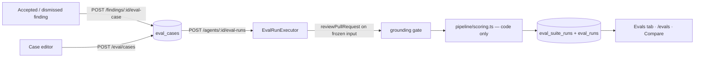

# Eval pipeline (SPEC-06)

Regression testing for reviewer agents: turn past review decisions into test cases,
re-run an agent on them after a prompt/model/skill change, and compare the numbers.
Spec: [`specs/eval-pipeline.md`](../../specs/eval-pipeline.md) · Plan:
[`docs/plans/eval-pipeline-plan.md`](../../docs/plans/eval-pipeline-plan.md).

## Data

| Table | One row per | Key columns |
|---|---|---|
| `eval_cases` | case | `owner_kind`+`owner_id` (agent or skill), `input_diff`, `input_files` (`{path,content}[]`), `input_meta` (PR title/body + source finding), `expected_output` (`{expectations[]}`), `source_finding_id` (unique per owner) |
| `eval_suite_runs` | run of a case set (`scope='full'`) or of one case (`scope='case'`) | `status`, `agent_version`, `config_snapshot` (prompt, model, strategy, skill versions), `case_ids`, metrics, `vacuous`, cost |
| `eval_runs` | per-case result | `suite_run_id`, `case_id` (**SET NULL** on case delete), `case_name` + `expected_snapshot` (history survives deletion), `status`, `actual_output` (`kept`, `dropped`, `matched`, `unmatched`) |

## Frozen inputs (why runs are comparable)

A case stores its own input: the diff of the finding's file (only overlapping hunks
when > 400 diff lines), the file at the PR head (`readFileAtRef`, ≤ 100 KB), and the
PR title/body. A run reviews **only** that, with the agent's prompt, model, strategy
and enabled skills, at `temperature: 0`. Repo-intel, callers, the agent's project
documents and derived intent are left out on purpose — they change as the repo moves.
Attached files go to the model through the engine's `projectDocs` slot (untrusted,
path-labelled); grounding still uses the diff only.

## Scoring — `modules/eval/pipeline/scoring.ts` (no LLM)

- **match**: same file (after stripping `./`, `a/`, `b/`) **and** overlapping line ranges (inclusive).
- **recall** = matched `must_find` ÷ all `must_find` (errored cases count as misses).
- **precision** = kept findings that hit a `must_find` *of their own case* ÷ all kept findings — every other finding, including one on a `must_not_flag` range, is noise.
- **citation accuracy** = kept ÷ (kept + dropped by the grounding gate).
- 0 ÷ 0 → `1.0` with a `vacuous` flag (UI shows "n/a").
- **case pass**: all `must_find` hit, no `must_not_flag` range hit, and a case with no expectations ("clean") must produce zero findings.

Mutation-tested to 100 % (`pnpm mutation:eval`, see
[`docs/evals/mutation-testing.md`](../../docs/evals/mutation-testing.md)).

## API

| Method | Path | Notes |
|---|---|---|
| POST | `/findings/:id/eval-case` | 201 created / 200 existing; 409 undecided; 503 diff unavailable |
| GET | `/eval/cases?owner_kind&owner_id` | cases + last result |
| GET | `/eval/cases/sources` | finding ids that already have a case |
| POST / PUT / DELETE | `/eval/cases[/:id]` | manual cases; 422 with `details.errors[]` |
| POST | `/eval/cases/:id/run` | single case (`scope='case'`, not in history) |
| POST | `/agents/:id/eval-runs` | 202; 409 if running; 422 no cases / no provider key |
| POST | `/skills/:id/eval-runs` | `{host_agent_id?}`; 422 "Pick a host agent…" |
| GET | `/eval/runs?owner_kind&owner_id&days` · `/eval/runs/:id` | history · detail with per-case results |
| POST | `/eval/runs/:id/promote` | restores the run's config snapshot (new agent version) |
| GET | `/eval/overview` · `/eval/dashboard/:kind/:id?days` | Eval Dashboard · owner dashboard |
| POST | `/eval/run-all` | one run per enabled agent with cases |

Runs execute in the background (fire-and-forget, like reviews); a process-wide
in-flight guard plus a `running` row check return 409. A `running` row older than
30 minutes is marked failed before that check (server restart).

## Verify

`cd server && pnpm verify:l06` — eval unit tests, contract parity, and the
integration suite (`test/eval.it.test.ts`, needs Docker).
