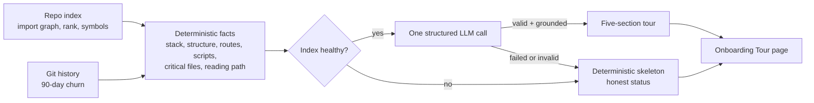

# Spec: Onboarding Tour
Spec ID: SPEC-02
Status: approved
Supersedes: —

## Problem and user

**Who is affected.** A developer opening an unfamiliar repository — typically an open-source project they want to contribute to, or a codebase they were just handed — who must get oriented fast.

**What hurts today.**
- DevDigest indexes a repository (import graph, PageRank-style rank, symbols) but shows none of it to a newcomer. There is no page that answers "where do I start, what matters, how do I run it, what do I pick up first".
- The building blocks exist but are not connected: an `onboarding` table (`server/src/db/schema/context.ts:120-127`), an `onboarding` model setting (`server/src/vendor/shared/contracts/platform.ts:15,48-50`), a prompt template (`server/src/prompts/onboarding.system.md`), and repo-intel facade methods for top-ranked files and critical paths (`server/src/modules/repo-intel/types.ts:175-181`). No server module generates a tour, no route serves it, and the client has no tour page (`client/src/app/onboarding` is the add-repository flow).
- The existing prompt template and the client text stubs describe a different set of sections (overview, architecture, key modules, getting started, conventions) from the five this feature requires.
- A tour written purely by an LLM from a repository is exactly where invented file paths and invented shell commands do harm, so the product must make clear what is derived deterministically and what is generated.

**Evidence.** The design (see *Inputs and provenance*) shows an "Onboarding for <repo>" page with a section navigation, collapsible cards for Architecture overview, Critical paths, How to run locally and Guided reading path, plus Regenerate and Share link actions, and a "Generated from index of N files · last refreshed …" line.

## Goals / Non-goals

**Goals**
1. A user opens any indexed repository and reads a guided tour with exactly five sections: Architecture overview, Critical paths, How to run locally, Guided reading path, First tasks.
2. The facts behind the tour (stack, structure, routes, scripts, critical files, reading order) are collected deterministically by repo-intel, with no LLM.
3. The reading order is computed from the import graph as PageRank × (1 + hotness).
4. At most one structured LLM call turns those facts into the five sections; every file path and command in the result is grounded in the repository.
5. When the index is degraded or the LLM call fails, the user sees a deterministic skeleton with an honest status instead of a fabricated or empty tour.
6. Every generation records how many LLM calls it made and what it cost, so a demo or operator can verify it from the logs.
7. Very large repositories produce a bounded-cost, bounded-input tour that says what it was based on.

**Non-goals**
- **Share link** (shown in the design): needs auth, expiry and private-repo rules; out of scope.
- Automatic generation or regeneration (on first index, on resync, on a schedule): generation is manual (Generate / Regenerate).
- Using Project Context documents (SPEC-01) or conventions as tour input.
- Fetching GitHub issues or labels (for example "good first issue") for First tasks.
- Executing any command shown in the tour.
- An in-app file viewer, editing files, or tours for a PR (this is a repository-level tour, not a review).
- Multi-language tours: the tour is written in English (the language setting of the existing template is out of scope).
- Retrying the LLM call automatically.

## User stories

- **US-1** As a new contributor to an unfamiliar repository, I want a guided tour (architecture, critical paths, how to run, what to read first, what to try first), so that I can start contributing quickly.
- **US-2** As a user, I want to see whether the tour is fully generated or only a deterministic skeleton, and what it is based on, so that I do not trust content the system could not support.
- **US-3** As a contributor, I want run-locally commands I can trace to files in the repository, so that I do not execute invented or unexplained commands.
- **US-4** As a user, I want to regenerate the tour and see when and at which commit it was generated, so that I can tell whether it is stale.
- **US-5** As an operator or maintainer, I want each generation to log how many LLM calls it made and what it cost, so that I can verify cost control.
- **US-6** As a user of a very large repository, I want the tour to be produced within bounded input and cost, so that big repositories do not break or bankrupt generation.

## Acceptance criteria (EARS)

### Generation lifecycle

- **AC-1** [Event-driven] [MUST] WHEN a user opens the Onboarding Tour page of a repository that has no stored tour, the system (shall) show a "Generate onboarding tour" call to action and not start generation on its own.
  Verify: integration — a repository with no stored tour; request the tour; the response is the empty state and no generation job or LLM call has occurred.
- **AC-2** [Event-driven] [MUST] WHEN a user clicks Generate or Regenerate, the system (shall) start exactly one generation for that repository and show a generating state until it finishes.
  Verify: integration — trigger generation; one generation record is created and the state endpoint reports "generating" until completion.
- **AC-3** [Unwanted behavior] [MUST] IF a generation is already in progress for the repository, THEN the system (shall) reject a new generation request with an in-progress indication and start nothing.
  Verify: integration — start a generation with a slow mock LLM; a second trigger returns the in-progress indication; the mock LLM is called once in total.
- **AC-4** [Ubiquitous] [MUST] The system (shall) store the latest produced tour per repository together with its generation time, the indexed commit it was built from, its status (`generated` or `skeleton`), the model used when applicable, the number of files indexed and the number of files considered.
  Verify: integration — generate; read back the stored record and assert every listed field is present.
- **AC-5** [Unwanted behavior] [MUST] IF a regeneration fails before producing any tour, THEN the system (shall) keep the previously stored tour unchanged and show the failure and its reason next to it.
  Verify: integration — store a good tour; make the next generation throw before output; the stored tour is byte-identical and the state reports the failure reason.

### Deterministic facts and ranking

- **AC-6** [Event-driven] [MUST] WHEN a generation starts, the system (shall) collect the repository facts — technology stack, directory structure, routes or endpoints, and runnable scripts or commands — through the repo-intel facade, without any LLM call.
  Verify: integration — a fixture repository; collect facts with the LLM mock configured to fail the test if called; the facts contain stack, structure, routes and scripts.
- **AC-7** [Ubiquitous] [MUST] For an unchanged checkout and index, the system (shall) produce identical facts, identical critical files and an identical reading-path order on every run.
  Verify: unit — run the fact collection and ordering twice over the same fixture; the outputs are deeply equal, including tie ordering.
- **AC-8** [Ubiquitous] [MUST] The system (shall) score each file for the reading path as PageRank × (1 + hotness), where hotness is the file's commit count within the last 90 days in the available git history, normalized to the range 0–1 across the repository, and order the reading path by score descending, breaking ties by path ascending.
  Verify: unit — a fixture graph with known PageRank values and known per-file commit counts; assert the computed scores and the exact order, including a tie.
- **AC-9** [Unwanted behavior] [MUST] IF the checkout's git history is too shallow to measure the 90-day window, THEN the system (shall) apply hotness 0 to every file and state in the tour that hotness was not applied and how much history was available.
  Verify: integration — a depth-1 checkout; the reading-path order equals pure PageRank order and the stored tour carries the "hotness not applied" note with the available history size.
- **AC-10** [Ubiquitous] [MUST] The system (shall) exclude test files, configuration files, type-declaration files, migrations and generated files from the critical files and the reading path.
  Verify: unit — a fixture containing each excluded kind with high rank; none appears in either list.
- **AC-11** [Ubiquitous] [MUST] The system (shall) select as Critical paths up to 5 files that are the highest-ranked after exclusions, each with its path, the number of repository files that import it, and a one-line role.
  Verify: unit — a fixture graph; the section has at most 5 entries, ordered by rank, each with the correct importer count.
- **AC-12** [Ubiquitous] [MUST] The system (shall) present the Guided reading path as an ordered list of up to 10 files, each with its position, its path and a one-line reason.
  Verify: unit — a fixture with more than 10 eligible files; the list has exactly 10 entries numbered 1–10 in score order, each with a non-empty reason.

### The LLM step

- **AC-13** [Event-driven] [MUST] WHEN the facts are collected and the index status is full or partial, the system (shall) make exactly one structured LLM call whose input consists only of the facts and bounded file excerpts, and whose output is the five sections.
  Verify: integration — generate with a mock LLM; the mock receives exactly one call and its input contains no file content beyond the configured excerpts.
- **AC-14** [Ubiquitous] [MUST] The system (shall) cap the LLM input at the configured limits (top-ranked files considered, excerpt size per file, total input tokens; values: OQ-1) and state in the tour how many of the indexed files it was based on.
  Verify: integration — a fixture with far more files than the cap; the LLM input stays within the token cap and the tour text states "based on top N of M files" with the real N and M.
- **AC-15** [Unwanted behavior] [MUST] IF the LLM output does not match the five-section structure, THEN the system (shall) make no further LLM call and present the deterministic skeleton with status "skeleton — generation failed" and the validation reason.
  Verify: integration — a mock LLM returning malformed JSON; the mock was called once, the stored tour has status `skeleton` and the reason.
- **AC-16** [Unwanted behavior] [MUST] IF the LLM call fails (error, timeout or quota), THEN the system (shall) present the deterministic skeleton with status "skeleton — LLM unavailable" and the failure reason, without retrying.
  Verify: integration — a mock LLM throwing a quota error; one call was attempted; the stored tour has status `skeleton` with the reason.
- **AC-17** [Unwanted behavior] [MUST] IF the index status is degraded, failed or not yet built when a generation starts, THEN the system (shall) make no LLM call and present the deterministic skeleton with a status that names the index state.
  Verify: integration — an index state of `degraded`; the mock LLM has zero calls; the tour status names the degraded state.
- **AC-18** [Unwanted behavior] [MUST] IF the LLM output references a file path that is not in the repository index, THEN the system (shall) drop that reference, and drop any entry (critical path, reading-path step or first task) left without a valid file.
  Verify: unit — LLM output containing one real and one invented path; the invented one is removed and an entry made only of invented paths is removed.
- **AC-19** [Unwanted behavior] [MUST] IF an LLM-produced architecture diagram is not valid Mermaid, THEN the system (shall) omit the diagram and still show the rest of the section.
  Verify: unit — an invalid diagram string; the section renders its prose without a diagram and without an error.

### Section content

- **AC-20** [Ubiquitous] [MUST] The system (shall) show in How to run locally only commands detected deterministically in repository files (package scripts, the package manager implied by the lockfile, an environment-example file, a container compose file, and code fences in the README), each labelled with its source file.
  Verify: unit — a fixture with package.json, a lockfile, `.env.example`, a compose file and a README; every displayed command maps to a detected source and shows that source label.
- **AC-21** [Unwanted behavior] [MUST] IF the LLM output contains a command that is not among the detected commands, THEN the system (shall) discard it.
  Verify: unit — LLM output with one detected and one invented command; only the detected command remains.
- **AC-22** [Ubiquitous] [SHOULD] The system (shall) order the detected commands into steps in the sequence install, configure environment, start services, run, whenever commands of those kinds exist.
  Verify: unit — a fixture with all four kinds; the steps appear in that order.
- **AC-23** [Ubiquitous] [MUST] The system (shall) show First tasks as 3 to 5 tasks, each with a title, a rationale and at least one repository file, produced only from the repository facts and with no network access other than the single LLM call.
  Verify: integration — generate with a mock LLM; the section has 3–5 tasks, each citing an indexed file, and no HTTP request other than the LLM call was made.
- **AC-24** [Unwanted behavior] [MUST] IF a section has no valid content after validation, THEN the system (shall) show the section with its deterministic content when available, and otherwise the text "Not available" with the reason (for example, no import graph for this language).
  Verify: unit — a repository without an import graph; Critical paths and Guided reading path show "Not available" with the reason; the other sections render.
- **AC-25** [Ubiquitous] [MUST] The skeleton (shall) contain every deterministic part — stack, directory structure with file counts, critical paths with importer counts, reading path, and run-locally commands — and mark the Architecture overview narrative and First tasks as requiring generation.
  Verify: integration — a skeleton result; assert the deterministic sections are populated and the two LLM-dependent parts carry the "requires generation" marker.
- **AC-26** [Ubiquitous] [MUST] The tour (shall) display its status honestly: "Generated" for a full tour, and for a skeleton the reason (index state, LLM failure or invalid output) in text.
  Verify: unit — render each status; the badge text names the status and reason for the skeleton cases.

### Page and interaction

- **AC-27** [Ubiquitous] [MUST] The page (shall) show the title "Onboarding for <repository name>" and the line "Generated from index of N files · last refreshed <relative time>", where N is the number of indexed files at generation time.
  Verify: unit — a stored tour for repository `payments-api` with 12 files; the header and line render with the real values.
- **AC-28** [Ubiquitous] [MUST] The page (shall) present the five sections in this fixed order — Architecture overview, Critical paths, How to run locally, Guided reading path, First tasks — as collapsible cards, with an "On this page" navigation listing them that scrolls to the chosen section and highlights the current one.
  Verify: unit — render a tour; five cards in order, each collapsible; clicking a navigation entry scrolls to its card and marks it active.
- **AC-29** [Event-driven] [MUST] WHEN a user clicks Open on a critical-path or reading-path entry, the system (shall) open that file at the indexed commit on the repository's hosting site in a new tab (assumption, see OQ-3).
  Verify: unit — clicking Open produces a link to the file path at the stored commit with `target=_blank` and no opener access.
- **AC-30** [Event-driven] [MUST] WHEN a user clicks the copy button on a command, the system (shall) copy exactly that command's text.
  Verify: unit — click copy; the clipboard receives the command text unchanged.
- **AC-31** [Ubiquitous] [MUST] The page (shall) display, next to the commands, a notice that the commands come from the repository and must be reviewed before running (commands are never executed by the system, NFR-3d).
  Verify: unit — the notice is present whenever commands are shown; integration — no route or job runs a command from the tour.
- **AC-32** [State-driven] [MUST] WHILE the repository's current indexed commit differs from the commit the stored tour was generated from, the system (shall) show a note with both short commit ids stating that the tour may be out of date.
  Verify: unit — a tour at `abc1234` and a repository at `def5678`; the note shows both ids; with equal ids the note is absent.
- **AC-33** [Ubiquitous] [MUST] The page (shall) provide distinct loading, generating, error and empty states.
  Verify: unit — render each state from fixtures; each shows its own text and the generating state offers no second Generate action.
- **AC-34** [Event-driven] [SHOULD] WHEN a user selects "Onboarding Tour" in the sidebar, the system (shall) open the tour page of the currently selected repository.
  Verify: unit — the sidebar item exists in the Workspace group and its link targets the active repository's tour page.
- **AC-35** [Ubiquitous] [MUST] The system (shall) render all tour text as Markdown without raw HTML, and render links only to paths that exist in the index or to the hosting-site file links of AC-29.
  Verify: unit — a tour body containing `<script>` and a `javascript:` link; neither executes or becomes a link.

### Observability

- **AC-36** [Ubiquitous] [MUST] For every generation attempt, the system (shall) write one structured log record containing the repository, the outcome (`generated`, `skeleton` or `failed`), the number of LLM calls (0 or 1), input and output tokens, cost in USD, model, duration, files indexed, files considered, and the skeleton reason when there is one.
  Verify: integration — generate in each outcome; exactly one record per attempt with the listed fields and the correct call count (1, or 0 for the degraded-index case).
- **AC-37** [Ubiquitous] [COULD] The page (shall) show a footer with the model, token count and cost of the generation that produced the tour.
  Verify: unit — a stored tour with model, tokens and cost; the footer renders them.

### Traceability matrix

| Source | Covered by |
|---|---|
| US-1 | AC-1, AC-2, AC-6, AC-8, AC-10, AC-11, AC-12, AC-13, AC-23, AC-27, AC-28, AC-29, AC-34 |
| US-2 | AC-15, AC-16, AC-17, AC-24, AC-25, AC-26, AC-9 |
| US-3 | AC-18, AC-19, AC-20, AC-21, AC-22, AC-30, AC-31, AC-35 |
| US-4 | AC-3, AC-4, AC-5, AC-32, AC-33 |
| US-5 | AC-36, AC-37 |
| US-6 | AC-7, AC-14 |
| EC-1 | AC-14 |
| EC-2 | AC-17, AC-25 |
| EC-3 | AC-9 |
| EC-4 | AC-24 |
| EC-5 | AC-20 |
| EC-6 | AC-18 |
| EC-7 | AC-15 |
| EC-8 | AC-16 |
| EC-9 | AC-3 |
| EC-10 | AC-5 |
| EC-11 | AC-32 |
| EC-12 | AC-24 |
| EC-13 | AC-20, AC-21, AC-31 |
| EC-14 | OQ-4 |
| NFR-1 | self (Verify given) |
| NFR-2 | self (Verify given) |
| NFR-3 | self (Verify given) |
| NFR-4 | self (Verify given) |
| NFR-5 | self (Verify given) |
| NFR-6 | self (Verify given) |

## Edge cases

- **EC-1** A very large repository: the indexer already caps indexed files (`MAX_INDEXED_FILES = 5000`, `server/src/modules/repo-intel/constants.ts:42`), and the LLM input is capped further; the tour states how many files it was based on (AC-14).
- **EC-2** The repository is not cloned, still indexing, or the index is degraded or failed: no LLM call, deterministic skeleton with an honest status (AC-17, AC-25).
- **EC-3** The checkout is shallow: hotness is not applied and the tour says so (AC-9).
- **EC-4** No run commands are detectable (no manifest, no README fences): How to run locally says "Not available" with the reason (AC-24).
- **EC-5** A monorepo with several packages: commands are shown with their source file so the package they belong to is clear (AC-20).
- **EC-6** The LLM mentions files that do not exist: references are dropped (AC-18).
- **EC-7** The LLM returns malformed or off-structure output: skeleton, one call only (AC-15).
- **EC-8** The LLM times out, errors or is over quota: skeleton, one call only (AC-16).
- **EC-9** Regenerate is clicked twice or from two tabs: one generation only (AC-3).
- **EC-10** A regeneration fails: the previous good tour is kept (AC-5).
- **EC-11** The repository moved on since the tour was generated: a stale note appears (AC-32).
- **EC-12** The repository has no import graph (a language the graph does not support): ranked sections are "Not available" (AC-24).
- **EC-13** A hostile repository: its README, scripts and file names try to inject instructions or dangerous commands (AC-20, AC-21, AC-31, NFR-3).
- **EC-14** The repository is removed while a generation is running: no orphaned tour must remain (OQ-4).

## Non-functional requirements

- **NFR-1** [Cost] [MUST] The system (shall) make at most 1 LLM call per generation and no other paid external call; the LLM input shall not exceed the configured token cap (OQ-1), and the cost is recorded (AC-36).
  Verify: integration — across generated, malformed-output, LLM-error and degraded-index scenarios, the mock LLM call count is 1, 1, 1 and 0 respectively; input tokens ≤ cap.
- **NFR-2** [Performance] [SHOULD] For an index of up to 5,000 files, the system (shall) finish the deterministic stage (facts, ranking, skeleton) within 5 seconds (p95) and the whole generation within 60 seconds (p95) with a provider that answers within 30 seconds (targets are assumptions, OQ-7).
  Verify: integration — a 5,000-file fixture index; time 20 generations with a mock LLM delaying 0 s and 30 s respectively; assert p95 of each stage.
- **NFR-3** [Security] [MUST] The system (shall) satisfy this checklist: (a) all repository-derived text sent to the LLM is inside untrusted-content delimiters and the template tells the model to treat it as data; (b) LLM output is accepted only as the five-section structure, with Markdown only and no HTML; (c) file references and commands are validated against the index and the detected command set before display; (d) commands are rendered as inert text with a copy button and never executed; (e) generation endpoints verify that the repository belongs to the user's workspace.
  Verify: integration — negative tests: a README with "ignore previous instructions", LLM output with `<script>`, an invented path and an invented command, and a request for another workspace's repository; each is neutralized, dropped or rejected.
- **NFR-4** [Reliability] [MUST] The system (shall) guarantee that no failure path (invalid output, LLM error, process error) deletes or corrupts the last successfully stored tour, and that at most one generation per repository runs at a time.
  Verify: integration — inject a failure at each stage of a regeneration; the stored tour is unchanged; two concurrent triggers produce one generation.
- **NFR-5** [Privacy] [MUST] The system (shall) not write repository file contents, excerpts or the assembled LLM prompt to logs; only paths, counts, token numbers, cost and status are allowed (repositories may be private).
  Verify: unit — generate over a fixture with a unique marker in a file's content; the marker is absent from every log record.
- **NFR-6** [Accessibility] [SHOULD] The system (shall) satisfy this checklist: (a) the collapsible cards and the section navigation are operable with the keyboard; (b) copy and Open buttons have accessible names that include the command or file; (c) status and staleness are conveyed in text, not by color alone.
  Verify: unit — component tests: toggling a card with the keyboard, accessible-name assertions, status text present.

Categories not included: Compatibility — the feature adds a new page and does not alter existing contracts' behavior; Reliability of the facts themselves is covered by AC-7.

## Inputs and provenance

Analysis date: 2026-10-10.

**Sources from the user**
- Requirements text (user message, 2026-10-10, original in Ukrainian, translated here): a tour of an unfamiliar repository in five parts — architecture overview, critical paths, local run, recommended reading order, first tasks; deterministic facts via `repoIntel.*`; reading path computed from the import graph as PageRank × (1 + hotness); one structured LLM call turning facts into five sections; a deterministic skeleton with honest status when the index degrades or the call fails; tests derived from this spec; final demo on an unfamiliar open-source repository, checking call count and cost in the logs.
- Answers to clarifying questions: audience is a new contributor to any repository; very large repositories use facts from the ranked index with capped input; without a full index the system shows a deterministic skeleton with honest status; Share link is out of scope and Regenerate is in scope; hotness is recent commit churn over 90 days; First tasks are proposed by the LLM from repository facts only; run commands are deterministic and never executed; the tour is refreshed manually with a staleness note and a per-generation log of calls and cost.
- Design, folder `to_analyze/`: `img_4.png` — the "Onboarding for payments-api" page (header with Regenerate and Share link, "Generated from index of 12,450 files · last refreshed 2h ago", "On this page" navigation, Architecture overview with a node diagram, Critical paths with Open buttons, How to run locally with copyable numbered commands); `img_5.png` — the continuation (How to run locally, Guided reading path with numbered files and reasons). The sidebar shows "Onboarding Tour" in the Workspace group next to Pull Requests and Project Context.

**Code as context (read)**
- Facade: `server/src/modules/repo-intel/types.ts:25,154-181` (index status `full | partial | degraded | failed`, the degraded contract, `getIndexState`, `getTopFilesByRank`, `getCriticalPaths`); `server/src/modules/repo-intel/service.ts:811-860` (`getCriticalPaths`: dependency chains from top-ranked roots); `:861-` (path kinds excluded from rank-driven samples: tests, configs, declarations, migrations, generated); `server/src/modules/repo-intel/AGENTS.md` (read only through the facade; unindexed repos must degrade gracefully).
- Rank and hotness: `server/src/db/schema/repo-intel.ts:96-113` (hotness is always 0 in v1 because the clone is shallow; the `hotness` column exists so rank can become `pagerank * (1 + hotness)` without a schema change); `server/src/adapters/git/simple-git.ts:16-20,78-87` (shallow clone depth 1, resync fetches depth 50); `server/src/modules/repo-intel/constants.ts:42,49` (`MAX_INDEXED_FILES = 5000`, `BFS_DEPTH = 2`).
- Existing pieces: `server/src/db/schema/context.ts:120-127` (`onboarding` table: repo id, JSON, generated-at); `server/src/vendor/shared/contracts/platform.ts:15,48-50` (feature model `onboarding`); `server/src/prompts/onboarding.system.md` (existing template with a different section list and grounding rules); `client/messages/en/onboarding.json` (text stubs with a different section list); `client/src/app/onboarding/_components/AddRepoView` (the existing `/onboarding` route is the add-repository flow).
- Insights: `server/INSIGHTS.md` (the dependency graph needs POSIX paths or `file_edges` stays empty on Windows; arch boundaries are machine-checked).

**What the design does not show:** the First tasks section (below the visible area), the Regenerate and generating states, the skeleton and status presentation, the stale note, the empty and error states, hover and responsive behavior, and what Open links to. Unseen parts are not assumed covered. Design discrepancies: the header reads "index of 12,450 files" while the indexer caps indexed files at 5,000 (mock data; the real number is shown, AC-27); the design shows Critical paths as file rows, while the facade returns dependency chains, so this spec follows the design and lists ranked files with importer counts (AC-11); the design's sidebar places Onboarding Tour in the Workspace group.

## Untrusted inputs

| Input | Assumption | Required handling | Abuse case |
|---|---|---|---|
| Repository contents (README, source excerpts, manifests, file names, comments) | Fully attacker-controlled for an unfamiliar open-source repository | Untrusted-content delimiters around everything sent to the LLM; the template says to treat it as data (NFR-3a); input caps (AC-14) | Prompt injection to change the tour, to exfiltrate, or to recommend a malicious command |
| Scripts and commands found in manifests, compose files and README fences | Authored by the repository's contributors | Shown only as inert text with source labels, a review notice and a copy button; never executed (AC-20, AC-31, NFR-3d) | `curl … \| sh` or destructive scripts presented as setup steps |
| LLM output | Untrusted until validated | Structure validation (AC-15); drop ungrounded paths and commands (AC-18, AC-21); Markdown only, no HTML (AC-35); invalid diagrams dropped (AC-19) | Invented files or commands, HTML or script in Markdown, malicious Mermaid |
| File paths and names | May contain markup or unusual characters | Escaped when rendered; links built only from validated index paths (AC-35) | XSS or link spoofing via a crafted file name |
| Git history (commit counts) | Metadata only | Used only as numbers for hotness; commit messages are not read or sent | Inflated churn to steer the reading order (low impact: it only reorders) |
| Generate / Regenerate requests | Come from the client | Workspace ownership check, single in-flight guard (AC-3, NFR-3e, NFR-4) | Cost abuse by repeated triggers; cross-workspace access |
| Text in the design images | Mockup text | — | No instructions aimed at the assistant were found in the images |

## Open questions

All items below have a stated default and none blocks planning.

- **OQ-1** LLM input limits: proposal — consider the top 30 ranked files, at most 2 KB of excerpt per file, at most 24,000 input tokens in total. Confirm or change.
- **OQ-2** Hotness needs history, but the checkout is shallow (depth 1 at clone, 50 at resync), so a 90-day window is usually not available; today hotness is hard-coded to 0. AC-8 and AC-9 define the behavior with whatever history exists. Should regeneration deepen the fetch to cover 90 days (for example with a date-bounded fetch), at the cost of a larger fetch? Default: no, use available history and say so.
- **OQ-3** What the Open button opens. Default: the file at the stored commit on the repository's hosting site in a new tab, because the app has no file viewer.
- **OQ-4** Where the tour page lives and how it relates to the existing `/onboarding` add-repository route (route naming), and what happens to a tour when its repository is removed (the table is cascade-linked to the repository). Default: a per-repository route; the stored tour is deleted with the repository.
- **OQ-5** The existing prompt template and client text stubs use a different section list; they are replaced by the five sections in this spec. No spec change needed; recorded so the planner covers them.
- **OQ-6** Model: the tour uses the existing per-workspace `onboarding` feature-model setting. Default: unchanged.
- **OQ-7** Numeric targets in NFR-2 are proposals.
- **OQ-8** Unseen design parts (First tasks layout, skeleton and status presentation, stale note, generating state) will follow the visual style of the existing sections unless a design is supplied.
- **OQ-9** Not adopted UX ideas (optional): showing the model and cost on the page (included only as COULD in AC-37), a "copy all commands" button, and a mini repository map in the skeleton.
