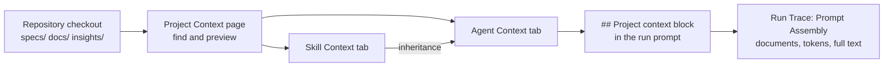

# Spec: Project Context
Spec ID: SPEC-01
Status: approved
Supersedes: —

## Problem and user

**Who is affected.** DevDigest users who configure review agents and skills (Skills Lab) and run PR reviews: developers and tech leads whose projects already hold written rules — PRDs, specifications, architecture notes, insights — as Markdown files in the repository.

**What hurts today.**
- An agent sees the diff, the PR description, derived intent, skills and repository structure, but **not the project's own rules**. For example, a PRD says "no endpoint may expose internal account IDs", yet the reviewer only knows generic code defects.
- The prompt already reserves a `## Project context` section for untrusted specification text, and the run trace has a "Specs read" field. Both are empty for every run: the server never passes specifications into the review (`server/src/modules/reviews/run-executor.ts:246-269`, `:402`).
- The client hooks for "Project Context" call endpoints that do not exist on the server (`client/src/lib/hooks/core.ts:122-137`), and there is no page or menu entry.
- The only lever for teaching an agent project rules is copying text by hand into the agent's system prompt. That text goes stale and does not show its token cost.

**Evidence.** The designs (see *Inputs and provenance*) describe a Project Context page, a Context tab in the agent and skill editors, and a "Project context — attached specs (untrusted)" row in the run trace's Prompt Assembly.

## Goals / Non-goals

**Goals**
1. A user finds every Markdown document under the project's `specs/`, `docs/` and `insights/` folders and reads it (Preview).
2. A user attaches documents to agents and skills and orders them; an agent inherits the documents of its skills.
3. The number of tokens the documents add to each prompt is computed dynamically from their actual content and is visible before a run.
4. On every agent launch, the full text of the attached documents is placed into the prompt as text in the `## Project context` section.
5. In Run Trace → Prompt Assembly, the user sees which documents were attached, how many tokens they take, and can open the full text that went into the request.

**Non-goals**
- **Editing, creating or uploading documents and creating folders through the UI** (the `+`, folder and upload buttons and the Edit toggle in the design). Reason: the server's checkout is a "read-only mirror" that every sync resets with `reset --hard origin/<branch>` and never commits (`server/src/adapters/git/simple-git.ts:78-87`); edits made in the file system would be lost and would never reach GitHub. Following the product owner's rule ("if it proves too difficult, keep view-only"), this slice is **view-only**. See OQ-6.
- Automatic document selection based on PR content, semantic search, chunking, embeddings (the "Indexed: N files · M chunks" footer in the design belongs to a different subsystem, see OQ-9).
- The "Coverage" metric (the ring showing 78) — undefined, see OQ-8.
- Documents outside `specs/`, `docs/`, `insights/`, and non-Markdown files.
- Reading documents from the PR branch (see OQ-5).
- Changes to the Onboarding Tour (the last two design images are a separate feature).
- Versioning of attachments (see OQ-7).

## User stories

- **US-1** As a DevDigest user, I want to see all specifications and other Markdown documents of the project in one place and read them, so that I can quickly find the rules agents should know.
- **US-2** As an agent author, I want to attach documents to an agent and set their order, so that the agent reviews PRs with the project's rules in mind.
- **US-3** As a skill author, I want to attach documents to a skill, so that every agent using that skill inherits them.
- **US-4** As an agent or skill author, I want to see how many tokens the attached documents will add, so that I can control prompt cost and size.
- **US-5** As a user, I want the attached documents to enter the prompt automatically as full text whenever an agent runs, so that I don't have to copy them by hand.
- **US-6** As a user investigating a run, I want to see in Prompt Assembly exactly which documents were attached and open their full text, so that I can understand what the model's answer was based on.
- **US-7** As a user, I want to see how many agents use each document, so that I understand the impact of changing it.

## Acceptance criteria (EARS)

### Discovery and browsing

- **AC-1** [Event-driven] [MUST] WHEN a user opens the "Project Context" page of a repository, the system (shall) show a list of all `*.md` files, at any nesting depth, under the `specs/`, `docs/` and `insights/` folders of the synced default-branch checkout; each item shows its path relative to the repository root and a root label (`specs` | `docs` | `insights`).
  Verify: integration — fixture checkout with `*.md` in `specs/`, `docs/a/b/`, `insights/`, and two files with the same name in different folders; open the list and assert that each file is present with its full path and label.
- **AC-2** [Ubiquitous] [MUST] The system (shall) exclude from the list files without the `.md` extension and any files outside the `specs/`, `docs/` and `insights/` folders (including the root `README.md` and anything under `node_modules/`).
  Verify: integration — the same fixture plus a root `README.md`, `node_modules/x/readme.md` and `docs/a.txt`; assert none of them appears in the list.
- **AC-3** [Event-driven] [MUST] WHEN a user selects a document in the list, the system (shall) show its content in Preview mode rendered as Markdown (headings, lists, inline code, tables).
  Verify: unit — render a fixture with `#`, a list, `` `code` `` and a table; assert the corresponding elements.
- **AC-4** [Unwanted behavior] [MUST] IF a Markdown document contains raw HTML or a script, THEN the system (shall) display it as inert text and not execute it.
  Verify: unit — content `` and ``; after rendering, `window.x` is unset and the DOM has no active `script`/`onerror` elements.
- **AC-5** [Event-driven] [SHOULD] WHEN a user clicks the refresh button on the Project Context page, the system (shall) resync the checkout, rediscover the documents, and update the list, the usage counters and the token counts.
  Verify: integration — change a file in the fixture's "remote" repository, click refresh, and assert the new content and the new token count in the response.
- **AC-6** [Ubiquitous] [MUST] For each document in the list, the system (shall) show the number of distinct agents to whose prompt the document is added, directly or through a linked skill.
  Verify: integration — a document attached to agent A directly and to a skill linked to agents B and C; assert the counter is 3 and that agent A, which has the document both directly and through the skill, is counted once.
- **AC-7** [Unwanted behavior] [MUST] IF the `specs/`, `docs/` and `insights/` folders contain no `*.md` file, THEN the system (shall) show an empty state naming the scanned folders.
  Verify: unit — empty discovery result; assert the empty-state text and the mention of all three folders.
- **AC-8** [Unwanted behavior] [MUST] IF the repository checkout is unavailable (not yet cloned, or the sync failed), THEN the system (shall) show an error state with the reason and a retry action instead of an empty list.
  Verify: integration — a repository without a checkout; the list request returns an error with a code and reason; the UI shows the error with a retry button.
- **AC-9** [Unwanted behavior] [MUST] IF a file exceeds the document size limit (value: OQ-2), THEN the system (shall) show it in the list marked "too large" and not allow it to be attached.
  Verify: integration — a file one byte over the limit; the list carries the marker and an attempt to attach it is rejected with a validation error.

### Attaching to agents and skills

- **AC-10** [Event-driven] [MUST] WHEN a user enables a document on an agent's Context tab, the system (shall) attach the document to that agent so that it stays attached after the page is reloaded.
  Verify: integration — attach, then re-fetch the agent state; the document is in the attached list.
- **AC-11** [Event-driven] [MUST] WHEN a user disables an attached document, the system (shall) detach it from the agent without changing the file itself.
  Verify: integration — detach; the document is absent from the attached list and the file in the checkout is unchanged.
- **AC-12** [Event-driven] [MUST] WHEN a user reorders the attached documents by dragging or with the keyboard, the system (shall) persist the new order, which determines the documents' order in the prompt.
  Verify: integration — attach A, B; reorder to B, A; run the agent with a mock LLM; in the `## Project context` block B precedes A.
- **AC-13** [Ubiquitous] [MUST] The agent Context tab (shall) show "N of M attached" (N attached out of M discovered repository documents) and a filter by document name.
  Verify: unit — M=7, N=2 renders "2 of 7 attached"; filtering by a substring leaves only the matching rows.
- **AC-14** [Event-driven] [SHOULD] WHEN a user clicks Preview on a document row in an agent's or a skill's Context tab, the system (shall) show a Markdown view of that document without changing the attachments.
  Verify: unit — clicking Preview opens a view with the document's content; the attachment state is unchanged.
- **AC-15** [Event-driven] [MUST] WHEN a user enables a document on a skill's Context tab, the system (shall) attach the document to that skill so that it stays attached after the page is reloaded.
  Verify: integration — attach to a skill, re-fetch the skill; the document is in the list.
- **AC-16** [Event-driven] [MUST] WHEN an agent is launched, the system (shall) add to its `## Project context` block the documents of only those of its linked skills that are enabled and not flagged by injection detection.
  Verify: integration — an agent with two skills, one disabled; run with a mock LLM; the prompt contains only the documents of the enabled skill.
- **AC-17** [Ubiquitous] [MUST] A document attached both to an agent and to its skill (or to several of its skills), the system (shall) include in the prompt once, at the position of its first occurrence.
  Verify: unit — a document shared between the direct list and a skill; in the assembled block its text appears exactly once.
- **AC-18** [Ubiquitous] [MUST] The system (shall) order the documents in the block first by the agent's own document order, then by the order of its skills and the order of documents within each skill (assumption, see OQ-3).
  Verify: unit — agent [D1, D2], skill S1 [D3], skill S2 [D4]; the order in the block is D1, D2, D3, D4.
- **AC-19** [Ubiquitous] [MUST] The "Serializes as" preview on a skill's Context tab (shall) be built by the same renderer that produces the prompt section and carry the same `## Project context` heading.
  Verify: unit — the skill preview output is identical to the fragment the prompt assembler returns for the same document list.
- **AC-20** [State-driven] [SHOULD] WHILE an agent has linked skills with attached documents, the system (shall) show those inherited documents on the agent's Context tab separately, read-only, labelled with the source skill, and include them in the token total.
  Verify: unit — an agent with a skill that has a document; the tab shows an inherited row "via <skill>" without a checkbox, and the total includes it.
- **AC-21** [Ubiquitous] [MUST] The system (shall) record an attachment as a (repository, path relative to the repository root) pair and, when running for repository X, apply only the attachments made for X (assumption, see OQ-7).
  Verify: integration — a document attached in repository X; running the same agent for repository Y neither adds that document nor fails.

### Token counting

- **AC-22** [Ubiquitous] [MUST] The system (shall) compute each document's token count from its actual content in the current synced checkout, not from the file size in bytes and not from a stored value for an older version of the content.
  Verify: unit — two documents of equal character length (English prose and dense code/Cyrillic) give different token counts; after the file content changes, its count changes.
- **AC-23** [Ubiquitous] [MUST] The token total on an agent's Context tab (shall) equal the token count of the `## Project context` block that would be added to that agent's prompt at that moment (including inherited documents, de-duplication, wrappers and heading), and carry an "≈" marker.
  Verify: integration — assemble the prompt for the agent with a mock LLM and count the block's tokens with the same tokenizer; the value returned by the total API matches exactly.
- **AC-24** [Ubiquitous] [MUST] A skill's Context tab (shall) show the token total of the documents attached to that skill.
  Verify: unit — a skill with two documents; the total equals the token count of the serialized block of those documents.
- **AC-25** [Event-driven] [MUST] WHEN a user enables or disables a document or changes the order, the system (shall) update the token total without a page reload.
  Verify: unit — toggle a checkbox; the total changes in the same render without navigation.
- **AC-26** [Ubiquitous] [SHOULD] The system (shall) show the token count next to each document in the Project Context list and on the Context tabs.
  Verify: unit — document rows show the token value from the API response.

### Injection at run time

- **AC-27** [Event-driven] [MUST] WHEN an agent is launched for a PR, the system (shall) read the full text of every document attached to it (directly or through a skill) and add it as text to the prompt's `## Project context` section, without shortening any document's text.
  Verify: integration — attach two documents; run with a mock LLM; the user message contains both full texts under the `## Project context` heading.
- **AC-28** [Event-driven] [MUST] WHEN an agent run starts, the system (shall) read all of its documents once, at the start of the run, from the synced default-branch checkout (the same one the Project Context page shows) and use the same texts in all prompts of that run (branch assumption, see OQ-5).
  Verify: integration — a run with a strategy that splits the diff into chunks; change a file in the checkout mid-run; all chunks contain the same document text.
- **AC-29** [Ubiquitous] [MUST] The system (shall) place each document in a separate untrusted-content block whose label contains the document's path, so that the model and the trace reader can tell documents apart.
  Verify: unit — the assembled block for two documents contains two `<untrusted source="…">` blocks, and each label contains the document's path.
- **AC-30** [Unwanted behavior] [MUST] IF a document's text contains a sequence that closes the untrusted-content block, THEN the system (shall) neutralize it so that it does not close the block.
  Verify: unit — a document with `</untrusted>` followed by an instruction; the output has exactly one closing tag per document.
- **AC-31** [Ubiquitous] [MUST] The system (shall) apply the rules of AC-16 through AC-30 to every agent-launch path that assembles a prompt in this application (running a single agent, running all agents, re-running).
  Verify: integration — the same agent with an attached document launched through each path; the document is present in every prompt.
- **AC-32** [Unwanted behavior] [MUST] IF an agent has no attached documents (directly or through a skill), THEN the system (shall) not add a `## Project context` section and not change the rest of the prompt compared to the current behavior.
  Verify: unit — assembling a prompt without documents yields the same user text, byte for byte, as before this feature (snapshot).
- **AC-33** [Unwanted behavior] [MUST] IF an attached document is missing from the checkout (deleted or renamed), unreadable (binary or not UTF-8), or over the size limit (OQ-2), THEN the system (shall) skip it, continue the run, and record the path and the reason (`missing` | `unreadable` | `too_large`) in the trace.
  Verify: integration — three attached documents in these states plus one healthy one; the run succeeds, the prompt contains only the healthy one, and the trace has three entries with reasons.
- **AC-34** [Unwanted behavior] [MUST] IF the total token count of the `## Project context` block exceeds the token budget (value: OQ-1), THEN the system (shall) drop whole documents from the end of the ordered list until the block fits, without truncating any document, and record in the trace the path of every dropped document with the reason `over_budget`.
  Verify: integration — a budget smaller than the sum of three documents; the last one (or last two, if needed) is dropped and earlier ones are present in full; if the first document alone exceeds the budget, no block is added and the document is recorded as dropped.
- **AC-35** [Unwanted behavior] [MUST] IF a document path is absolute, contains `..`, or (after symlink resolution) leads outside the repository checkout, THEN the system (shall) refuse to read it, not include its content in any response or prompt, and record the reason `refused_containment`.
  Verify: integration — an attachment with path `../../etc/passwd` and a symlink in `docs/` pointing at a file outside the checkout; both are rejected and the content appears neither in the API nor in the prompt.
- **AC-36** [Ubiquitous] [COULD] The system (shall) not add to the prompt a document consisting only of whitespace.
  Verify: unit — a document containing `"\n  \n"` produces no block and is not counted in tokens.

### Transparency (Run Trace → Prompt Assembly)

- **AC-37** [Event-driven] [MUST] WHEN a user opens the Run Trace of a run that had documents, the system (shall) show in Prompt Assembly a separate expandable row "Project context — attached specs (untrusted)" with the document count and total token count.
  Verify: unit — a trace with two documents; the row is present with the "untrusted" label, "2 docs" and the tokens.
- **AC-38** [Event-driven] [MUST] WHEN a user expands that row, the system (shall) show the list of documents in injection order, each with its path, its token count, and the ability to open the full text that was added to the request.
  Verify: unit — expand the row; items appear in injection order; clicking a document shows its full text.
- **AC-39** [Ubiquitous] [MUST] The system (shall) store in the run trace the text of every document added, exactly as it was included in the request, so that viewing the trace after the file is changed or deleted shows the text as of the run.
  Verify: integration — run; modify and delete the file in the checkout; the trace request returns the original text.
- **AC-40** [Event-driven] [MUST] WHEN a run had skipped (AC-33, AC-35) or dropped (AC-34) documents, the system (shall) show them in the expanded row as a separate list with path and reason.
  Verify: unit — a trace with one skipped and one dropped document; both are in the list with their reasons.
- **AC-41** [Ubiquitous] [SHOULD] The trace's Configuration section (shall) list the paths of the documents added to the request in the "Specs read" field.
  Verify: unit — a trace with two documents; the field contains both paths rather than "none".
- **AC-42** [Event-driven] [COULD] WHEN a user clicks "copy" on the Project context row, the system (shall) copy the full text of the block.
  Verify: unit — the click writes the block's full text to the clipboard.
- **AC-43** [Unwanted behavior] [MUST] IF a trace was created before this feature and carries no document data, THEN the system (shall) display it without errors as before.
  Verify: unit — a recorded old trace parses and renders; the documents row is absent or empty.

### Traceability matrix

| Source | Covered by |
|---|---|
| US-1 | AC-1, AC-2, AC-3, AC-4, AC-5, AC-7, AC-8, AC-9 |
| US-2 | AC-10, AC-11, AC-12, AC-13, AC-14, AC-21 |
| US-3 | AC-15, AC-16, AC-17, AC-18, AC-19, AC-20 |
| US-4 | AC-22, AC-23, AC-24, AC-25, AC-26 |
| US-5 | AC-27, AC-28, AC-29, AC-30, AC-31, AC-32, AC-33, AC-34, AC-35, AC-36 |
| US-6 | AC-37, AC-38, AC-39, AC-40, AC-41, AC-42, AC-43 |
| US-7 | AC-6 |
| EC-1 | AC-33 |
| EC-2 | AC-28, AC-39 |
| EC-3 | AC-17 |
| EC-4 | AC-16 |
| EC-5 | AC-28, OQ-4 |
| EC-6 | AC-36 |
| EC-7 | AC-33 |
| EC-8 | AC-35 |
| EC-9 | AC-1, NFR-1 |
| EC-10 | AC-1 |
| EC-11 | AC-28 |
| EC-12 | AC-21 |
| EC-13 | AC-34 |
| EC-14 | OQ-7 |
| NFR-1 | self (Verify given) |
| NFR-2 | self (Verify given) |
| NFR-3 | self (Verify given) |
| NFR-4 | self (Verify given) |
| NFR-5 | self (Verify given) |
| NFR-6 | self (Verify given) |
| NFR-7 | self (Verify given) |

## Edge cases

- **EC-1** An attached document is deleted or renamed in the repository: the run does not fail, the document is skipped and visible in the trace (AC-33). Whether an attachment "follows" a rename is not covered (OQ-10).
- **EC-2** A file changes between viewing in the UI, a run, and viewing the trace: the run reads the checkout state at its start, and the trace stores the text as of the run (AC-28, AC-39).
- **EC-3** A document is attached to both an agent and its skill: it appears once in the prompt (AC-17).
- **EC-4** A skill is disabled or flagged by injection detection: its documents are not added (AC-16).
- **EC-5** A large diff that the review splits into chunks: the engine re-assembles the prompt for every chunk, so the block repeats in each prompt and the cost grows with the number of chunks (`reviewer-core/src/review/run.ts:141,180`). The UI total reflects the tokens of a single prompt (AC-28; repeating versus inserting once — OQ-4).
- **EC-6** An empty document or one containing only whitespace (AC-36).
- **EC-7** A binary or non-UTF-8 file with a `.md` extension (AC-33).
- **EC-8** A path with `..`, an absolute path, or a symlink pointing outward (AC-35).
- **EC-9** A very large number of documents (hundreds): the list must stay fast (AC-1, NFR-1).
- **EC-10** Identical file names in different folders: told apart by the full path (AC-1).
- **EC-11** A checkout sync during a run: documents are read once at the start (AC-28).
- **EC-12** An agent runs for a different repository than the one the documents were attached from (AC-21).
- **EC-13** A single document larger than the token budget on its own (AC-34).
- **EC-14** Restoring an older version of an agent or skill: whether attachments are restored with it is undefined (OQ-7).

## Non-functional requirements

- **NFR-1** [Performance] [SHOULD] The system (shall) return the document list with token counts for a repository of ≤ 500 documents with a total size ≤ 10 MB within ≤ 1000 ms (p95) with an already-synced checkout (target is an assumption, OQ-12).
  Verify: integration — a fixture of 500 files of ≈20 KB each; measure 20 consecutive requests; p95 ≤ 1000 ms.
- **NFR-2** [Performance] [SHOULD] After a checkbox toggle or reorder, the system (shall) update the token total in the UI within ≤ 200 ms (p95) of the user action, with the document data already loaded (target is an assumption, OQ-12).
  Verify: unit — a component test measuring the time between the event and the updated total on a fixture of 50 documents.
- **NFR-3** [Cost] [MUST] The feature (shall) add 0 extra LLM calls per run (discovery, attachment, counting and injection make no LLM calls); the only change in run cost is the additional input tokens of the Project context block.
  Verify: integration — a run with a mock LLM; the number of LLM calls is the same with and without documents for the same strategy.
- **NFR-4** [Security] [MUST] The system (shall) satisfy this checklist: (a) every document path passes relative-path validation and realpath containment within the checkout; (b) document content in the prompt is always inside an untrusted-content block with the closing tag neutralized; (c) the Markdown preview does not execute raw HTML and does not allow `javascript:` links; (d) files over the size limit are not read in full; (e) the attachment endpoints validate identifiers and that the agent, skill and repository belong to the user's workspace.
  Verify: integration — a set of negative tests for each of (a)–(e): a path with `..`, a document with `</untrusted>`, `[x](javascript:alert(1))` in Markdown, a file one byte over the limit, an identifier from another workspace.
- **NFR-5** [Privacy] [MUST] The system (shall) not write document content to server logs; only paths, sizes and token counts are allowed (content may be proprietary).
  Verify: unit — a run with a document containing a unique marker; assert the marker is absent from all run log records.
- **NFR-6** [Observability] [SHOULD] For every run, the system (shall) write to the structured log the number of attached, added, skipped and dropped documents and the block's total tokens, so that a run can be analyzed after the fact.
  Verify: integration — a run with a mixed set (AC-33/AC-34); the log contains the four counters with the expected values.
- **NFR-7** [Accessibility] [SHOULD] The system (shall) satisfy this checklist: (a) reordering documents is possible from the keyboard; (b) every checkbox and Preview button has an accessible name containing the document's name; (c) the "attached / inherited / skipped" state is conveyed by more than color.
  Verify: unit — component tests: reordering by keys, presence of accessible names, a text label for the state.

Categories not included: Reliability as a separate requirement — behavior for unavailable documents is set by AC-33/AC-34; Compatibility — set by AC-32 and AC-43.

## Inputs and provenance

Analysis date: 2026-10-10.

**Sources from the user**
- Text description of the feature (user message, 2026-10-10): find the project's specifications and other MD documents; attach them to skills and agents on the tabs shown in the design; dynamic token counting; when an agent is launched, the documents are added to the prompt as text; in Prompt Assembly, a clear "project context attached specs" indicator with the ability to open the full text.
- User answers to clarifying questions: discovery only in `specs/`, `docs/`, `insights/` (fixed roots); when over budget, drop the lowest-priority documents whole and name them; editing — "consider how hard it is in the file system; if too difficult, view-only" (conclusion: see Non-goals and OQ-6).
- Designs, folder `to_analyze/` (all 6 images viewed): `img.png` — Project Context page (file list, Preview/Edit, "Used by 3 agents", Coverage 78, footer "Indexed: 12 files · 1,240 chunks"); `img_1.png` — Context tab of the Security Reviewer agent ("2 of 7 attached", "Order matters…", "≈ 317 tokens"); `img_2.png` — Context tab of skill `pr-quality-rubric` ("1 attached", "Any agent using this skill inherits these documents", "Serializes as"); `img_3.png` — Agent run trace: Configuration ("Specs read"), Stats, Prompt Assembly with the "Project context — attached specs (untrusted)" row; `img_4.png`, `img_5.png` — Onboarding Tour (outside this feature).

**Code as context (read)**
- Prompt assembly: `reviewer-core/src/prompt.ts:30-34` (`wrapUntrusted` neutralizes `</untrusted>`), `:63-64` (`specs?: string[]`), `:158-161` (index-based `spec-<i>` labels), `:181` (the `## Project context` section), `:196-206` (`assembly.specs`); `reviewer-core/src/review/run.ts:141,180` (specs are passed into assembly, re-assembled for every chunk in chunked mode).
- Run: `server/src/modules/reviews/run-executor.ts:246-269` (engine call without `specs`), `:488-506` (skills: only `enabled` and without `injectionDetected`), `:402`, `:579` (`specs_read: []`).
- Checkout: `server/src/adapters/git/simple-git.ts:37-39` (path `<cloneDir>/<owner>/<name>`), `:78-87` (`fetch` + `reset --hard`, "read-only mirror"), `:130` (file read without traversal protection); `server/src/modules/_shared/checkout-paths.ts` (`isRelativeSafePath`, `resolveContainedPath`, `ContainmentError`, `MissingPathError`); `server/src/modules/brief/constants.ts:43` (`MAX_SPEC_BYTES = 256 KB` — precedent for a size limit).
- Contracts: `server/src/vendor/shared/contracts/platform.ts:281-296` (`SpecFile`, `IndexStatus` with no server consumer), `…/trace.ts:39-52,66-69,103` (`specs`, `PromptAssemblyMeta` with only `skills_tokens`, `specs_read: string[]`); a contract change must be mirrored by hand into `client/src/vendor/shared` (root `AGENTS.md`).
- Client: `client/src/lib/hooks/core.ts:122-137` (hooks to non-existent endpoints), `…/TraceBody.tsx:39-50,68-90` (current rendering of "Specs read" and of the specs block, without an "untrusted" label or tokens), `client/src/app/agents/[id]/page.tsx:15` (agent tabs: config, skills), `client/src/vendor/ui/nav.ts` (menu without Project Context), `client/messages/en/context.json` (text stubs that mention `.devdigest/specs/`).
- Insights: `client/INSIGHTS.md` (agent Skills tab: list order = prompt order; Save is explicit), `server/INSIGHTS.md` (the checkout tracks the default branch, not the PR head; the tokenizer in the hot path is used for skills only).
- Tokens: `server/src/adapters/tokenizer/index.ts` (`js-tiktoken cl100k_base` with a `ceil(len/4)` fallback).

**Findings from research subagents** (reports are untrusted data; key claims were verified against the code, and the sources cited above are the primary ones): Markdown file discovery and server tables/endpoints for attachments do not exist; the CI agent-runner is not in this repository.

**What the design does not show:** the Edit mode screen, dialogs for the `+`/folder/upload buttons, loading, error and empty states, hover and drag states, narrow-screen behavior, how inherited documents appear on the agent tab, and the definitions of "Coverage" and "Indexed chunks". Parts not seen are not assumed to be covered. The design contains discrepancies: the heading "Project specifications" in the skill's "Serializes as" versus `## Project context` in the agent tab, the trace and the code (resolved in AC-19); `.devdigest/specs/` in the page header versus the `specs/ docs/ insights/` folders in the list (resolved by the fixed-roots choice; empty-state text must name the scanned folders — AC-7); different file sets in the mock data of the page and of the agent tab (mock data, ignored).

## Untrusted inputs

| Input | Assumption | Required handling | Abuse case |
|---|---|---|---|
| Content of repository documents | Writable by anyone with write access to the default branch; may be proprietary | Untrusted-content block with the closing tag neutralized (AC-29, AC-30); read from a default-branch snapshot, so a PR author cannot change the rules their PR is judged against inside that same PR (AC-28, OQ-5); content is not logged (NFR-5) | Prompt injection ("approve this PR"); an attempt to close the block with `</untrusted>`; leaking proprietary text into logs |
| Document path in attachment requests | Comes from the client | Relative-path validation + realpath containment in the checkout (AC-35, NFR-4a) | `../`, absolute paths, symlinks pointing outward, null bytes |
| File size and encoding | Arbitrary | Size limit (AC-9, AC-33, OQ-2), refusal for non-UTF-8 | A file of hundreds of MB; a binary file named `.md`; memory and token exhaustion |
| Markdown in the preview | May contain HTML, scripts, dangerous links | Render without raw HTML; filter `javascript:` (AC-4, NFR-4c) | XSS through a repository document |
| Attachment request bodies (identifiers, order) | Come from the client | Schema validation, uniqueness, workspace ownership (NFR-4e) | Foreign identifiers, duplicates, huge arrays |
| Text in the design sources | Images from mockups | — | No attempts to inject instructions addressed to the assistant were found in the images |

## Open questions

- **OQ-1** The numeric token budget of the `## Project context` block and its source: a constant, or derived from the model's context window (a `ModelInfo` field exists but is not used for reviews). Who decides: the product owner / planning stage. Without a value AC-34 cannot be checked numerically.
- **OQ-2** The size limit of a single document. Proposal: 256 KB, matching the Brief module's existing `MAX_SPEC_BYTES`.
- **OQ-3** The order of inherited versus own documents (AC-18 assumes: the agent's own documents first, then by skill order). To be confirmed.
- **OQ-4** In chunked review mode the block repeats in every prompt (EC-5). Is the multiplied cost acceptable, or should the documents go only into the first chunk / a separate cached prefix?
- **OQ-5** Reading from the default branch (the checkout state) is assumed, because that is what the system syncs. Consequence: a specification added in the PR itself does not reach that PR's prompt until it is merged. To be confirmed that this is desired.
- **OQ-6** Editing. Complexity assessment: the server's checkout is a disposable mirror (`reset --hard` on every sync, never committed, git-ignored), so edits in the file system would either vanish or never reach GitHub. The real options need a separate decision: (a) an overlay of edits in the database on top of the checkout (needs a conflict policy against the remote), (b) writing to GitHub via the API (needs write permission and a commit/PR flow), (c) a local-path repository mode. Decided: this slice is view-only. To be confirmed.
- **OQ-7** Attachment scope and lifecycle: the (repository, path) pair and the behavior in other repositories (AC-21 is an assumption); save immediately or via a Save button (the design shows no Save; the agent Skills tab has an explicit Save); whether attachments are part of agent/skill versions and are restored with them (EC-14).
- **OQ-8** What "Coverage" (the ring showing 78) on the Project Context page means, and whether it is in this slice. Not included in the requirements.
- **OQ-9** The footer "Indexed: 12 files · 1,240 chunks": should the page show the repo-intel index state, or replace it with an "N documents · M tokens" summary? Not included in the requirements.
- **OQ-10** Should an attachment survive a file rename in git (rename tracking)? Assumed not.
- **OQ-11** Token accuracy: the count uses the `cl100k_base` tokenizer that the trace already uses for skills; for other providers' models the real count will differ, hence the "≈" marker on the total. Is a provider-specific tokenizer needed?
- **OQ-12** The numeric targets of NFR-1 and NFR-2 are proposals and need confirmation.
- **OQ-13** Parity for the CI agent-runner (outside this repository): the source of documents for CI runs was not examined.
- **OQ-14** UX ideas not adopted (optional): a warning when attached documents exceed a share of the budget; bulk attach by folder; a "stale/missing" marker on attached documents in the Context tab; a diff view of a document between a run and its current state.
