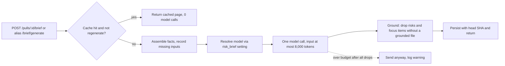

# Spec: PR Brief contract gaps
Spec ID: SPEC-04
Status: approved
Supersedes: SPEC-03 (client/specs/2026-10-11-pr-brief-polish.md), limited to its non-goal "Adding a `summary` field to the brief contract" and its OQ-2; all other SPEC-03 criteria stay in force. SPEC-03 itself is not edited.

## Problem and user
**Who:** a reviewer reading the PR Brief on the Overview tab, and the maintainers who rely on the brief's cost, model choice and grounding guarantees.

The PR Brief feature is largely implemented (server brief module, client PrBriefCard, SPEC-03 polish). An audit of the original homework text against the code on 2026-10-11 found these remaining gaps (each verified in code, see *Inputs and provenance*):
- **Input budget not recorded as a requirement.** The code enforces 8000 (tokens) over the whole assembled model input (`server/src/modules/brief/constants.ts:21`, `prompts.ts:108-109`), but no spec states the number with its unit.
- **No `summary`.** The stored/served `PrBrief` has `what` and `why`, not the homework's `summary` (`server/src/vendor/shared/contracts/brief.ts:109-115`; model output schema `schemas.ts:39-45`). The card renders `brief.what` and `brief.why` (`PrBriefCard.tsx:142-143`).
- **POST path differs.** The generate route is `POST /pulls/:id/brief/generate` (`routes.ts:35-37`); the homework says `POST /pulls/:id/brief`. The only caller found is the client hook (`client/src/lib/hooks/brief.ts:40`); `mcp-server/src` contains no brief reference.
- **Grounding vs the homework wording.** A risk is dropped when it has zero surviving file refs (`grounding.ts:69-73`, already met). A focus item survives with `line: null` when no line is grounded (`grounding.ts:142-146`, `ReviewFocusItem.line` nullable at contract line 104). Decision: this stays; a focus item carries a file, plus a line when known (file-only items are kept).
- **Missing inputs are only partly disclosed.** The model prompt marks absent Intent explicitly (`prompts.ts:161`) and always states index status (`prompts.ts:204`), but an absent linked issue or spec is simply omitted from the prompt (`prompts.ts:139-140`), and nothing in the stored brief or the card tells the reviewer which inputs were missing.
- **Model resolution and one-call logging** exist (`service.ts:138`, `service.ts:144`, log `brief.generate` at `service.ts:152-205`) but are not pinned by a requirement.

## Goals / Non-goals
**Goals**
- Record the model input budget with its unit as a measurable requirement.
- Add a real, additive `summary` (what the PR does and why) to the shared contract and show it in the card.
- Accept `POST /pulls/:id/brief` as the generate route while keeping the current path working.
- Require each surviving risk to cite at least one grounded file and each focus item to carry a grounded file, with a line when known.
- Make the brief state which inputs (Intent, Blast radius, linked issue, specs) were missing.
- Pin model resolution through the `risk_brief` setting and exactly-one-call observability.

**Non-goals**
- Navigation, skeleton, not-in-diff notice and verdict banner (covered by SPEC-03).
- Removing or renaming `what` / `why` (see OQ-1).
- Changing SHA-based caching/staleness, the drop order of the budget loop, or the risk/focus size bounds.
- Surfacing brief calls in the run trace; any `mcp-server` brief tool.

## User stories
- **US-1** As a reviewer, I want a single `summary` of what the PR does and why at the top of the brief, so that I grasp the PR at a glance.
- **US-2** As an API consumer, I want to generate a brief with `POST /pulls/:id/brief`, so that the API matches the documented contract while existing callers keep working.
- **US-3** As a reviewer, I want every risk and review-focus item to point at a real place in the code, so that I can act on it.
- **US-4** As a reviewer, I want the brief to tell me which inputs were missing, so that I can judge how much to trust it.
- **US-5** As a maintainer, I want the model chosen from the `risk_brief` setting, one logged call per generation and a bounded input size, so that cost and behavior are predictable and auditable.

## Acceptance criteria (EARS)

### Summary
- **AC-1** [Event-driven] [MUST] WHEN a brief generation succeeds, the system (shall) store and return a non-empty `summary` that states what the PR does and why, of at most 3 sentences, alongside the unchanged `what` and `why`.
  Verify: integration — mock the model to return a summary; generate; assert the returned and re-read brief carry the same non-empty `summary`.
- **AC-2** [Ubiquitous] [MUST] The system (shall) apply the same grounding to `summary` as to `what` and `why` (links to paths outside the PR or blast radius neutralized, unknown endpoint/symbol citations dropped).
  Verify: unit — ground a summary containing `[x](https://evil.test)` and an unknown `` `fooBar` `` citation; assert the link is replaced by its label and the citation is recorded as dropped.
- **AC-3** [Event-driven] [MUST] WHEN a stored brief created before this change (no `summary`) is read, the system (shall) return it as a valid page with HTTP 200 and `summary` absent.
  Verify: integration — seed a `pr_brief` row with what/why only; GET the brief; assert 200, schema-valid, no `summary`.
- **AC-4** [State-driven] [MUST] WHILE the displayed brief has a non-empty `summary`, the system (shall) show the summary in the PR Brief card above risks and review focus.
  Verify: integration — render the card with a summary; assert the text is present before the risks section.
- **AC-5** [State-driven] [MUST] WHILE the displayed brief has no `summary`, the system (shall) show its `what` and `why` instead and render no empty summary block.
  Verify: integration — render the card with a legacy brief; assert what/why shown and no summary element.
- **AC-6** [Ubiquitous] [MUST] The system (shall) keep the server and client vendored `brief.ts` contract files byte-identical, both containing the added `summary`.
  Verify: unit — read both files and assert equal content and that `PrBrief` declares `summary`.

### POST route
- **AC-7** [Event-driven] [MUST] WHEN a client sends `POST /pulls/:id/brief` with an optional `{regenerate}` body, the system (shall) run the same generation flow, workspace scoping and response shape as the current generate route.
  Verify: integration — POST to the new path for a PR with files; assert a `BriefGenerateResult` with status `generated`; a PR of another workspace returns 404.
- **AC-8** [Event-driven] [MUST] WHEN a client sends `POST /pulls/:id/brief/generate`, the system (shall) behave identically to AC-7 and share its in-flight guard, so that concurrent POSTs on the two paths for one PR cause one generation.
  Verify: integration — start a slow generation on one path, POST the other path; assert status `generating` and exactly one model call.

### Grounded references
- **AC-9** [Ubiquitous] [MUST] The system (shall) drop any risk that has no file reference in the PR's changed files or blast-radius files after grounding. (Already met: `grounding.ts:65-73`.)
  Verify: unit — a risk whose refs are all unknown paths is absent from the grounded brief and listed in `dropped.risks`.
- **AC-10** [Event-driven] [MUST] WHEN a review-focus item names a changed file but has no line after grounding (no line given, or the line lies outside every hunk of its file), the system (shall) keep the item as a file-only item with `line: null`.
  Verify: unit — focus items with a valid line, a null line, and a line outside all hunks, all on changed files; assert all three survive, the first with its line and the other two with `line: null`, and none is listed in `dropped.focus`.
- **AC-11** [Unwanted] [MUST] IF a review-focus item names a file that is not a changed file of the PR, THEN the system (shall) drop the item. (Already met: `grounding.ts:138-141`.)
  Verify: unit — a focus item citing a blast-only or unknown file is absent and listed in `dropped.focus`.

### Missing inputs
- **AC-12** [Unwanted] [MUST] IF the Intent, Blast radius, linked issue or specs input was unavailable when a brief was generated, THEN the system (shall) name each missing input in the brief JSON stored with the brief (computed by the server from the fact set, not by the model) and in the card that displays it.
  Verify: integration — generate for a PR with no cached intent, no linked issue, no spec and an unavailable index; assert the response names all four; render the card and assert the text. Currently partially met: only the model prompt marks Intent and index status; nothing is stored or displayed.
- **AC-13** [State-driven] [MUST] WHILE all four inputs were available, the system (shall) show no missing-inputs statement.
  Verify: integration — generate with all inputs present; assert the missing list is empty and the card shows no such text.

### Model, call count, input
- **AC-14** [Ubiquitous] [MUST] The system (shall) resolve the provider and model of every generation from the workspace's `risk_brief` feature setting, with no hard-coded model. (Already met: `service.ts:138`.)
  Verify: integration — set the `risk_brief` setting to a model; generate; assert the model call and `provenance.model` use it; change the setting and assert the next generation uses the new one.
- **AC-15** [Event-driven] [MUST] WHEN a generation reaches the model, the system (shall) issue one structured model call from the brief service (adapter-internal repair retries do not count as additional calls; their number is reported as `attempts`) and write one `brief.generate` log line carrying the PR id, provider, model, attempts, token counts, cost and per-category drop counts, without brief prose.
  Verify: integration — generate with a fake LLM and a capturing logger; assert one call to the structured method and one `brief.generate` line with those fields and no `what`/`why` text.
- **AC-16** [Ubiquitous] [MUST] The system (shall) issue 0 model calls for GET, for a cache hit without regenerate, for a PR with no changed files, and for a concurrent request that finds a generation in flight. (Already met: `service.ts:55-107`.)
  Verify: integration — exercise the four paths with a counting fake LLM; assert 0 calls.
- **AC-17** [Ubiquitous] [MUST] The system (shall) build the model input only from pre-computed facts (PR description, intent, blast-radius summary, diff stats and hunk line ranges, linked issue, attached specs) and never include diff hunk bodies. (Already met by design: `prompts.ts:172-184`.)
  Verify: unit — render the payload for a PR whose patch contains a unique marker string; assert the marker is absent while paths and line ranges are present.
- **AC-18** [Event-driven] [MUST] WHEN the assembled input exceeds the budget of NFR-1, the system (shall) drop whole input items in the existing fixed order until it fits or no droppable item remains, and record how many drop categories were applied. (Already met: `prompts.ts:69-120`.)
  Verify: unit — a fact set over 8,000 tokens; assert items drop in order, `droppedCount` matches, final tokens ≤ 8,000 when droppable items sufficed.
- **AC-19** [Unwanted] [MUST] IF the assembled input still exceeds the budget of NFR-1 after every drop step, THEN the system (shall) send the request anyway and write a warning log line stating that the budget was exceeded, with the token count and the budget.
  Verify: unit/integration — a fixture whose non-droppable parts exceed 8,000 tokens; assert the model is still called once and a warning with both numbers is logged (no brief prose).

### Traceability matrix
| Source | Covered by |
|---|---|
| US-1 | AC-1, AC-2, AC-3, AC-4, AC-5, AC-6 |
| US-2 | AC-7, AC-8 |
| US-3 | AC-9, AC-10, AC-11 |
| OQ-1 to OQ-8 | resolved, folded into AC-1 to AC-19 |
| US-4 | AC-12, AC-13 |
| US-5 | AC-14, AC-15, AC-16, AC-17, AC-18, AC-19 |
| EC-1 | AC-3, AC-5 |
| EC-2 | AC-1 |
| EC-3 | AC-8 |
| EC-4 | AC-10 |
| EC-5 | AC-9 |
| EC-6 | AC-19 |
| EC-7 | AC-8 |
| EC-8 | AC-12 |
| EC-9 | AC-15 |
| NFR-1 | self (Verify given) |
| NFR-2 | self (Verify given) |
| NFR-3 | self (Verify given) |
| NFR-4 | self (Verify given) |

## Edge cases
- **EC-1** Cached brief from before this change has no `summary` -> AC-3, AC-5.
- **EC-2** Model returns an empty or over-long summary -> AC-1 (non-empty is required; the generation follows the existing schema-validation and repair path).
- **EC-3** An older client still posts to `/brief/generate` during rollout -> AC-8.
- **EC-4** Focus items without a grounded line -> AC-10 (kept as file-only items; SPEC-03 AC-3 handles their navigation).
- **EC-5** All risks dropped by grounding -> AC-9 (card already shows "No specific risks identified.").
- **EC-6** Input still over budget after every drop step (the loop stops after the last step, `prompts.ts:109`) -> AC-19 (sent anyway, warning logged).
- **EC-7** Concurrent POSTs on the new and old path for one PR -> AC-8.
- **EC-8** Several inputs missing at once (no intent, no issue, no spec, index unavailable) -> AC-12.
- **EC-9** The structured call retries internally (`attempts` > 1) while the requirement says "exactly once" -> AC-15 (counts calls from the brief service).

## Non-functional requirements
- **NFR-1** [Cost] [MUST] The system (shall) keep the whole assembled model input (system prompt, injection guard and user payload) at ≤ 8,000 tokens (unit: tokens, as counted by the server tokenizer) per generation, whenever the droppable items suffice, and (shall) NOT raise this value; lowering it requires a documented reason.
  Verify: unit — count tokens of the assembled messages for an oversized fixture and assert ≤ 8000; assert the constant equals 8000.
- **NFR-2** [Compatibility] [MUST] The system (shall) read 100% of `pr_brief` rows stored before this change without a migration and without validation errors, and (shall) keep `POST /pulls/:id/brief/generate` returning the same response shape for 100% of existing callers.
  Verify: integration — seed legacy rows and call both paths; assert schema-valid responses.
- **NFR-3** [Observability] [SHOULD] The system (shall) log, for every generation attempt including failures, one `brief.generate` line with `ok`, provider, model and PR id, and (shall) log 0 characters of issue bodies, spec content or brief prose.
  Verify: integration — success and model-failure runs with a capturing logger; assert fields present and a marker string from issue body/spec absent.
- **NFR-4** [Security] [MUST] The system (shall) satisfy this checklist: (a) PR title/body, issue and spec text enter the model input only wrapped as untrusted data with the injection guard appended; (b) `summary` and missing-inputs text are rendered as plain text or Markdown with raw HTML disabled; (c) the new POST path enforces the same workspace scoping as the old one.
  Verify: integration — hostile fixtures (HTML in summary, cross-workspace PR id) per the checklist.
- Performance and Accessibility: no new numeric target; generation latency is dominated by the model call and unchanged, and the card keeps SPEC-03's accessibility criteria.

## Inputs and provenance
Read on 2026-10-11 (repo `C:\Projects\Agentic AI\dev-digest`); no researcher subagents (launched as a subagent, so research was done directly with Read/Grep). No Figma or design export was provided; the homework text arrived condensed in the task message.
- User/caller message — gap list 1-6 and homework requirements (source of all requirements).
- `AGENTS.md`, `server/AGENTS.md`, `client/AGENTS.md` — vendored contracts must be mirrored by hand; onion layering. `INSIGHTS.md` files were not read (the change is contract/route/prompt-level; the gap list came pre-audited).
- `server/src/modules/brief/constants.ts:21,25,29-32` budget 8000, output cap 1500, risk/focus/sentence bounds.
- `server/src/modules/brief/prompts.ts:18-53,69-120,139-140,161,172-184,204` system prompt, drop loop, per-input rendering, missing-input handling.
- `server/src/modules/brief/service.ts:55-114,138-157,184-205` getPage, cache/in-flight/refusal paths, `risk_brief` resolution, one `completeStructured` call, `brief.generate` log.
- `server/src/modules/brief/routes.ts:28-43` GET and POST `/brief/generate`; `schemas.ts:39-45` model output schema (what, why, risk_level, risks, review_focus); `grounding.ts:34-149` grounding rules.
- `server/src/modules/brief/facts.ts:40-70,164-213` `available` flags per input (issue, spec, intent, blast `degraded`).
- `server/src/vendor/shared/contracts/brief.ts:71-190` Risk, ReviewFocusItem, PrBrief, BriefPage, BriefGenerateResult. The client copy at `client/src/vendor/shared/contracts/brief.ts` was located and its generate-route comment (line 184) matches; a full line-by-line diff was NOT performed.
- `server/src/vendor/shared/contracts/platform.ts:17,62` `risk_brief` feature id.
- `client/src/lib/hooks/brief.ts:26,40` GET and POST (`/brief/generate`) callers; `client/src/app/repos/[repoId]/pulls/[number]/_components/PrBriefCard/PrBriefCard.tsx:142-143` renders what/why; `client/messages/en/brief.json` message catalogue (no summary or missing-inputs keys).
- `client/specs/2026-10-11-pr-brief-polish.md` (SPEC-03, approved, not edited): non-goal "Adding a `summary` field" and OQ-2 (default: no); superseded in part by this spec.
- User decisions on OQ-1 to OQ-8 relayed by the coordinator, 2026-10-11 (second pass).
- `mcp-server/src`: no brief reference found by grep (so no known external caller of the POST route).
- **Not seen:** the `pr_brief` table definition and repository code (assumed to store the brief as JSON so `summary` needs no migration; unverified), the Tokenizer implementation, the `FeatureModelResolver` wiring, `e2e` flows, other modules' INSIGHTS.

## Untrusted inputs
- **PR title/body, linked issue title/body, spec document content (third-party GitHub data, cloned repo):** enter the model input. Handling: `wrapUntrusted` plus `INJECTION_GUARD` (`prompts.ts:154-155,188-198`); issue body capped at 4,000 characters, spec at 256 KB (`constants.ts:43,47`). Abuse: prompt injection, oversized text (bounded by the 8,000-token budget).
- **Model output including `summary`, risks, focus items:** untrusted. Handling: schema validation, grounding of paths/lines/links/citations before persisting, text-only rendering (NFR-4). Abuse: invented paths, `javascript:` links, HTML, over-long strings.
- **Route params and body (`:id`, `regenerate`):** validated by the existing params/body schemas; workspace scoping on both POST paths (AC-7, NFR-4).
- **Stored brief JSON from earlier versions:** treated as possibly lacking new fields (AC-3).
- **Injection attempts found in design sources:** none.

## Open questions
OQ-1 to OQ-8 were resolved by the user on 2026-10-11 and are recorded here as decisions (already reflected in the criteria above); OQ-9 stays open.
- **OQ-1 (resolved)** Keep `what`/`why` alongside the new additive `summary` (AC-1, AC-3, AC-5).
- **OQ-2 (resolved)** This spec supersedes SPEC-03 only for its non-goal "Adding a `summary` field" and its OQ-2 (header `Supersedes`); SPEC-03's navigation, skeleton, notice and banner criteria remain in force. SPEC-03 is not edited.
- **OQ-3 (resolved)** `POST /pulls/:id/brief` is canonical; `/brief/generate` stays as a permanent alias (AC-7, AC-8). The client hook moves to the canonical path in the implementing plan. Residual risk: external scripts calling the old path are unknown, which the permanent alias covers.
- **OQ-4 (resolved)** If the input is still over 8,000 tokens after every drop step, it is sent anyway (current behavior), with a warning log (AC-19). No refusal.
- **OQ-5 (resolved)** "Exactly one model call" counts calls made by the brief service; adapter-internal repair retries are allowed and reported as `attempts` (AC-15).
- **OQ-6 (resolved)** The server computes the missing-inputs list from the fact set and stores it with the brief JSON (AC-12, AC-13).
- **OQ-7 (resolved)** Focus items with a null line are kept as file-only items; only items with an ungrounded file are dropped (AC-10, AC-11).
- **OQ-8 (resolved)** `summary` is capped at 3 sentences (AC-1).
- **OQ-9** Unadopted UX ideas: show a small "inputs used" chip row (Intent, Blast radius, Issue, Spec) with present/missing state; show the model and token budget used in the provenance line.
