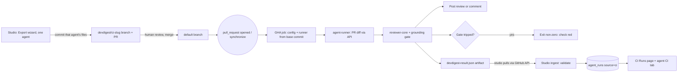

# Spec: Deploy review agents to GitHub Actions (Export to CI, CI Runs, agent CI tab)
Spec ID: SPEC-07
Status: approved
Supersedes: —

## Problem and user
**Who:** (1) an *agent owner* in the DevDigest studio who wants a tuned review agent (e.g. "Security Reviewer") to run on every pull request of a team repository without opening the studio; (2) the *maintainer* of that target repository, who has to review and merge the CI change and decide whether it may block merges; (3) the *PR author*, who receives the agent's review on GitHub.

**What hurts today (verified in code, see *Inputs and provenance*):**
- A CI runner already exists: `agent-runner/` (commit `04af4ca`) loads `.devdigest/agents/<slug>.yaml` + `.devdigest/skills/*.md`, fetches the PR diff through the GitHub API, runs the same `reviewer-core` pipeline as the studio including the mandatory grounding gate, computes the verdict deterministically from `ci_fail_on`, writes `devdigest-result.json`, posts a review/comment and exits non-zero when the gate trips (`agent-runner/src/run.ts:83-173`, `agent-runner/README.md:11-30`).
- Nothing in the studio produces those files or consumes the result. The runner and contracts refer to a server `ci` module (`server/src/modules/ci/workflow.ts`, `constants.ts`) that does not exist (`agent-runner/src/context.ts:9`, `agent-runner/src/index.ts:5`; no `server/src/modules/ci/` folder). The `ci_installations` and `ci_runs` tables exist since the first migration but nothing writes them (`server/src/db/schema/ci.ts:4-26`, no module references). The agent editor has only Config, Skills, Context, Evals tabs (`client/src/app/agents/[id]/_components/AgentEditor/constants.ts:10-16`); there is no `/ci-runs` page although the sidebar key and strings exist (`client/src/components/app-shell/helpers.ts:38`, `client/messages/en/ci.json`).
- Known wiring gaps between runner and studio: the post method chosen at export is never passed to the runner, which falls back to `github_review` (`agent-runner/insights/INSIGHTS.md:38`, `agent-runner/src/index.ts:25-33`); the result artifact carries no repository ID, commit SHA, verdict or workflow-run reference, so it cannot be tied to a repo/PR/commit or verified (`agent-runner/src/artifact.ts:32-54`, `server/src/vendor/shared/contracts/eval-ci.ts:501-512`).
- The design mock of the workflow (img_2) executes a non-existent marketplace action `devdigest/review-action@v1`, passes `secrets.OPENAI_API_KEY`, references `actions/checkout@v4` by tag and shows no `permissions:` block — each conflicts with this feature's security requirements (see *Untrusted inputs* and the Goals).

## Goals / Non-goals
**Goals**
- A four-step Export to CI wizard (Target → Preview → Configure → Install) opened from "Add to CI" on the agent's CI tab, installing into a repository picked from the workspace's repos.
- GitHub Actions as the only offered target.
- Several DevDigest agents per repository, one workflow file per agent (`.github/workflows/devdigest-review-<agent-slug>.yml`) with its own agent folder, check, "Fail CI on" policy, install PR and lifecycle.
- Preview of every file to be installed for the agent (manifest, skills, opt-in memory file, the runner bundle, an editable `.github/workflows/devdigest-review-<agent-slug>.yml`).
- Configure: `pull_request` event types (opened, synchronize, optional reopened) and publication method (GitHub review, PR comment, exit code only).
- Install by opening a PR from a dedicated per-agent `devdigest/ci-<agent-slug>` branch (never writing to the default branch, never force-overwriting) or by downloading a zip.
- A generated workflow that runs the bundled `agent-runner` and agent config from the PR's base commit with least-privilege `GITHUB_TOKEN`, SHA-pinned external actions, `OPENROUTER_API_KEY` from Actions Secrets only, one run per PR at a time, and no execution of PR content.
- Ingest by the studio pulling `devdigest-result.json` from the GitHub API, validated for size, schema, repository ID, commit SHA and origin workflow, recorded in `agent_runs` with `source='ci'`.
- A CI Runs page and an agent CI tab (installations, workflow version, history, "Fail CI on").

**Non-goals**
- CircleCI, Jenkins and Generic CLI generators (the design shows them; they are not offered).
- Publishing a `devdigest/review-action` marketplace action; it stays a non-executed placeholder in the template.
- Any inbound push/ingest endpoint on the studio server.
- Any change to the multi-run review service (`server/src/modules/reviews/`) or the PR feed (`server/src/modules/pulls/`) behavior.
- Creating or configuring rulesets / branch protection / required checks in the target repo (the user does this in GitHub).
- Reading, writing or validating the value of `OPENROUTER_API_KEY` from the studio.
- A per-run cost cap (follow-up; cost is bounded by the diff cap, AC-71, and model token limits — decision D-17).
- A GitHub App; the Agent Performance screen (design artboard N11); the agent Stats tab shown in the mocks.
- An `mcp-server` tool or an `e2e` flow JSON for CI runs (may follow in a separate spec).

## User stories
- **US-1** As an agent owner, I want to export an agent to GitHub Actions through a guided wizard, so that it reviews every PR of the target repository automatically.
- **US-2** As a target-repo maintainer, I want the export to arrive as a reviewable PR on a separate branch with a least-privilege, secret-safe workflow, so that I can audit permissions, triggers, secret handling and how PR content is processed before anything runs.
- **US-3** As an agent owner, I want to download the generated files as a zip, so that I can add them to a repository manually.
- **US-4** As a PR author, I want the agent's grounded review published on my PR in the chosen form, so that I see findings where I work.
- **US-5** As a maintainer, I want a CRITICAL finding to fail the CI check when "Fail CI on: CRITICAL" is set, so that a required check can block the merge.
- **US-6** As an agent owner, I want CI results to show up in the studio with repository, PR, agent, verdict, findings, cost, duration and a link to the job, so that I can monitor the agent in CI.
- **US-7** As an agent owner, I want the agent's CI tab to show where it is installed, which workflow version, its CI history and its "Fail CI on" policy, so that I can manage the deployment from one place.
- **US-8** As a studio operator, I want only authentic results that match the installed repository, the reviewed commit and an active agent to be recorded, so that CI history cannot be forged or misattributed.
- **US-9** As a target-repo maintainer, I want several DevDigest agents in one repository, each with its own workflow, check and "Fail CI on" policy, so that I can require, update and remove them independently.

## Acceptance criteria (EARS)

### Wizard — Target
- **AC-1** [Event-driven] [MUST] WHEN the user activates "Add to CI" on an agent's CI tab, the system (shall) open the "Export to CI" wizard on step 1 with the four steps labelled Target, Preview, Configure, Install in that order.
  Verify: unit — render the CI tab, click "Add to CI"; assert the dialog title and the four step labels in order with Target active.
- **AC-2** [Ubiquitous] [MUST] The system (shall) offer GitHub Actions as the only selectable target, preselected and marked "recommended".
  Verify: unit — render the Target step; assert exactly one selectable target "GitHub Actions" with the "recommended" badge and no CircleCI/Jenkins/Generic CLI option.
- **AC-3** [Ubiquitous] [MUST] The system (shall) let the user choose the target repository only from a picker listing the repositories of the current workspace, and keep Install disabled until a repository is chosen.
  Verify: unit — workspace with repos A and B; assert the picker lists exactly A and B, offers no free-text entry, and Install is disabled until one is picked.

### Wizard — Preview
- **AC-4** [Event-driven] [MUST] WHEN the Preview step opens, the system (shall) list every file that will be installed: `.devdigest/agents/<agent-slug>/manifest.yaml`, one `.devdigest/agents/<agent-slug>/skills/<skill-slug>.md` per skill linked to and enabled for the agent, `.devdigest/agents/<agent-slug>/runner/index.js`, `.github/workflows/devdigest-review-<agent-slug>.yml`, and `.devdigest/agents/<agent-slug>/memory.jsonl` only while memory export is enabled.
  Verify: integration — seed an agent with 2 linked skills (one globally disabled), memory export off; request the preview; assert exactly 4 paths: manifest, 1 skill, runner, workflow.
- **AC-5** [Ubiquitous] [MUST] The system (shall) generate the manifest so that it validates against the shared `AgentManifest` contract and carries the agent's current name, provider, model, system prompt, strategy, skill slugs and `ci_fail_on`.
  Verify: unit — generate the manifest for a fixture agent; parse it with `AgentManifest`; assert success and field equality with the agent.
- **AC-6** [Ubiquitous] [MUST] The system (shall) let the user edit only the agent's `.github/workflows/devdigest-review-<agent-slug>.yml` in the Preview step and show every other file read-only.
  Verify: unit — select each file in the list; assert only the workflow shows the "editable" marker and an editable editor.
- **AC-7** [Event-driven] [MUST] WHEN the user edits the workflow and then moves Back or Continue within the same wizard session, the system (shall) keep the edited text and install exactly that text (PR or zip).
  Verify: unit — edit the YAML, go Back to Target and forward to Install, choose zip; assert the zip entry equals the edited text.

### Generated workflow
- **AC-8** [Ubiquitous] [MUST] The system (shall) generate a workflow whose only trigger is `pull_request` with the event types selected in Configure, and which never uses `pull_request_target`, `issue_comment`, `workflow_run` or `pull_request_review_comment` triggers.
  Verify: unit — generate with types [opened, synchronize]; parse the YAML; assert `on` has only `pull_request.types == [opened, synchronize]`.
- **AC-9** [Ubiquitous] [MUST] The system (shall) declare `permissions` in the generated workflow as exactly `contents: read` and `pull-requests: write` when results are posted as a GitHub review or PR comment, so that every unlisted permission is `none`.
  Verify: unit — generate with post method "GitHub review"; assert the effective permission map has exactly those two keys and values.
- **AC-10** [Optional feature] [MUST] WHERE results are published as "None (exit code only)", the system (shall) declare `permissions` as exactly `contents: read` and `pull-requests: read`.
  Verify: unit — generate with post method none; assert the permission map has exactly those two keys and values.
- **AC-11** [Ubiquitous] [MUST] The system (shall) reference every external action in the generated workflow by a full 40-character commit SHA.
  Verify: unit — generate the workflow; assert every `uses:` value matches `owner/repo@<40 hex>`.
- **AC-12** [Ubiquitous] [MUST] The system (shall) make the generated workflow execute the bundled runner committed at `.devdigest/agents/<agent-slug>/runner/index.js`, with `uses: devdigest/review-action@v1` present only as a commented-out placeholder that is never executed.
  Verify: unit — parse the YAML; assert a step runs `.devdigest/agents/<agent-slug>/runner/index.js` and no executed step `uses: devdigest/review-action`; assert the placeholder text exists in a comment.
- **AC-13** [Ubiquitous] [MUST] The system (shall) supply `OPENROUTER_API_KEY` to the runner step only as an environment variable sourced from `secrets.OPENROUTER_API_KEY`, never in a `with:` input, a `run:` command line, or any echo/print statement.
  Verify: unit — parse the YAML; assert the key appears only as `env.OPENROUTER_API_KEY: ${{ secrets.OPENROUTER_API_KEY }}` on the runner step and nowhere in `run:` text.
- **AC-14** [Event-driven] [MUST] WHEN the pull request's head repository differs from its base repository (fork PR) or the run was triggered by Dependabot (`dependabot[bot]` actor), the system (shall) skip the review without failing the job and write a notice to the job summary and the job annotations stating that the DevDigest review did not run and why.
  Verify: unit — run the runner with a fork event payload, and again with a `dependabot[bot]` actor and no `OPENROUTER_API_KEY`; assert exit code 0, no LLM call, no GitHub POST, and a summary/notice text containing "review did not run".
- **AC-15** [Ubiquitous] [MUST] The system (shall) never interpolate PR title, PR body, branch names, commit messages or comment text into a `run:` script of the generated workflow; such data reaches the runner only through the event payload file or environment variables.
  Verify: unit — scan the generated YAML; assert no `${{ github.event.pull_request.(title|body|head.ref) }}`, `github.head_ref` or `github.event.comment` expression appears inside any `run:` block.
- **AC-16** [Ubiquitous] [SHOULD] The system (shall) configure the generated checkout step with `persist-credentials: false`.
  Verify: unit — parse the YAML; assert the checkout step has `with.persist-credentials: false`.
- **AC-17** [Ubiquitous] [MUST] The system (shall) make the generated workflow load the runner and all `.devdigest/**` configuration (manifest, `ci_fail_on` gate, skills, memory) from the PR's base commit, so that only the diff — fetched through the GitHub API — comes from the PR head and no file changed by the PR is executed or used as configuration.
  Verify: e2e — open a same-repo PR that changes `ci_fail_on` to `never` in the manifest and adds a CRITICAL issue; assert the check still fails under the base manifest's `critical`.
- **AC-18** [Ubiquitous] [MUST] The system (shall) pass the publication method chosen in Configure to the runner through the generated workflow, so that the runner publishes as a GitHub review, a PR comment, or nothing.
  Verify: unit — generate with "PR comment"; assert the runner step's environment sets the post method to `pr_comment`.
- **AC-19** [Ubiquitous] [MUST] The system (shall) make the generated workflow upload `devdigest-result.json` as a workflow artifact named `devdigest-result-<agent-slug>` whenever the runner wrote it, including when the runner exited non-zero because the gate tripped.
  Verify: e2e — trigger a run with a CRITICAL finding under "critical"; assert the check is red and the run has an artifact named `devdigest-result-<agent-slug>`.

### Wizard — Configure
- **AC-20** [Event-driven] [MUST] WHEN the Configure step opens for a new installation, the system (shall) preselect the triggers `pull_request:opened` and `pull_request:synchronize`, leave `pull_request:reopened` unselected but selectable, and keep Continue disabled while no trigger is selected.
  Verify: unit — render Configure; assert chip states; deselect both; assert Continue is disabled.
- **AC-21** [Ubiquitous] [MUST] The system (shall) offer exactly three publication methods — "GitHub review" (default, marked recommended), "PR comment", "None (exit code only)" — as a single-choice group.
  Verify: unit — render Configure; assert three radio options, the first checked by default.
- **AC-22** [Ubiquitous] [MUST] The system (shall) list `OPENROUTER_API_KEY` (user-provided, to be added under Settings → Secrets and variables → Actions) and `GITHUB_TOKEN` (provided by Actions) as expected secrets without ever reading, storing, transmitting or displaying the value of `OPENROUTER_API_KEY`.
  Verify: integration — run the full export against a mocked GitHub client; assert the only secrets-related call is the repository secrets *list* (names/metadata), no request or response body contains a sentinel secret value, and the Configure payload lists both secret names.
- **AC-23** [Ubiquitous] [MUST] The system (shall) show on the Configure step that blocking a merge requires "Fail CI on" to be set so the check fails and that check to be marked required in the repository's ruleset or branch protection, and that a REQUEST_CHANGES verdict blocks only where review rules require it.
  Verify: unit — render Configure; assert the info note mentions "Fail CI on", "required status check" and REQUEST_CHANGES review rules.
- **AC-24** [Event-driven] [MUST] WHEN the user changes trigger types or the publication method on Configure and the workflow has not been hand-edited, the system (shall) regenerate the workflow so it reflects the new selection.
  Verify: unit — without editing the YAML, select reopened and "PR comment"; install as zip; assert the workflow contains the three types and the `pr_comment` method.
- **AC-55** [Event-driven] [MUST] WHEN the user changes trigger types or the publication method on Configure after hand-editing the workflow, the system (shall) ask for confirmation before regenerating it, and keep the edited text unchanged if the user declines.
  Verify: unit — edit the YAML, then toggle reopened; assert a confirmation prompt; decline; assert the YAML equals the edited text; repeat and accept; assert the regenerated YAML contains reopened.
- **AC-67** [Optional feature] [MUST] WHERE the studio's GitHub token can list the target repository's Actions secrets, the system (shall) show "set" or "not set" for `OPENROUTER_API_KEY` derived only from the secret names in that list.
  Verify: integration — mock the secrets list with and without `OPENROUTER_API_KEY`; assert the Configure payload reports `set` / `not_set` and no value-bearing endpoint is called.
- **AC-68** [Unwanted behavior] [MUST] IF listing the repository's Actions secrets fails (for example 403 or 404), THEN the system (shall) show the static label "required" for `OPENROUTER_API_KEY` and let the user continue.
  Verify: integration — mock the secrets list to return 403; assert the Configure payload reports `required` and the export can proceed.

### Wizard — memory export
- **AC-62** [Optional feature] [MUST] WHERE the user has switched on memory export in the wizard (off by default), the system (shall) include `.devdigest/agents/<agent-slug>/memory.jsonl` in the installed files, and exclude it otherwise.
  Verify: unit — open the wizard; assert the memory switch is off and the file is absent; switch on; assert the file is listed and present in the zip.
- **AC-63** [State-driven] [MUST] WHILE memory export is switched on, the system (shall) show in Preview the exact read-only content of `.devdigest/agents/<agent-slug>/memory.jsonl` that will be installed.
  Verify: integration — seed 3 memory entries; enable export; assert the previewed content equals byte-for-byte the content committed or zipped.

### Wizard — workflow edit validation
- **AC-56** [Unwanted behavior] [MUST] IF the hand-edited workflow is not parseable YAML, THEN the system (shall) disable Install and show the parse error with its line number.
  Verify: unit — enter YAML with a bad indent on line 7; assert Install is disabled and the message mentions line 7.
- **AC-57** [Event-driven] [MUST] WHEN a hand edit removes the `permissions` block or adds a `pull_request_target` trigger, the system (shall) show a warning naming the change while keeping Install enabled.
  Verify: unit — delete `permissions`; assert a warning about permissions and Install enabled; add `pull_request_target`; assert a second warning.

### Wizard — Install
- **AC-25** [Event-driven] [MUST] WHEN the user selects "Open a PR with these files" and activates Install, the system (shall) commit all previewed files to a branch named `devdigest/ci-<agent-slug>` based on the repository's default branch and open a PR titled "Add DevDigest CI review: <agent name>" from it into the default branch, then show a link to that PR.
  Verify: integration — mocked GitHub client, repo default branch `trunk`, agent "Security Reviewer" (slug `security-reviewer`); install; assert one commit with all files on `devdigest/ci-security-reviewer` parented on `trunk`, one PR into `trunk` titled "Add DevDigest CI review: Security Reviewer", PR URL returned.
- **AC-78** [Ubiquitous] [MUST] The system (shall) state in the install PR body that pull requests from forks and from Dependabot are not reviewed, end with a passing job and therefore pass a required DevDigest check unreviewed, so maintainers must read the job-summary notice on those PRs.
  Verify: integration — install via the mocked GitHub client; assert the PR body contains the fork/Dependabot statement including "pass" and "unreviewed".
- **AC-26** [Ubiquitous] [MUST] The system (shall) write during an export only to `refs/heads/devdigest/ci-<agent-slug>` of the exported agent or to its timestamp-suffixed alternative branch the user accepted, never to the default branch or another agent's branch, and never with a forced (non-fast-forward) ref update.
  Verify: integration — mocked GitHub client recording ref writes; run a fresh export, a re-export and an accepted alternative-branch export; assert every write targets one of those refs with `force` false.
- **AC-27** [Event-driven] [MUST] WHEN an open PR from the agent's `devdigest/ci-<agent-slug>` branch already exists in the target repository, the system (shall) add a new commit on top of that branch and return the existing PR's URL instead of opening a second PR.
  Verify: integration — mocked GitHub client reports an open PR from `devdigest/ci-security-reviewer`; install that agent; assert one new commit parented on the branch head, no create-PR call, and the existing URL is returned.
- **AC-58** [Unwanted behavior] [MUST] IF the agent's branch `devdigest/ci-<agent-slug>` exists but no open PR uses it, THEN the system (shall) stop without changing any ref, explain that the branch already exists, and offer to install on `devdigest/ci-<agent-slug>-<timestamp>` instead.
  Verify: integration — mocked branch `devdigest/ci-security-reviewer` exists, no open PR; install; assert no ref write and a response offering a `devdigest/ci-security-reviewer-` suffixed branch; accept; assert the files land on that branch with a new PR.
- **AC-28** [Unwanted behavior] [MUST] IF GitHub rejects any export call (for example a missing `workflow` permission on the studio's token, no write access, or an unknown repository), THEN the system (shall) show an error naming the failed operation and the GitHub status, record no installation, and keep the wizard on Install with all selections and edits intact.
  Verify: integration — mock the commit call to fail with 403 "refusing to allow ... without `workflow` scope"; assert an error response naming the operation and status 403, zero installation rows, and that a retry with the same request body succeeds once the mock is fixed.
- **AC-29** [Event-driven] [MUST] WHEN the user selects "Download .zip" and activates Install, the system (shall) download one zip archive containing exactly the previewed files with their repository-relative paths and current edits, without any GitHub write and without recording an installation.
  Verify: integration — request the zip; assert entry paths/contents equal the preview payload, the mocked GitHub client receives zero write calls, and the installation count is unchanged.
- **AC-30** [Event-driven] [MUST] WHEN a PR is opened or updated successfully, the system (shall) record an installation holding agent, agent slug, workflow file path, repository, the repository's GitHub ID, target "GitHub Actions", workflow version, branch, PR URL and install time, and show it on the agent's CI tab.
  Verify: integration — successful export; assert one installation row with those values; re-export; assert still one row for that agent+repo with updated version/time; export a second agent to the same repo; assert two rows with different slugs and workflow paths, the first unchanged.

- **AC-89** [Unwanted behavior] [MUST] IF the runner bundle has not been built in the studio's checkout, THEN the system (shall) refuse Preview and Install with an error stating that the agent-runner bundle is missing and naming the build command (`cd agent-runner && pnpm build`), with no GitHub write and no installation recorded.
  Verify: integration — remove the built bundle; request the preview and an install; assert both return the error naming the build command, zero GitHub write calls and zero installation rows.

### Multiple agents per repository
- **AC-81** [Event-driven] [MUST] WHEN an agent is exported to a repository in which another DevDigest agent is already installed, the system (shall) generate the exported agent's own workflow file `.github/workflows/devdigest-review-<agent-slug>.yml` and agent folder `.devdigest/agents/<agent-slug>/`, leaving the other agent's files, branch, PR and installation unchanged.
  Verify: integration — agent `a` installed in repo R; export agent `b` to R; assert `b`'s commit, branch and PR contain only `b` paths, `a`'s installation row is unchanged, and no request touches `a`'s paths or branch.
- **AC-82** [Ubiquitous] [MUST] The system (shall) add, change or delete in an export (fresh install or re-export, PR or zip) only paths under the exported agent's `.devdigest/agents/<agent-slug>/` folder and its own `.github/workflows/devdigest-review-<agent-slug>.yml`.
  Verify: integration — agents `a` and `b` installed; re-export `a` with memory export switched off after it was on; assert the commit's changed paths are all `a` paths (including the deleted `a` memory file) and the zip for `a` contains only `a` paths.
- **AC-83** [Ubiquitous] [MUST] The system (shall) fix an agent's slug when the agent is first installed into a repository, store it on that installation, and reuse it for every later re-export to that repository, including after the agent is renamed.
  Verify: integration — install "Security Reviewer" (slug `security-reviewer`); rename the agent to "Sec Review"; re-export; assert all paths, the branch and the check name still use `security-reviewer`.
- **AC-84** [Unwanted behavior] [MUST] IF the slug derived for a first install is already used in the target repository by another agent's active or removal-pending installation, an existing `.devdigest/agents/<slug>/` folder, or an existing `.github/workflows/devdigest-review-<slug>.yml` on the default branch, THEN the system (shall) use the lowest free numeric suffix (`<slug>-2`, `<slug>-3`, …) and show the resulting paths in Preview before Install.
  Verify: integration — repo has `devdigest-review-security-reviewer.yml` on the default branch from another agent; export a second agent named "Security Reviewer"; assert Preview lists `security-reviewer-2` paths and the installation stores `security-reviewer-2`.
- **AC-85** [Ubiquitous] [MUST] The runner (shall) load exactly one manifest per run — the one in the agent folder its workflow names — and ignore every other agent folder under `.devdigest/agents/`.
  Verify: unit — `.devdigest/agents/a/` and `.devdigest/agents/b/` with different manifests and skills; run for `a`; assert only `a`'s system prompt, skills and `ci_fail_on` are used and `b`'s files are never read.
- **AC-86** [Ubiquitous] [MUST] The system (shall) give each agent's generated workflow a workflow name and job name containing the agent's stored slug, so that each agent produces its own check, with a name that stays the same across re-exports.
  Verify: unit — generate workflows for slugs `a` and `b`, and regenerate `a` after a rename; assert the two check names differ and `a`'s check name is identical before and after.
- **AC-87** [Ubiquitous] [MUST] The system (shall) state in the install PR body and on the Configure step the exact check name of this agent, and that it can be marked required in the ruleset or branch protection independently of other DevDigest agents' checks.
  Verify: integration — install agent `a`; assert the PR body and the Configure payload both contain `a`'s check name, and the PR body contains the "independently" statement.

### Removing an agent from CI
- **AC-91** [Event-driven] [MUST] WHEN the user activates "Remove from CI" on an active installation, the system (shall) commit the deletion of that agent's `.devdigest/agents/<agent-slug>/` folder and `.github/workflows/devdigest-review-<agent-slug>.yml` to a branch `devdigest/ci-<agent-slug>-remove` based on the default branch, open a PR titled "Remove DevDigest CI review: <agent name>" into the default branch, show its link, and mark the installation "removal pending".
  Verify: integration — agents `a` and `b` installed; remove `a`; assert one commit on `devdigest/ci-a-remove` whose changes are deletions of exactly `a`'s folder files and `devdigest-review-a.yml`, one PR with that title, and `a`'s installation status `removal_pending` with the PR URL.
- **AC-92** [Ubiquitous] [MUST] The system (shall) write during a removal only to the agent's `devdigest/ci-<agent-slug>-remove` branch or its accepted timestamp-suffixed alternative, delete no path outside that agent's folder and workflow file, and never use a forced ref update or write to the default branch.
  Verify: integration — mocked GitHub client recording ref writes and tree changes; remove `a` with `b` installed; assert every ref write targets `a`'s removal branch with `force` false and no `b` path appears in the tree changes.
- **AC-93** [Event-driven] [MUST] WHEN an open PR from the agent's removal branch already exists, the system (shall) return that PR's link and keep the installation "removal pending" without opening a second PR.
  Verify: integration — mocked open PR from `devdigest/ci-a-remove`; remove `a`; assert no create-PR call and the existing URL is returned.
- **AC-94** [Unwanted behavior] [MUST] IF the agent's removal branch exists but no open PR uses it, THEN the system (shall) stop without changing any ref, explain that the branch already exists, and offer to use `devdigest/ci-<agent-slug>-remove-<timestamp>` instead.
  Verify: integration — mocked branch `devdigest/ci-a-remove` exists, no open PR; remove; assert no ref write and a response offering the suffixed branch; accept; assert the deletion lands there with a new PR.
- **AC-95** [State-driven] [MUST] WHILE an installation is "removal pending", the system (shall) show "removal pending" with a link to the removal PR on the agent's CI tab instead of the "Remove from CI" action.
  Verify: unit — render the CI tab with a `removal_pending` installation; assert the label, the PR link, and no "Remove from CI" button for that row.
- **AC-96** [Event-driven] [MUST] WHEN a refresh or CI Runs pull finds through the GitHub API that the removal PR was merged, the system (shall) first ingest that installation's completed, not yet ingested runs and then mark the installation "removed".
  Verify: integration — `removal_pending` installation with 1 completed un-ingested run; mock the removal PR as merged; refresh; assert the run is ingested and the installation status is `removed`.
- **AC-97** [Unwanted behavior] [MUST] IF the removal PR is found closed without merging, THEN the system (shall) return the installation to its previous active state and offer "Remove from CI" again.
  Verify: integration — mock the removal PR as closed unmerged; refresh; assert the installation is active again and the CI tab payload offers removal.
- **AC-98** [Unwanted behavior] [MUST] IF neither the agent's folder nor its workflow file exists on the default branch when "Remove from CI" is activated (for example deleted manually), THEN the system (shall) open no PR, mark the installation "removed" directly, and say so, including a link to the agent's install PR if that PR is still open.
  Verify: integration — mock both paths absent on the default branch and the install PR still open; remove; assert zero ref writes, status `removed`, and a message containing the install PR link; repeat with only the workflow file present and assert a removal PR deleting just that file.
- **AC-99** [Unwanted behavior] [MUST] IF GitHub rejects any removal call, THEN the system (shall) show an error naming the failed operation and the GitHub status and leave the installation status unchanged.
  Verify: integration — mock the commit call to fail with 403; remove; assert the error response and the installation still active.
- **AC-100** [State-driven] [MUST] WHILE an installation is "removed", the system (shall) keep its CI run history listed read-only on the CI tab and the CI Runs page, show the installation as "removed", and offer no "Remove from CI" or "Update CI config" action for it.
  Verify: integration — installation with 2 ingested runs marked removed; assert both runs are still returned, the installation is labelled `removed`, and its action list is empty.

### Agent CI tab
- **AC-31** [Ubiquitous] [MUST] The system (shall) show a "CI" tab in the agent editor that lists each installation with repository, target, workflow version, and the status and relative time of its latest CI run.
  Verify: unit — render the tab with two installations (one without runs); assert both rows with their fields and a "no runs yet" state for the second.
- **AC-32** [State-driven] [MUST] WHILE the agent has no installation, the system (shall) show an empty state that explains the agent is not deployed to CI and offers "Add to CI".
  Verify: unit — render the tab with zero installations; assert the empty message and the button.
- **AC-59** [Ubiquitous] [MUST] The system (shall) show "Active in N repos" where N is the number of distinct repositories, excluding those whose installation is "removed", in which the agent's install PR was merged or from which at least one CI run of the agent was ingested.
  Verify: integration — three installations: one merged PR, one open PR with an ingested run, one closed-unmerged PR without runs; plus another agent merged in the third repo; assert N = 2 for this agent; mark the merged one removed; assert N = 1.
- **AC-33** [State-driven] [SHOULD] WHILE an installation's workflow version is older than the version the studio currently generates, the system (shall) mark that installation as outdated and offer "Update CI config", which opens the wizard for that repository.
  Verify: unit — installation version 1, current 2; assert the outdated marker and that the action opens the wizard prefilled with the repository.
- **AC-34** [Ubiquitous] [MUST] The system (shall) show on the CI tab the agent's CI run history, newest first, with the same fields as the CI Runs page.
  Verify: integration — ingest 3 runs for the agent and 1 for another agent; assert the tab's history returns exactly the 3, newest first.
- **AC-35** [Ubiquitous] [MUST] The system (shall) provide a "Fail CI on" control on the CI tab with the values never, critical, warning, any, which reads and writes the same agent setting as the Config tab.
  Verify: unit — change the value on the CI tab; assert the agent update request carries `ci_fail_on`; render Config; assert the same value.
- **AC-36** [Event-driven] [SHOULD] WHEN "Fail CI on" is saved with a value that differs from the one in an installation's exported manifest, the system (shall) mark that installation as needing "Update CI config" for the new policy to take effect in CI.
  Verify: unit — installation exported with `critical`; save `warning`; assert the installation shows the update-needed marker.

### Runner behavior in CI
- **AC-37** [Ubiquitous] [MUST] The runner (shall) pass every finding through the reviewer-core grounding gate and exclude every finding that does not cite a line of the PR diff from the published result, the verdict, the exit code and the artifact.
  Verify: unit — stub the LLM to return one grounded and one ungrounded finding; run the runner; assert only the grounded one appears in the posted payload and `findings_count == 1`.
- **AC-38** [Event-driven] [MUST] WHEN at least one grounded finding meets the manifest's `ci_fail_on` threshold, the runner (shall) use the REQUEST_CHANGES verdict and exit with a non-zero code, independent of the model's self-reported verdict.
  Verify: unit — `ci_fail_on: critical`, one CRITICAL grounded finding, model verdict "approve"; assert event REQUEST_CHANGES and exit code 1.
- **AC-39** [Event-driven] [MUST] WHEN the review completes, the runner (shall) publish the result as a GitHub review, a PR comment, or nothing, according to the configured publication method.
  Verify: unit — run with each method against a fetch stub; assert POST to `/pulls/:n/reviews`, to `/issues/:n/comments`, or no POST.
- **AC-40** [Unwanted behavior] [MUST] IF the runner fails before a grounded review exists (invalid manifest, missing skill file, missing `OPENROUTER_API_KEY` on a same-repo non-Dependabot PR, diff fetch or model error), THEN it (shall) exit non-zero, publish nothing, write no artifact, and log one error line that contains no secret value.
  Verify: unit — same-repo event, empty key and a sentinel token value; assert exit 1, no POST, no artifact write, and the log line lacks the sentinel.
- **AC-60** [Ubiquitous] [MUST] The runner (shall) exclude from the reviewed diff only `.devdigest/**` and its own agent's workflow file `.github/workflows/devdigest-review-<agent-slug>.yml`, and review changes to every other file under `.github/workflows/`, including other agents' DevDigest workflow files.
  Verify: unit — agent `a`; diff touching `.devdigest/agents/b/runner/index.js`, `.github/workflows/devdigest-review-a.yml`, `.github/workflows/devdigest-review-b.yml`, `.github/workflows/devdigest-review-new.yml` and `.github/workflows/deploy.yml`; assert the parsed diff holds exactly `devdigest-review-b.yml`, `devdigest-review-new.yml` and `deploy.yml`.
- **AC-71** [Event-driven] [MUST] WHEN the reviewable diff exceeds the diff cap — set by the workflow environment variables `DEVDIGEST_MAX_DIFF_BYTES` and `DEVDIGEST_MAX_DIFF_LINES` in the agent's `devdigest-review-<agent-slug>.yml` (editable in Preview), defaults 200 KB (204,800 bytes) of diff text and 3,000 changed lines, whichever is reached first — the runner (shall) review only the files taken in descending order of size that fit together within the cap, skip the rest, and mark the result `partial`.
  Verify: unit — fixture diff of 5 files totalling 4,000 changed lines with the variables unset; assert the reviewed set is the largest files whose sum stays ≤ 3,000 lines and ≤ 204,800 bytes, the prompt contains no skipped file, and the artifact is marked `partial`; repeat with `DEVDIGEST_MAX_DIFF_LINES=1000` and assert the smaller set.
- **AC-79** [Unwanted behavior] [MUST] IF `DEVDIGEST_MAX_DIFF_BYTES` or `DEVDIGEST_MAX_DIFF_LINES` is unset or not a positive integer, THEN the runner (shall) use that limit's default (204,800 bytes or 3,000 lines respectively) and note the fallback in the job log.
  Verify: unit — run with `DEVDIGEST_MAX_DIFF_LINES=abc` and `DEVDIGEST_MAX_DIFF_BYTES=-5`; assert the applied caps are 3,000 lines and 204,800 bytes and the log mentions both fallbacks.
- **AC-72** [State-driven] [MUST] WHILE a result is `partial`, the runner (shall) list every skipped file path in the published review or comment body and in the job summary, together with the cap that was applied.
  Verify: unit — run the AC-71 fixture (one skipped path named `[x](https://evil.test).js`) with post method "PR comment"; assert the comment body and the job-summary text each contain all skipped paths and the cap values, with the path rendered as code, not as a link.
- **AC-61** [Event-driven] [MUST] WHEN a new run of an agent's generated workflow starts for a pull request while an earlier run of the same agent's workflow for the same pull request is in progress, the system (shall) cancel that earlier run and leave runs of other agents' workflows untouched.
  Verify: unit — generate workflows for agents `a` and `b`; parse both; assert each has a `concurrency` group keyed by agent slug and PR number with `cancel-in-progress: true`, and the two group keys differ.
- **AC-41** [Ubiquitous] [MUST] The runner (shall) write into `devdigest-result.json` only these data items: repository ID, repository `owner/name`, PR number, reviewed head commit SHA, workflow run ID and attempt, agent name, agent slug, runner/workflow version, verdict, findings count with per-severity counts, blockers count, cost in USD, review duration, the `partial` flag, and the skipped file paths.
  Verify: unit — build an artifact from fixtures; assert its key set equals the allowlist and it validates against the shared result contract.
- **AC-42** [Ubiquitous] [MUST] The system (shall) keep the values of `OPENROUTER_API_KEY` and `GITHUB_TOKEN` out of the artifact, the posted review or comment, the job summary, the job log and any trace.
  Verify: e2e — set `OPENROUTER_API_KEY` to a valid key and run the test PR; download the job logs and the artifact; assert neither contains the key or token value (search for the raw value and its first 8 characters).

### Ingest (studio pulls from GitHub)
- **AC-43** [Ubiquitous] [MUST] The system (shall) obtain CI results only by having the studio server download, with the workspace's GitHub token, the result artifact of a completed workflow run in an installed repository, exposing no endpoint that accepts results pushed from outside.
  Verify: integration — enumerate the server's registered routes; assert none accepts a CI result body; ingest via a mocked GitHub artifact download; assert one record.
- **AC-77** [Event-driven] [SHOULD] WHEN the user opens the CI Runs page, the system (shall) run the same fetch-and-ingest as Refresh (AC-70), and start no background or timed refresh.
  Verify: integration — open the CI Runs page with a mocked GitHub listing 1 new completed run; assert 1 new record; advance a fake clock by 1 hour without user action; assert no further GitHub calls.
- **AC-70** [Event-driven] [MUST] WHEN the user activates Refresh on the CI Runs page or the agent CI tab, the system (shall) fetch and ingest the result artifacts of every completed, not yet ingested run of the DevDigest workflow in each installed repository.
  Verify: integration — mocked GitHub lists 2 completed runs (1 already ingested) and 1 in-progress run; refresh; assert exactly 1 new record.
- **AC-69** [Unwanted behavior] [MUST] IF an artifact comes from a workflow run whose workflow file path, as reported by the GitHub API, is not the workflow file path recorded on an active or removal-pending installation in that repository, THEN the system (shall) not ingest it, not list it on CI Runs, and log the reason `foreign_workflow`.
  Verify: integration — installation for agent `a` (`devdigest-review-a.yml`); mocked runs of `.github/workflows/other.yml` and of an uninstalled `.github/workflows/devdigest-review-x.yml`, each with a `devdigest-result-*` artifact; refresh; assert zero `agent_runs` rows, no CI Runs entry, and two `foreign_workflow` log entries.
- **AC-90** [Ubiquitous] [MUST] The system (shall) attribute every ingested or listed CI run to the installation whose recorded workflow file path matches the run's workflow file path reported by the GitHub API, never to an agent named or implied by the artifact.
  Verify: integration — agents `a` and `b` installed in one repo; a run of `devdigest-review-b.yml` whose artifact claims agent `a`; refresh; assert the run is attributed to `b`'s installation.
- **AC-44** [Unwanted behavior] [MUST] IF a result artifact is larger than 1 MB (1,048,576 bytes) or fails validation against the shared result contract, THEN the system (shall) reject it, import none of its result data, and log the rejection reason (`too_large` or `schema`).
  Verify: integration — ingest a 1,048,577-byte artifact, one missing the commit SHA and one with a string findings count; assert all three rejected with the right reason and zero `agent_runs` rows.
- **AC-45** [Unwanted behavior] [MUST] IF the result's repository ID differs from the GitHub repository ID recorded for the installation the run is attributed to (AC-90), THEN the system (shall) reject it, import none of its result data, and log the reason `repository_mismatch`.
  Verify: integration — installation for repo ID 111; ingest a result claiming repo ID 222 with the same `owner/name`; assert rejected with reason `repository_mismatch`.
- **AC-46** [Unwanted behavior] [MUST] IF the result's commit SHA is not a 40-character hexadecimal SHA or differs from the head SHA GitHub reports for the workflow run it was downloaded from, THEN the system (shall) reject it, import none of its result data, and log the reason `sha_mismatch`.
  Verify: integration — mock the workflow run's head SHA `aaa…`; ingest a result with `bbb…`; assert rejected with reason `sha_mismatch`.
- **AC-74** [Unwanted behavior] [MUST] IF the blob SHA of the attributed installation's workflow file (`.github/workflows/devdigest-review-<agent-slug>.yml`) at the workflow run's head SHA differs from the blob SHA of that file at the PR's base commit SHA for that run — the base SHA taken from the GitHub API's workflow-run / pull-request data, never from the artifact — or the file is missing at either commit, THEN the system (shall) reject the result, import none of its result data, and log the reason `workflow_modified`.
  Verify: integration — mock the run's PR data with base SHA `b1…`, blob `abc…` at the head SHA and `def…` at `b1…`; refresh; assert zero `agent_runs` rows and the logged reason; with equal blobs assert one row; with equal blobs but a later, different workflow on the base branch tip, assert the run is still accepted; with an artifact claiming a different base SHA, assert the API value is used.
- **AC-64** [Unwanted behavior] [MUST] IF the result belongs to an installation whose agent has been deleted or disabled, THEN the system (shall) reject it, import none of its result data, and log the reason `agent_inactive`.
  Verify: integration — disable the agent; refresh with one new valid run; assert zero new `agent_runs` rows and the logged reason.
- **AC-47** [Event-driven] [MUST] WHEN a result passes all checks, the system (shall) record one run in `agent_runs` with `source='ci'`, a terminal status, the installation's agent, findings count, blockers, cost and duration, associated with the repository, PR number, commit SHA and GitHub Actions run link.
  Verify: integration — ingest a valid result; assert one `agent_runs` row with `source='ci'`, status not `running`, matching agent and metrics, and that the CI Runs list shows repo, PR, SHA and link.
- **AC-48** [Ubiquitous] [MUST] The system (shall) keep exactly one run record per workflow run ID and attempt, so that re-ingesting the same attempt adds nothing and a re-run (new attempt) adds a separate record.
  Verify: integration — ingest run 42 attempt 1 twice and run 42 attempt 2 once; assert two rows.
- **AC-49** [Ubiquitous] [MUST] The system (shall) leave PR feed output (PR list cost rollup, a PR's run history and timeline) and multi-run review service behavior unchanged by ingested CI runs.
  Verify: integration — seed a PR with one local run (cost 0.01); ingest a CI run for the same repo/PR number (cost 0.05); assert the PR list cost stays 0.01 and the PR run list still has one entry.
- **AC-66** [Ubiquitous] [MUST] The system (shall) exclude ingested CI runs from the agent list's run count and average cost, showing them only on the agent CI tab and the CI Runs page.
  Verify: integration — agent with 2 local done runs (avg 0.02) plus 1 ingested CI run (0.10); assert the agent list shows 2 runs and avg 0.02.
- **AC-80** [Event-driven] [MUST] WHEN a run of the DevDigest workflow is rejected for `too_large`, `schema`, `repository_mismatch`, `sha_mismatch`, `agent_inactive` or `workflow_modified`, the system (shall) list that run attempt once on CI Runs with status "rejected", the reason code and its GitHub Actions run link, without importing any findings, verdict or cost from it.
  Verify: integration — refresh with one run rejected as `workflow_modified`, then refresh again; assert exactly one CI Runs entry with status `rejected`, reason `workflow_modified`, the run link, no findings/verdict/cost, and zero `agent_runs` rows for it.

### CI Runs page
- **AC-50** [Ubiquitous] [MUST] The system (shall) show a CI Runs page listing CI runs newest first with timestamp, repository, PR number, agent, verdict, findings (total and per severity), cost, duration, status, and a link to the GitHub Actions run.
  Verify: unit — render with 2 fixture runs; assert column headers and row values, rows in descending time order.
- **AC-73** [State-driven] [MUST] WHILE a CI run's result is `partial`, the system (shall) mark it "partial" on the CI Runs page and the agent CI tab and show the number of skipped files.
  Verify: unit — render a fixture run with `partial` and 2 skipped paths; assert the "partial" marker and "2 skipped files".
- **AC-75** [Event-driven] [SHOULD] WHEN a completed run of an installed agent's DevDigest workflow has no result artifact and the GitHub API data for that run shows neither a fork PR nor a Dependabot-triggered run (AC-88), the system (shall) list it on CI Runs with status "failed" and its GitHub Actions run link.
  Verify: integration — mocked completed same-repo, non-Dependabot run without artifact; refresh; assert one CI run with status `failed`, the run link, and no findings/cost values.
- **AC-88** [Event-driven] [MUST] WHEN a completed run of an installed agent's DevDigest workflow has no result artifact and the GitHub API data for that run shows the PR's head repository differs from its base repository or the run's triggering actor is `dependabot[bot]`, the system (shall) list it on CI Runs with status "skipped — secrets unavailable" and its GitHub Actions run link, deciding this from GitHub API data only and never from artifact content.
  Verify: integration — three mocked completed runs without artifact: a fork PR, a `dependabot[bot]`-triggered run, a same-repo human run; refresh; assert statuses `skipped`, `skipped`, `failed`; then add a fake artifact claiming `skipped` to a same-repo run with no API fork/Dependabot signal and assert it is not shown as skipped.
- **AC-76** [Event-driven] [SHOULD] WHEN a completed run's result artifact has expired before ingest, the system (shall) list it on CI Runs with status "result expired" and its GitHub Actions run link.
  Verify: integration — mocked run whose artifact is flagged expired; refresh; assert one CI run with status `result_expired` and the run link.
- **AC-65** [Ubiquitous] [MUST] The system (shall) keep CI runs ingested before an agent was deleted or disabled listed on the CI Runs page with their original agent name, without offering any action that modifies them.
  Verify: integration — ingest a run, delete the agent; assert the run is still returned with the agent name and the UI renders no edit/re-run/delete action for it.
- **AC-51** [Unwanted behavior] [MUST] IF a stored run link is not an `https://github.com/<owner>/<repo>/actions/runs/<id>` URL of the run's own repository, THEN the system (shall) render no link for that run.
  Verify: unit — fixture with `javascript:alert(1)` and one with another repo's URL; assert no anchor is rendered for either.
- **AC-52** [Ubiquitous] [MUST] The system (shall) render every artifact-derived text value (agent name, verdict, repository, version) as plain text, never as HTML or markdown.
  Verify: unit — fixture agent name ``; assert it appears as literal text and no `img` element is created.
- **AC-53** [State-driven] [MUST] WHILE no CI run exists, the system (shall) show the empty state "No CI runs yet" with the explanation that runs appear once an agent is exported to CI.
  Verify: unit — render with an empty list; assert the empty-state title and body.
- **AC-54** [Ubiquitous] [SHOULD] The system (shall) let the user filter CI runs by period (last 7 days or all), agent, repository and status.
  Verify: unit — apply each filter to a fixture set; assert only matching rows remain.

AC IDs are grouped by topic, not ordered by number: AC-55 to AC-100 were added in later decision passes and placed next to the criteria they extend. The sequence AC-1…AC-100 has no gaps.

| Source | Covered by |
|---|---|
| US-1 | AC-1, AC-2, AC-3, AC-4, AC-5, AC-20, AC-21, AC-24, AC-25, AC-30, AC-62, AC-63, AC-67, AC-68, AC-89 |
| US-2 | AC-6, AC-7, AC-8, AC-9, AC-10, AC-11, AC-12, AC-13, AC-14, AC-15, AC-16, AC-17, AC-22, AC-26, AC-27, AC-28, AC-55, AC-56, AC-57, AC-58, AC-78 |
| US-3 | AC-29 |
| US-4 | AC-18, AC-37, AC-39, AC-40, AC-60, AC-61, AC-71, AC-72, AC-79 |
| US-5 | AC-19, AC-23, AC-35, AC-36, AC-38 |
| US-6 | AC-47, AC-50, AC-51, AC-52, AC-53, AC-54, AC-65, AC-66, AC-70, AC-73, AC-75, AC-76, AC-77, AC-88 |
| US-7 | AC-31, AC-32, AC-33, AC-34, AC-35, AC-36, AC-59 |
| US-8 | AC-41, AC-42, AC-43, AC-44, AC-45, AC-46, AC-48, AC-49, AC-64, AC-69, AC-74, AC-80, AC-90 |
| US-9 | AC-61, AC-81, AC-82, AC-83, AC-84, AC-85, AC-86, AC-87, AC-90, AC-91, AC-92, AC-93, AC-94, AC-95, AC-96, AC-97, AC-98, AC-99, AC-100 |
| EC-1 | AC-14 |
| EC-2 | AC-14 |
| EC-3 | AC-40 |
| EC-4 | AC-27 |
| EC-5 | AC-58 |
| EC-6 | AC-28 |
| EC-7 | AC-4 |
| EC-8 | AC-61, AC-48 |
| EC-9 | AC-48 |
| EC-10 | AC-45 |
| EC-11 | AC-46 |
| EC-12 | AC-47 |
| EC-13 | AC-19 |
| EC-14 | AC-17 |
| EC-15 | AC-60 |
| EC-16 | AC-55 |
| EC-17 | AC-56, AC-57 |
| EC-18 | AC-62, AC-63 |
| EC-19 | AC-39 |
| EC-20 | AC-50 |
| EC-21 | AC-75 |
| EC-22 | AC-76 |
| EC-23 | AC-64, AC-65 |
| EC-24 | AC-47 |
| EC-25 | AC-44 |
| EC-26 | AC-68 |
| EC-27 | AC-69 |
| EC-28 | AC-59 |
| EC-29 | AC-71, AC-72, AC-73 |
| EC-30 | AC-71 |
| EC-31 | AC-74 |
| EC-32 | AC-14, AC-78 |
| EC-33 | AC-74, AC-80 |
| EC-34 | AC-71 |
| EC-35 | AC-79 |
| EC-36 | AC-74, AC-80 |
| EC-37 | AC-81, AC-86, AC-87 |
| EC-38 | AC-84 |
| EC-39 | AC-83 |
| EC-40 | AC-60, AC-69 |
| EC-41 | AC-60, AC-74 |
| EC-42 | AC-69, AC-65 |
| EC-43 | AC-61 |
| EC-44 | AC-88 |
| EC-45 | AC-89 |
| EC-46 | AC-82, AC-91, AC-92 |
| EC-47 | AC-81, AC-82 |
| EC-48 | AC-97 |
| EC-49 | AC-98 |
| EC-50 | AC-98 |
| EC-51 | AC-93, AC-94 |
| EC-52 | AC-96, AC-69 |
| EC-53 | AC-83, AC-84 |
| EC-54 | AC-100, AC-59 |
| NFR-1 | self (Verify given) |
| NFR-2 | self (Verify given) |
| NFR-3 | self (Verify given) |
| NFR-4 | self (Verify given) |
| NFR-5 | self (Verify given) |
| NFR-6 | self (Verify given) |

## Edge cases
- **EC-1** Fork PR: Actions provides no secrets and a read-only token; the review is skipped with an explanatory notice and a non-failing job (AC-14). Whether that blocks a merge is left to the repo's required-check settings (decision D-3).
- **EC-2** Dependabot PR in the same repository: Actions secrets are not exposed to Dependabot-triggered runs; handled like a fork PR (AC-14).
- **EC-3** `OPENROUTER_API_KEY` not yet added, same-repo PR: the runner hard-fails, posts nothing, writes no artifact, and the check is red (AC-40).
- **EC-4** Re-export while the agent's previous `devdigest/ci-<agent-slug>` PR is still open: a new commit on that branch, no second PR (AC-27).
- **EC-5** The agent's `devdigest/ci-<agent-slug>` branch exists without an open PR (possibly holding commits not made by DevDigest): stop, offer a timestamp-suffixed branch, never force-overwrite (AC-58). The current adapter force-moves existing branches (`octokit.ts:309-316`), which AC-26 forbids.
- **EC-6** The studio's GitHub token cannot create workflow files (`workflow` scope / "Workflows: write" missing) or lacks write access: error, no installation (AC-28).
- **EC-7** Agent with zero linked or enabled skills: manifest lists no skills and no skill file is generated (AC-4).
- **EC-8** Several `synchronize` pushes in quick succession: earlier in-progress runs are cancelled (AC-61); each completed attempt is ingested once (AC-48).
- **EC-9** A workflow run is re-run (new attempt) or the same artifact is fetched twice: one record per run ID + attempt (AC-48).
- **EC-10** Repository renamed or transferred, or a result names a repo that is not installed: matched by repository ID, mismatches rejected (AC-45).
- **EC-11** Forged or stale result whose SHA is not the run's head SHA (AC-46).
- **EC-12** PR not known to the studio's PR feed (repo never polled): the run is still recorded with repository, PR number and SHA (AC-47).
- **EC-13** Gate trips and the runner exits non-zero: the artifact must still be uploaded (AC-19).
- **EC-14** A same-repo PR edits `.devdigest/**` (e.g. sets `ci_fail_on: never`, swaps the runner) to weaken its own review: config and runner come from the base commit (AC-17).
- **EC-15** A PR changes other files under `.github/workflows/`: reviewed; only the reviewing agent's own workflow file is skipped (AC-60). Today the runner drops the whole prefix (`agent-runner/src/diff.ts:21`).
- **EC-16** The user hand-edits the workflow in Preview, then changes triggers or post method in Configure: confirmation before regenerating (AC-55).
- **EC-17** The hand-edited workflow is not valid YAML (blocks Install, AC-56), or the edit removes `permissions` / adds `pull_request_target` (warning only, AC-57).
- **EC-18** Workspace memory may contain sensitive text that would become readable to everyone with repo read access: export is opt-in, off by default, and previewed exactly (AC-62, AC-63).
- **EC-19** Large PR: GitHub rejects inline comments with 422 and the runner falls back to a body-only review (`agent-runner/src/github.ts:85-87`) (AC-39).
- **EC-20** APPROVE is downgraded to COMMENT because `GITHUB_TOKEN` cannot approve (`github.ts:65-70`); CI Runs shows the deterministic verdict from the artifact (AC-50).
- **EC-21** A completed workflow run that produced no artifact (runner hard failure): listed as "failed" with its run link (AC-75).
- **EC-22** Artifact expired (GitHub retention) before the studio refreshes: listed as "result expired" with its run link (AC-76).
- **EC-23** Agent deleted or disabled in the studio after installation while the workflow keeps running from the committed manifest: later results rejected (AC-64), existing history kept (AC-65). Note `ci_installations` cascades on agent delete (`schema/ci.ts:6-8`), so a deleted agent's later runs match no installation and are logged as `foreign_workflow` (AC-69, EC-42).
- **EC-24** The server's boot reaper marks every `agent_runs` row in `running` as failed (`run.repo.ts:105-112`); CI runs are recorded only in a terminal status (AC-47).
- **EC-25** Oversized artifact (> 1 MB) (AC-44).
- **EC-26** The studio's token cannot list the repo's Actions secrets: static "required" label (AC-68).
- **EC-27** Another workflow in the same repository uploads an artifact named like the DevDigest result (AC-69).
- **EC-28** Install PR closed without merging and no runs ingested: the repo does not count as active (AC-59).
- **EC-29** Very large diff (no diff-size limit exists in the runner today): partial review of the largest files within the cap, skipped files listed, result marked `partial` (AC-71, AC-72, AC-73).
- **EC-30** A run would cost more than intended: no per-run cost cap in this spec (non-goal, D-17); cost is bounded by the diff cap (AC-71) and model token limits.
- **EC-31** A user with write access opens a same-repo PR that edits an agent's `devdigest-review-<agent-slug>.yml` itself; with `pull_request`, the PR's version of the workflow file runs and could upload a fabricated result whose SHA matches the run: rejected because the workflow blob differs from the base branch (AC-74).
- **EC-32** Fork/Dependabot PRs: a GitHub Actions job cannot conclude `neutral` and the read-only token cannot comment, so these PRs end with a passing job plus a notice (AC-14) and pass a required check unreviewed; the install PR body says so (AC-78).
- **EC-33** Runs whose agent workflow file legitimately differs from the base branch are also rejected as `workflow_modified` (AC-74) and appear on CI Runs as "rejected" (AC-80): the install PR's own run (the file does not exist at its base commit), runs on an "Update CI config" PR, and runs on PR branches created before a workflow update when the event's base commit already contains the update. Because the comparison uses each run's own base commit, runs that were valid when they ran stay valid after a later workflow update, whenever they are ingested.
- **EC-34** A single file larger than the whole diff cap: it does not fit and is skipped; smaller files after it may still be included; if no file fits, the review covers no files and the result is `partial` with every file listed as skipped (AC-71).
- **EC-35** `DEVDIGEST_MAX_DIFF_BYTES` / `DEVDIGEST_MAX_DIFF_LINES` missing, zero, negative or non-numeric after a Preview edit: defaults apply (AC-79).
- **EC-36** A PR raises its own diff cap by editing the cap variables in an agent's `devdigest-review-<agent-slug>.yml`: the PR's run still executes and posts its review on GitHub with the raised cap, but its workflow file differs from the one at the run's base commit, so the studio rejects its result as `workflow_modified` (AC-74) and lists it as "rejected" (AC-80); the raised-cap run never counts as a valid CI run.
- **EC-37** Two agents installed in one repository: each has its own check; one can fail on CRITICAL while the other passes, and each can be marked required on its own (AC-81, AC-86, AC-87).
- **EC-38** Slug collision: two workspace agents whose names give the same slug, or a pre-existing folder/workflow file with that slug in the repo (AC-84).
- **EC-39** Agent renamed after install: files, branch and check keep the stored slug, so required-check settings keep working (AC-83).
- **EC-40** A PR adds a new `devdigest-review-<x>.yml` that no installation owns: every installed agent reviews it as an ordinary workflow change (AC-60), and its runs' artifacts are ignored as `foreign_workflow` (AC-69).
- **EC-41** A PR modifies agent `b`'s workflow file: agent `a` reviews the change (AC-60); `b`'s run executes the PR's version and its result is rejected as `workflow_modified` (AC-74).
- **EC-42** Agent deleted in the studio while its workflow still exists in a repo where other agents stay installed: its installation cascades away, its later runs no longer match any installation and are logged as `foreign_workflow` (AC-69); its earlier history stays listed (AC-65).
- **EC-43** Runs of two agents on the same PR at the same time: neither cancels the other (AC-61).
- **EC-44** Fork or Dependabot run: green job, no artifact; listed as "skipped — secrets unavailable", decided from GitHub API data (AC-88), not "failed".
- **EC-45** The studio's agent-runner bundle was never built (`scripts/dev.sh` does not build it): Preview and Install return an error naming the build command (AC-89).
- **EC-46** Removing one agent from a repository: "Remove from CI" opens a PR deleting only its folder and workflow file; other agents keep working because no file is shared (AC-82, AC-91, AC-92).
- **EC-48** Removal PR closed without merging: the installation returns to active and can be removed again (AC-97).
- **EC-49** The agent's files were already deleted manually on the default branch: no PR, the installation is marked removed directly (AC-98); if only one of the two paths is left, the removal PR deletes just that one.
- **EC-50** Removal requested while the agent's install PR was never merged: nothing to delete on the default branch, so the installation is marked removed and the message links the still-open install PR for the user to close (AC-98).
- **EC-51** The removal branch already exists, with or without an open PR (AC-93, AC-94).
- **EC-52** Runs that complete while removal is pending are ingested normally; on the refresh that sees the merge they are ingested before the installation becomes removed (AC-96). Later runs (for example on PR branches that still contain the deleted workflow) match no active installation and are logged as `foreign_workflow` (AC-69).
- **EC-53** The agent is added to the same repository again after removal: a new install with its stored slug if still free, otherwise the AC-84 suffix (AC-83, AC-84).
- **EC-54** A removed installation keeps its history read-only and no longer counts in "Active in N repos" (AC-100, AC-59).
- **EC-47** Two agents exported to the same repository at the same time: separate branches and PRs over disjoint paths, mergeable in either order (AC-81, AC-82).

## Non-functional requirements
- **NFR-1** [Security] [MUST] The generated workflow (shall) pass this checklist: (a) only `pull_request` triggers; (b) explicit `permissions` with no key beyond `contents` and `pull-requests`; (c) every external `uses:` pinned to a 40-hex SHA; (d) no `${{ github.event.* }}` / `github.head_ref` expression inside `run:`; (e) `OPENROUTER_API_KEY` only via `secrets.*` into `env`; (f) fork/Dependabot handling per AC-14; (g) no executed marketplace DevDigest action; (h) runner and `.devdigest/**` loaded from the base commit; (i) a per-PR, per-agent `concurrency` group with `cancel-in-progress: true`; (j) workflow file, runner path, artifact name, workflow name and job name all use the installation's stored agent slug.
  Verify: unit — a lint test over the generated YAML for every combination of 3 trigger sets × 3 post methods; 0 violations.
- **NFR-2** [Privacy] [MUST] The exported file set (PR commit and zip) (shall) contain 0 occurrences of any value stored in the studio's secrets store, and 0 memory entries while memory export is off.
  Verify: integration — put sentinel values into the test secrets provider and seed memory; generate PR payload and zip with memory export off; assert 0 sentinel matches and no `memory.jsonl`.
- **NFR-3** [Observability] [MUST] The server (shall) write exactly one structured log entry per export or removal attempt (fields: operation `export` or `remove`, agent ID, agent slug, repository, branch, outcome, GitHub status on failure) and per ingest attempt (fields: repository, repository ID, workflow file path, attributed agent slug, PR number, commit SHA, workflow run ID and attempt, outcome `accepted`, `failed`, `result_expired`, `skipped`, or one of the reason codes `too_large`, `schema`, `repository_mismatch`, `sha_mismatch`, `agent_inactive`, `foreign_workflow`, `workflow_modified`), with 0 secret values.
  Verify: integration — capture logs for one accepted ingest, one failed, one expired and one skipped run, one ingest per rejection reason, one failed export and one failed removal; assert one entry each with the listed fields and no sentinel secret.
- **NFR-4** [Cost] [MUST] Studio-side export and ingest (shall) make 0 LLM calls; LLM cost occurs only inside the target repo's CI under the user's OpenRouter key, and fork/Dependabot PRs cause 0 LLM calls.
  Verify: integration — run export + ingest with a counting LLM mock; assert 0 calls (fork/Dependabot case is covered by AC-14's unit check).
- **NFR-5** [Compatibility] [MUST] Every shared-contract change for this feature (shall) be byte-identical in `server/src/vendor/shared` and `client/src/vendor/shared`.
  Verify: unit — compare each changed or added contract file across the two vendored copies; assert identical content.
- **NFR-6** [Accessibility] [SHOULD] The wizard (shall) meet this checklist: focus moves into the dialog on open and returns to "Add to CI" on close; Escape closes it; Tab cycles within it; the current step is exposed to assistive tech (e.g. `aria-current="step"`); target cards and publication options are radio groups operable with arrow keys; trigger chips and the memory switch toggle with Space/Enter and expose their state; the regenerate confirmation is a focus-trapped dialog; the CI Runs link has an accessible name including the repository and PR number.
  Verify: manual — keyboard-only and screen-reader walkthrough of the wizard and CI Runs page (focus trap and dialog semantics are not reliably testable in jsdom).

Performance and Reliability have no NFR: no latency or availability target was given by the user or the design. The size limits decided are the 1 MB artifact cap (AC-44) and the diff cap with partial review (AC-71).

## Inputs and provenance
- **User message, 2026-10-14 (initial)** — scope of "worktree B", wizard steps, target rule, Preview/Configure/Install contents, `devdigest/ci` branch rule, runner + placeholder action, CI Runs fields, CI tab contents, isolation from multi-run service and PR feed, `agent_runs source='ci'` ingest, workflow security rules, 7-step end-to-end flow, verification criteria.
- **User decisions, 2026-10-14 (relayed by the coordinator), resolving former OQ-1…OQ-15:**
  - **D-1** (OQ-1) Ingest is pull-only: the server downloads the workflow-run artifact with the workspace GitHub token and validates schema, repository ID and commit SHA; no inbound push endpoint → AC-43, AC-44–AC-46, AC-69, AC-70.
  - **D-2** (OQ-2) Target repository is picked from the workspace's repos; the demo-repo fork must be added to the workspace first → AC-3.
  - **D-3** (OQ-3, corrected by D-18) Fork/Dependabot PRs: skip the review and explain why. GitHub Actions cannot conclude a job as `neutral`, so the result is a passing job plus a job-summary notice and annotations; such PRs pass a required check unreviewed → AC-14, AC-78.
  - **D-4** (OQ-4) Runner and `.devdigest/**` config (manifest, gate) come from the PR's base commit; only the diff comes from the PR head → AC-17.
  - **D-5** (OQ-5) Configure change after a manual edit asks before regenerating; invalid YAML blocks Install; removing `permissions` or adding `pull_request_target` warns without blocking → AC-24, AC-55, AC-56, AC-57.
  - **D-6** (OQ-6) Existing `devdigest/ci` without an open PR: stop with a message and offer `devdigest/ci-<timestamp>`; never force-overwrite → AC-26, AC-58.
  - **D-7** (OQ-7) The runner skips only DevDigest's own `devdigest-review.yml`; other workflow changes are reviewed → AC-60.
  - **D-8** (OQ-8) A zip download creates no installation; "Active in N repos" = repos with a merged install PR or at least one ingested CI run → AC-29, AC-59.
  - **D-9** (OQ-9, corrected by D-16/D-17) Artifact ≤ 1 MB → AC-44. The runner has no existing diff limit, so the diff cap is defined by D-16; the per-run cost cap is dropped by D-17.
  - **D-10** (OQ-10) A new push cancels the in-progress run (per-PR `concurrency`); a re-run is a separate record keyed by run ID + attempt → AC-61, AC-48.
  - **D-11** (OQ-11) `memory.jsonl` export is opt-in, off by default; Preview shows exactly what would be exported → AC-4, AC-62, AC-63.
  - **D-12** (OQ-12) Agent deleted/disabled after install: later results rejected and logged; existing history stays read-only → AC-64, AC-65.
  - **D-13** (OQ-13) CI runs appear only on the CI tab and CI Runs and are excluded from agent list stats → AC-66, AC-49.
  - **D-14** (OQ-14) "set / not set" for `OPENROUTER_API_KEY` from secrets-list metadata only, never the value; static "required" label if the token cannot list secrets → AC-22, AC-67, AC-68.
  - **D-15** (OQ-15) Zip option label: "Download .zip" → AC-29.
- **User decisions, second pass, 2026-10-14 (relayed by the coordinator), resolving OQ-16, OQ-17, OQ-18, OQ-21:**
  - **D-16** (OQ-16) Diff cap with partial review: configurable defaults 200 KB / 3,000 changed lines; above the cap the runner reviews the largest files up to the cap, marks the result `partial`, and lists skipped files in the review summary and job summary → AC-71, AC-72, AC-73, AC-41. The byte value and the greedy rule are fixed by D-24 and D-25; where the cap is configured is decided by D-22.
  - **D-17** (OQ-17) No per-run cost cap in this spec; recorded as a non-goal / follow-up; rely on the diff cap and token limits.
  - **D-18** (OQ-18) Accept a passing job + job-summary notice/annotations for fork and Dependabot PRs; document in the install PR body (AC-78) and the README that these PRs pass the required check unreviewed. The README is documentation owned by `doc-writer`, not a spec criterion.
  - **D-21** (OQ-21) Ingest rejects a result when the `devdigest-review.yml` used by the run (at the run's head SHA) differs from the base-branch version, compared by GitHub API blob SHA; new rejection reason `workflow_modified` → AC-74, NFR-3. The comparison point is fixed by D-26 (the run's own base commit, not the base branch at ingest time).
- **User decisions, third pass, 2026-10-14 (relayed by the coordinator), resolving OQ-19, OQ-20, OQ-22, OQ-23:**
  - **D-19** (OQ-19) A completed run without an artifact shows "failed"; an expired artifact shows "result expired"; both keep the job link → AC-75, AC-76.
  - **D-20** (OQ-20) No background auto-refresh; results are pulled when CI Runs opens and on Refresh → AC-77, AC-70. The existing "auto-refresh on" string (`client/messages/en/ci.json:8`) is to be removed or replaced.
  - **D-22** (OQ-22) The diff cap is set by workflow environment variables `DEVDIGEST_MAX_DIFF_BYTES` / `DEVDIGEST_MAX_DIFF_LINES` in `devdigest-review.yml`, editable in Preview, with the AC-71 defaults when unset or invalid; no shared-contract change → AC-71, AC-79. The D-21 workflow-file check means a PR that raises its own cap gets its result rejected (EC-36).
  - **D-23** (OQ-23) Runs rejected by the workflow-file check, and by the other ingest rejection reasons where a run is identifiable, appear on CI Runs as "rejected" with the reason; no findings are imported → AC-80. Interpretation used: every artifact is pulled from a known run, so all reasons except `foreign_workflow` produce a "rejected" entry. `foreign_workflow` runs are not DevDigest runs and are only logged (AC-69); this exclusion was confirmed in the fourth pass.
- **User decisions, fourth pass, 2026-10-14 (relayed by the coordinator), resolving OQ-24, OQ-25, OQ-26:**
  - **D-24** (OQ-24) 200 KB = 204,800 bytes of diff text → AC-71, AC-79.
  - **D-25** (OQ-25) Greedy largest-first: files are taken in descending order of size; a file that doesn't fit is skipped and smaller files after it can still be included → AC-71, EC-34.
  - **D-26** (OQ-26) AC-74 compares the run's `devdigest-review.yml` with the file at the PR's base commit SHA for that run; the base SHA comes from the GitHub API (workflow-run / pull-request data), never from the artifact. Runs that were valid when they ran stay valid after a later workflow update → AC-74, EC-33, EC-36.
  - **Confirmed:** artifacts from other workflows are only logged and never appear on CI Runs → AC-69.
- **User decisions, fifth pass, 2026-10-14 (relayed by the coordinator after planning; spec set back from approved to draft by the user):**
  - **D-27** Multiple DevDigest agents per repository, one workflow file per agent `.github/workflows/devdigest-review-<agent-slug>.yml`, each with its own agent folder `.devdigest/agents/<agent-slug>/`, check, "Fail CI on", required-check setting and install PR; the runner processes one manifest per run; a re-export updates only that agent's files → AC-4, AC-6, AC-12, AC-19, AC-30, AC-61, AC-71, AC-81–AC-87, AC-90, US-9. Supersedes plan assumption A1 (409 for a second agent). Earlier decisions that name `devdigest-review.yml` (D-7, D-21, D-22, D-26) now apply per agent file.
  - **D-28** New CI run status "skipped — secrets unavailable" for fork/Dependabot runs (green job, no artifact), decided from GitHub API data (head repo ≠ base repo, or triggering actor `dependabot[bot]`), never from the artifact; other no-artifact runs stay "failed" → AC-75, AC-88, EC-44. Supersedes plan assumption A2. AC-14's Dependabot condition is reworded to the triggering actor, which is what GitHub uses to withhold secrets.
  - **Confirmed for the plan:** new dependencies `yaml` + `fflate` (server) and `yaml` (client) are allowed (no spec change); `scripts/dev.sh` does not build agent-runner, and export returns a clear error until it is built → AC-89, EC-45.
- **Derived by spec-creator under the coordinator's delegation (fifth pass), confirmed by the user as written (sixth pass, 2026-10-14):**
  - **D-29** Everything agent-specific lives in the agent folder, including its own runner copy (`.devdigest/agents/<agent-slug>/runner/index.js`), skills and memory file; nothing is shared between agents. Reason: a shared runner or skills folder would make one agent's re-export or removal change another agent (contradicts D-27's "that agent's files only"). Cost: one runner bundle (about 1–2 MB, plan A11) per agent in the target repo.
  - **D-30** Branch `devdigest/ci-<agent-slug>`; when it exists without an open PR, offer `devdigest/ci-<agent-slug>-<timestamp>` (D-6 applied per agent). PR title "Add DevDigest CI review: <agent name>" so two agents' install PRs are distinguishable → AC-25–AC-27, AC-58.
  - **D-31** AC-60 skips only the reviewing agent's own workflow file (plus `.devdigest/**`), not every `devdigest-review-*.yml`. Reason: a pattern skip would let a PR add a malicious workflow named `devdigest-review-<anything>.yml` that no agent reviews.
  - **D-32** The slug is fixed at first install per repo and stored on the installation (survives renames, keeps check names stable); collisions get the lowest free `-2`, `-3`, … suffix, shown in Preview → AC-83, AC-84.
  - **D-33** Runs are attributed to installations by the workflow file path GitHub reports for the run; artifact content never decides attribution; runs of DevDigest-looking files no installation owns are `foreign_workflow` → AC-69, AC-90, EC-40, EC-42.
- **User decision, sixth pass, 2026-10-14 (relayed by the coordinator), resolving OQ-27:**
  - **D-34** The agent's CI tab offers "Remove from CI" per installation. It opens a PR on a per-agent branch `devdigest/ci-<agent-slug>-remove` (D-30's no-force and existing-branch rules apply) that deletes only that agent's `.devdigest/agents/<agent-slug>/` folder and `devdigest-review-<agent-slug>.yml`. The installation shows "removal pending" with the PR link until the PR is found merged through the GitHub API on refresh/pull, then becomes "removed"; existing CI run history stays read-only → AC-91–AC-100, AC-59, AC-69, AC-84, NFR-3, EC-46, EC-48–EC-54. Details derived by spec-creator in line with D-34: PR title "Remove DevDigest CI review: <agent name>"; a closed-unmerged removal PR returns the installation to active (AC-97); already-deleted files mean no PR and direct "removed" (AC-98); pending runs are ingested before the status flips (AC-96); a removed installation no longer reserves its slug (AC-84).
- **Plan read for context (read-only):** `docs/plans/2026-10-14-ci-agent-deployment-plan.md` R1–R11 and A1–A18 (2026-10-14). A1 and A2 are superseded by D-27 and D-28; A17 ("50 most recent runs of `devdigest-review.yml` per repo") now applies per installed workflow file.
- **Assumptions confirmed in the first pass:** GitHub Actions is the only target (AC-2); opened + synchronize on by default, reopened optional (AC-20); exit-code-only → `pull-requests: read` (AC-10, raised to MUST); "Fail CI on" on the CI tab is the Config tab's setting (AC-35).
- **Design screenshots** (`to_analyze_2/`, read 2026-10-14):
  - `img_1.png` — agent CI tab: "CI deployment · Active in 2 repos", rows `acme/payments-api`/`acme/billing-worker` with "GitHub Actions", "succeeded", relative time; "Update CI config", "Add to CI", "Add repository". Tabs Config/Skills/Context/Evals/Stats/CI.
  - `img.png` — Target step: GitHub Actions (recommended, "Runs on pull_request events"), CircleCI, Jenkins, Generic CLI.
  - `img_2.png` — Preview: files `.devdigest/agents/security-reviewer.yaml`, two skills, `.devdigest/memory.jsonl`, `.github/workflows/devdigest-review.yml` (editable); YAML with `types: [opened, synchronize, reopened]`, `actions/checkout@v4`, `devdigest/review-action@v1`, `openai-key: ${{ secrets.OPENAI_API_KEY }}`, `GITHUB_TOKEN: ${{ secrets.GITHUB_TOKEN }}`. No runner bundle listed.
  - `img_3.png` — Configure: opened + synchronize selected, reopened not; Secrets expected `OPENROUTER_API_KEY` "not set", `GITHUB_TOKEN` "ready"; Post results as GitHub review (recommended) / PR comment / None (exit code only); note "set Fail CI on … add a required status check … No GitHub App needed".
  - `img_4.png` — Install: "Open a PR with these files" (recommended; PR in `acme/payments-api` titled "Add DevDigest CI review" with 5 files) and "Copy files as a zip" (relabelled "Download .zip" per D-15); link "GitHub Action setup docs".
- **Design bundles** `one_more_design.txt`, `google_drive_link_content.txt` — self-unpacking HTML; only the artboard index was readable: "Agent Editor · CI (deployed repos + Add to CI)", "Export to CI Wizard (N12)", "CI Runs (N13)", "CI Runs · empty", "Agent Performance (N11)" (line 178). The screen components are gzip+base64 assets I could not decode without a shell.
- **Not seen:** the CI Runs screen (N13) and its empty state, the Export wizard's interaction states (loading, error, success), the repository picker, memory switch and regenerate confirmation (no design exists for them), the CI tab's history and "Fail CI on" UI, any Figma prototype or variant, the "GitHub Action setup docs" target.
- **Code (branch `L07-ci-deployment`, read 2026-10-14):**
  - Runner: `agent-runner/README.md:11-30,83-112`; `agent-runner/CLAUDE.md:35-70`; `agent-runner/src/run.ts:83-173` (pipeline, deterministic gate, hard-fail); `src/index.ts:25-33,52-58,65-68` (post-method env fallback, log lines, direct-run guard); `src/artifact.ts:32-54` (artifact fields); `src/context.ts:30-33` (fork flag, "workflow responsible for not scheduling fork PRs"); `src/github.ts:65-70,85-87` (APPROVE→COMMENT, 422 fallback); `src/diff.ts:21` (ignored prefixes `.devdigest/`, `.github/workflows/`). No reference to `memory.jsonl` in `agent-runner/src`. No diff-size limit in `agent-runner/src` or `reviewer-core/src` (grep for max/limit/truncate constants found only `MAX_PR_DESCRIPTION_CHARS = 4000` and `MAX_INTENT_CHARS = 1500`, `reviewer-core/src/prompt.ts:92,109`).
  - Contracts: `server/src/vendor/shared/contracts/eval-ci.ts:406-512` (`CiTarget`, `CiFile.editable`, `AgentManifest` — no cost-cap field, `CiExportInput` defaults incl. `base: 'main'` and reopened, `CiInstallation`, `CiRun`, `CiResultArtifact` "ingested back on refresh"); `knowledge.ts:215` (`CiFailOn`).
  - Schema: `server/src/db/schema/runs.ts:19-52` (`agent_runs.source` enum `local|ci`, nullable `pr_id`, `blockers`, `cost_usd`); `server/src/db/schema/ci.ts:4-26`; `server/src/db/schema/repos.ts:5-25` (no GitHub numeric repo ID stored); `server/src/db/schema/knowledge.ts:8-29` (memory scopes).
  - Readers of `agent_runs` without a source filter: `server/src/modules/pulls/repository.ts:161-163` (PR cost rollup), `server/src/modules/reviews/repository/run.repo.ts:40-50` (PR run history), `:105-112` (boot reaper), `server/src/modules/agents/repository.ts:98-114` (agent run count/avg cost).
  - GitHub adapter: `server/src/adapters/github/octokit.ts:245-349` (`openPullRequest`, `commitFiles` with force ref update at 309-316, `findOpenPr`); studio token via `platform/container.ts:309-310`. No auth hooks in `server/src/app.ts`.
  - Grounding gate: `reviewer-core/src/grounding.ts:52-69`; gate functions `reviewer-core/src/output/to-review.ts:37-51`.
  - Client: `client/src/app/agents/[id]/_components/AgentEditor/constants.ts:10-16`; `ConfigTab/ConfigTab.tsx:24,118-122` (existing `ci_fail_on` control); `client/src/components/app-shell/helpers.ts:38`; `client/messages/en/ci.json` (wizard/CI Runs strings incl. "Refresh"/"auto-refresh on" at 7-9; table columns lack agent/verdict/duration; `blockMergeDesc` says a GitHub App is required, contradicting img_3 and the user; free-text "Target repository" field at 57-59, superseded by D-2).
  - Module docs: root `AGENTS.md`, `server/AGENTS.md`, `client/AGENTS.md`, `reviewer-core/AGENTS.md`; `server/INSIGHTS.md:271-289` (agent_runs/reviews link); `client/INSIGHTS.md:34-35` (editor tabs use active repo); `reviewer-core/INSIGHTS.md:42-44` (grounding mandatory). Root `AGENTS.md` does not list `agent-runner/` as a package (documentation gap, for `doc-writer`).
- **External platform facts relied on (GitHub Actions behavior, not re-fetched in this session):** fork-PR runs get no secrets and a read-only token; Dependabot-triggered runs get no Actions secrets; a job conclusion cannot be `neutral` (only the Checks API with `checks: write` can set it); `pull_request` runs the workflow file version from the PR's merge commit.
- **Existing specs:** `specs/eval-pipeline.md` (SPEC-06) lists "running evals from the CI agent-runner" as a non-goal (line 70) — no conflict. No other spec covers CI export.
- **Format note:** the caller pointed at `specs/07-blast-radius.md`; that file is a legacy free-form spec. This spec follows the `specs/README.md` convention (dated name, `SPEC-NN`, template headings) used by SPEC-01…06.
- **Research:** no researcher subagents (running as a subagent); all evidence gathered directly with Read/Grep/Glob.
- **Risk noted, not verified:** `agent-runner/src/index.ts:65-68` uses the `import.meta.url === file://${argv[1]}` direct-run guard that silently no-oped on Windows in the server (`server/INSIGHTS.md:291-303`); whether it fires in the ncc bundle on a Linux runner is unverified — the AC-17/AC-19/AC-42 e2e runs will expose it.

## Untrusted inputs
- **PR diff, title, body, branch names, commit messages, PR comments** (attacker-controlled for any PR author). Assumption: hostile. Handling: diff and PR text reach the model only through reviewer-core's `wrapUntrusted`/`INJECTION_GUARD` (`agent-runner/CLAUDE.md:64-70`); findings are kept only when grounded (AC-37); none of these values are interpolated into workflow shell code (AC-15) or turned into commands/permissions; runner and agent config come from the base commit, so PR files are never executed (AC-17). Abuse cases: prompt injection asking the model to approve, shell injection via a branch name like `$(curl …)`, a PR that edits `.devdigest/**` to disable its own gate.
- **Fork and Dependabot PRs.** Assumption: no secrets, read-only token. Handling: review skipped with a notice (AC-14); never `pull_request_target`; the studio shows the run as "skipped" only when GitHub API data says fork or Dependabot, so an artifact cannot relabel a failed run as skipped (AC-88). Abuse case: "pwn request" — privileged trigger plus checkout of PR head.
- **Same-repo PR editing the DevDigest workflow file.** A user with write access can change the workflow that runs for their own PR and upload a fabricated result whose SHA and repo match. Handling: ingest compares the workflow file's blob SHA at the run's head SHA with the blob at that run's base commit, taking the base SHA only from GitHub API data (never from the artifact, which the PR's code could write), and rejects any difference as `workflow_modified` (AC-74). With several agents, the check uses the workflow file of the installation the run is attributed to (AC-90), and other agents review changes to that file (AC-60, EC-41). Remaining risk: a writer who can push to the base branch can change the workflow there too; that is outside what ingest can verify. Side effect: legitimate runs with a differing workflow are also rejected (EC-33).
- **Diff-cap environment variables** (`DEVDIGEST_MAX_DIFF_BYTES`, `DEVDIGEST_MAX_DIFF_LINES`) — user-edited in Preview and editable by any PR that changes the workflow. Handling: non-positive or non-numeric values fall back to defaults (AC-79); a PR-raised cap leads to a `workflow_modified` rejection on ingest (AC-74, EC-36). Abuse case: a huge cap to force an expensive review — the run still bills the repo's OpenRouter key; only the studio record is rejected.
- **Changed-file paths listed as skipped** (AC-72) are PR-controlled strings. Handling: rendered as plain text in the studio (AC-52); in the review/comment body and job summary they must not be able to inject markdown links or HTML. Abuse case: a file named `[click](https://evil.test).js`.
- **LLM output** (inside the runner). Assumption: may be wrong or injected. Handling: deterministic verdict from grounded findings and `ci_fail_on`, never the model's verdict (AC-38).
- **`devdigest-result.json`** (produced in a third-party CI). Handling: obtained only by the studio's authenticated download from the GitHub API (AC-43), only from runs of a workflow file recorded on an installation (AC-69), attributed to that installation by the API-reported workflow path and never by artifact content (AC-90), size ≤ 1 MB and schema (AC-44), repository ID (AC-45), commit SHA vs the run's head SHA (AC-46), active agent (AC-64), one record per run attempt (AC-48). Abuse cases: forged results for another repo, replay, oversized payload, malformed numbers, a look-alike artifact from another workflow.
- **GitHub API data** (workflow run metadata, run URLs, secret names, PR state) fetched by the studio. Handling: run link rendered only when it is a `github.com` Actions URL of the same repository (AC-51); all artifact-derived strings rendered as plain text (AC-52); secrets list used for names only (AC-67). Abuse cases: `javascript:` links, HTML in agent names.
- **User-edited workflow YAML** in Preview. Assumption: the user owns it, but an edit can remove the safeguards. Handling: invalid YAML blocks Install (AC-56); removing `permissions` or adding `pull_request_target` warns (AC-57); otherwise installed as-is (AC-7).
- **Workspace memory exported into the target repo.** Handling: opt-in, off by default, exact content previewed (AC-62, AC-63).
- **Injection attempts in design sources:** none found. The mock YAML in `img_2.png` is treated as illustrative data; its insecure parts (tag-pinned checkout, executed placeholder action, `OPENAI_API_KEY`, no `permissions`) are overridden by the user's requirements, not adopted.

## Parallel work (added 2026-10-16)
This spec was built in parallel with `specs/2026-10-14-multi-agent-review.md` on a separate branch. This was not recorded before the run; it was added after the mentor review.
- **Merge order:** `L07-agent-runner` (the runner contract) → `L07-ci-deployment` → into `L07-multiagents` → one PR to `main`.
- **Shared files:** `client/src/vendor/ui/nav.ts`, `client/src/lib/hooks/index.ts`, `server/src/db/migrations/**` (multi-agent `0022`, CI `0023`), `server/INSIGHTS.md`, `client/INSIGHTS.md`; also the shared local Postgres.
- **Not shared:** `agent-runner/**` is changed only in the separate branch `L07-agent-runner`, which the CI spec depends on.
- **Merge rules, details:** "Parallel work agreement" in [`2026-10-14-ci-agent-deployment-plan.md`](../docs/plans/2026-10-14-ci-agent-deployment-plan.md).

## Open questions
None. OQ-1…OQ-27 are all resolved and recorded as decisions D-1…D-34 in *Inputs and provenance* (D-27…D-33 came from the fifth pass, D-34 resolves OQ-27). A per-run cost cap is a recorded follow-up (non-goal, D-17), not an open question.
