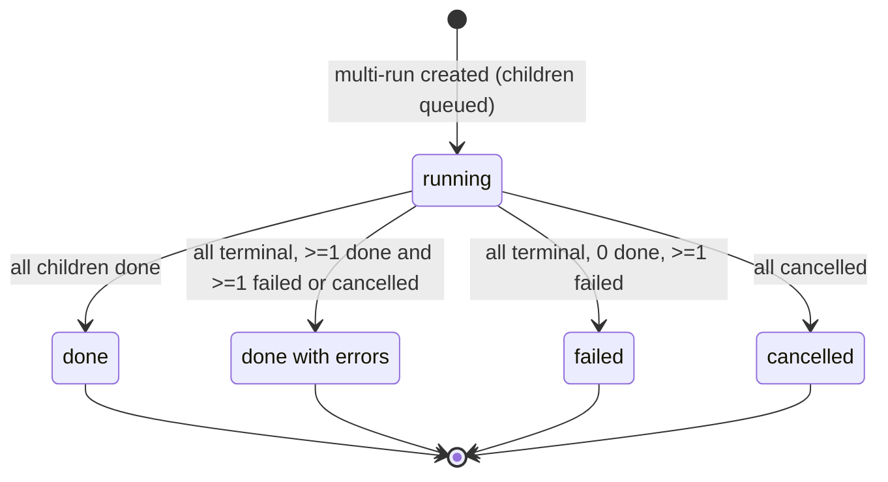

# Spec: Multi-Agent Review
Spec ID: SPEC-07
Status: approved
Supersedes: —

## Problem and user

**Who.** A developer or tech lead who reviews a pull request in DevDigest and wants several specialized
reviewer agents (security, performance, domain rules, mentoring, …) to look at the same PR.

**What hurts today.**
- A single PR can contain security risks, performance issues and domain-rule violations at the same
  time. Several specialized reviewers cover more ground, but only if the product removes duplicates,
  shows where agents disagree and makes cost visible *before* the run (user requirements, 2026-10-14).
- The PR page's "Run Review" menu can run "all enabled agents" or a checked subset, but each run is an
  isolated `agent_runs` row with no common parent. Nothing ties "the 4 agents I just ran together" into
  one result. The `multi_agent_runs` table exists, but no code writes or reads it, and `agent_runs` has
  no link to it (`server/src/db/schema/runs.ts:19-52`, `:79-88`).
- Results from several agents only appear as separate review accordions on the PR page. Nothing groups
  findings that refer to the same code location, so duplicates look like noise and disagreements stay
  invisible.
- No surface estimates cost or time before a run. The design's PR-page picker shows a hard-coded "~6s"
  per agent (design `0d4883bb…javascript:56`). Today's code shows the model name instead
  (`AgentSelectList.tsx:55-57`).
- Agents in one server-side batch run **sequentially**: `executeRuns` loads the diff and intent once,
  then awaits each agent in a `for` loop (`server/src/modules/reviews/run-executor.ts:153-180`). The PR
  page gets parallelism only by firing one HTTP request per agent (`RunReviewDropdown.tsx:53-63`). So
  the requirement's "parallel execution already exists" is only true on the client side.
- The run trace drawer (`RunTraceDrawer`) lives in the PR route's private `_components` folder
  (`client/src/app/repos/[repoId]/pulls/[number]/_components/RunTraceDrawer/`). Under the frontend
  architecture rule, another route may not import it (`.claude/skills/frontend-architecture/SKILL.md:26-28`,
  `:76-79`).

**What this feature delivers (worktree A).** An agent picker on the PR page, a "Configure run" screen
with pre-run time and cost estimates, a server-side multi-run that groups the individual agent runs, a
results page with **Columns** and **Tabs + detail** modes, a "Where agents disagree" section built on a
derived cross-agent grouping of findings, and the existing run trace drawer reused on the results page.

## Goals / Non-goals

**Goals**
- G1. Let the user pick a PR and a set of agents, see estimated time and cost from past runs, and start
  one multi-agent review (Configure run screen and PR-page picker).
- G2. Persist one parent multi-run per launch and link every child agent run to it. Children stay
  ordinary agent runs, so the PR page, cost roll-ups and traces keep working unchanged.
- G3. Run the selected agents concurrently (up to a tunable limit, default 4), with failures isolated
  per agent.
- G4. Group findings across agents by code location as a *derived view*. Persisted findings and their
  per-agent attribution are never altered (attribution is raw data for a later Per-Agent Stats homework).
- G5. Show disagreements per code location, including "did not flag", with a "Show only conflicts" toggle.
- G6. Show live per-agent status, cost and a "View trace" entry point that opens the same trace drawer
  as the PR page.

**Non-goals (explicitly out of scope)**
- `ci/` and `agent-runner/`: unchanged.
- The Compose Review drawer (it curates findings before publishing a review; it is unrelated to the
  pre-run cost estimate).
- Changes to `reviewer-core` prompts, including per-agent notes explaining a "did not flag" (decision D1).
  Listed as a future item.
- "Reply to author" (shown in the Tabs screenshot `to_analyze/img_1.png`).
- The *behavior* of "Learn". The button is rendered disabled as a hook for the Memory homework (D10).
- A multi-run history or list page (D7).
- New DB fields on agents for icon or color (D6).
- Changing `mcp-server` tools. Its `run_agent_on_pr` keeps calling the existing single-agent review route
  and does not create multi-runs.
- Per-Agent Stats or Agent Performance pages (they consume the attribution data later).

## User stories

- **US-1** As a reviewer, I want a "Configure run" screen where I pick a PR and tick the agents to run,
  so that I can launch a multi-agent review deliberately from one place.
- **US-2** As a reviewer on a PR page, I want a quick "Pick agents to run" picker, so that I can launch
  a multi-agent review without leaving the PR.
- **US-3** As a reviewer, I want time and cost estimates per agent and in total, based on past runs, so
  that I know what a run will cost before I spend LLM credits.
- **US-4** As a reviewer, I want all agents I launched together grouped under one multi-run, so that I
  can return to one results page for that launch.
- **US-5** As a reviewer, I want the selected agents to run in parallel, with one agent's failure not
  stopping the others, so that the wall-clock time is about that of the slowest agent.
- **US-6** As a reviewer, I want findings that several agents raised about the same code location shown
  as one group, while every original finding keeps its agent attribution, so that duplicates stop
  looking like noise and nothing is lost.
- **US-7** As a reviewer, I want a "Where agents disagree" section with each participating agent's
  verdict per code location (including "did not flag") and a "Show only conflicts" toggle, so that
  discrepancies are visible at a glance.
- **US-8** As a reviewer, I want a Columns view with one column per agent showing live status, score,
  duration and cost, so that I can watch parallel progress and compare results side by side.
- **US-9** As a reviewer, I want a Tabs + detail view with one tab per agent and full finding details
  (confidence, suggested fix, Accept / Dismiss / Turn into eval case, and a placeholder Learn), so that
  I can triage one agent's findings in depth.
- **US-10** As a reviewer, I want "View trace" on each agent to open the same trace drawer as the PR
  page (Live log while running, Trace afterwards), so that I can inspect any agent's run without
  learning a new UI.
- **US-11** As a reviewer, I want to cancel one agent or all agents of a running multi-run, so that I
  can stop spending credits on runs I no longer need.
- **US-12** As a reviewer on a PR page, I want a link to the latest multi-run for that PR, so that I can
  get back to its results.

## Acceptance criteria (EARS)

### Multi-run lifecycle (server)

- **AC-1** [Event-driven] [MUST] WHEN a client requests a multi-run for a PR in its workspace with a
  list of 1 or more agent ids, the system (shall) create one multi-run record linked to that PR, plus
  one agent run per distinct selected agent linked to that multi-run, and return the multi-run id and
  every child run id (with agent id and name) before any agent finishes.
  Verify: integration — POST a multi-run for 3 seeded agents with a delayed mock LLM; assert the
  response holds 1 multi-run id + 3 run ids while all 3 rows are still `running`, and each row
  references the multi-run.
- **AC-2** [Ubiquitous] [MUST] The system (shall) execute the child agent runs of one multi-run
  concurrently, so that, when the number of children does not exceed the concurrency limit (AC-18a),
  every child has started its agent-specific review before any child finishes.
  Verify: integration — 3 agents with a mock LLM that delays 1 s per call; assert the multi-run's wall
  time is < 2 s (not ≥ 3 s) and all 3 LLM calls overlapped in time.
- **AC-3** [Unwanted behavior] [MUST] IF one child agent run fails (provider error, timeout, invalid
  output), THEN the system (shall) mark only that child `failed` with its error text and let every
  other child run to completion.
  Verify: integration — mock LLM throws for agent B only; assert A and C end `done` with reviews
  persisted and B ends `failed` with a non-empty error.
- **AC-4** [Unwanted behavior] [MUST] IF the agent list is empty, or contains an id that does not exist
  in the caller's workspace, THEN the system (shall) reject the request with a 4xx error and create no
  multi-run and no agent runs.
  Verify: integration — POST with `[]` and with one foreign/unknown id; assert 4xx and unchanged
  `multi_agent_runs`/`agent_runs` row counts.
- **AC-5** [Unwanted behavior] [MUST] IF the PR does not exist in the caller's workspace, THEN the
  system (shall) return 404 and create no multi-run and no agent runs.
  Verify: integration — POST for a random PR id; assert 404 and unchanged row counts.
- **AC-6** [Ubiquitous] [MUST] The system (shall) start at most one child run per agent within one
  multi-run, even when the request lists the same agent id more than once.
  Verify: integration — POST `[A, A, B]`; assert exactly 2 child runs (A, B).
- **AC-7** [Event-driven] [MUST] WHEN a client requests a multi-run by id, the system (shall) return:
  the PR number and title; the multi-run start time; the aggregate status; and, per child run, the run
  id, agent id, agent name, provider, model, run status (`queued`/`running`/`done`/`failed`/`cancelled`),
  error text, verdict, score, summary, duration, cost and that run's persisted findings (id, severity,
  category, title, file, start and end line, confidence, rationale, suggestion, accepted/dismissed
  timestamps). Child runs (shall) be returned in the order the user selected the agents (AC-7a).
  Verify: integration — after a completed 2-agent multi-run, GET it; assert the payload validates
  against the shared contract and its findings equal those from the existing PR reviews read.
- **AC-7a** [Ubiquitous] [MUST] The system (shall) persist each child run's position in the selection
  order at multi-run creation, so that the column and tab order (selection order) is identical across
  page reloads and sessions. (Resolves OQ-19.)
  Verify: integration — POST agents `[C, A, B]`; GET the multi-run twice; assert children ordered
  C, A, B both times. Unit — Columns and Tabs render in payload order.
- **AC-8** [Unwanted behavior] [MUST] IF a requested multi-run id does not exist or belongs to another
  workspace, THEN the system (shall) return 404.
  Verify: integration — GET with an unknown id and with an id created under another workspace; assert 404.
- **AC-9** [State-driven] [MUST] WHILE at least one child run of a multi-run is `queued` or `running`,
  the system (shall) report the multi-run's aggregate status as `running`.
  Verify: unit — aggregate-status derivation over child statuses `[done, running]` → `running`.
- **AC-10** [Event-driven] [MUST] WHEN every child run of a multi-run has reached `done`, the system
  (shall) report the aggregate status as `done`.
  Verify: unit — `[done, done, done]` → `done`.
- **AC-11** [Event-driven] [MUST] WHEN every child run has reached a terminal status and at least one
  is `done` and at least one is `failed`, the system (shall) report the aggregate status as
  `done with errors` (partial).
  Verify: unit — `[done, failed]` → partial. Integration: AC-3's scenario ends partial.
- **AC-11a** [Event-driven] [MUST] WHEN every child run has reached a terminal status, the system
  (shall) derive the remaining aggregate statuses as follows: at least one `done` plus at least one
  `cancelled` (with or without `failed`) → `done with errors`; no `done` and at least one `failed` →
  `failed`; every child `cancelled` → `cancelled`. (Resolves OQ-1.)
  Verify: unit — `[done, cancelled]` → partial; `[failed, failed]` → `failed`; `[failed, cancelled]` →
  `failed`; `[cancelled, cancelled]` → `cancelled`.
- **AC-12** [Event-driven] [MUST] WHEN a multi-run total is computed, the system (shall) report total
  duration as the maximum child duration and total cost as the sum of non-null child costs.
  Verify: unit — children (8.2 s, $0.06), (7.4 s, $0.05), (failed, null) → 8.2 s, $0.11.
- **AC-13** [Ubiquitous] [MUST] The system (shall) keep every child run an ordinary agent run: it
  appears in the PR's run history, its review appears in the PR's review list attributed to its agent,
  and its cost counts in the PR list's cost roll-up exactly as a single-agent run does.
  Verify: integration — after a 2-agent multi-run, GET `/pulls/:id/runs` and `/pulls/:id/reviews`;
  assert both child runs and reviews are present with their agent ids.
- **AC-14** [Ubiquitous] [MUST] The system (shall) compute cross-agent grouping and disagreement
  without creating, updating, merging or deleting any persisted finding or changing its agent
  attribution.
  Verify: integration — snapshot the findings rows (ids, fields, review → agent) before and after
  reading a multi-run's grouping twice; assert they are identical.
- **AC-15** [Event-driven] [MUST] WHEN a client requests the latest multi-run for a PR, the system
  (shall) return the most recent multi-run of that PR by start time, or an explicit "none" result when
  the PR has no multi-run.
  Verify: integration — create 2 multi-runs for PR X; assert the second is returned; assert "none"
  for PR Y.
- **AC-16** [Event-driven] [MUST] WHEN "Cancel all" is requested for a multi-run, the system (shall)
  move every child still `queued` or `running` to `cancelled` and leave children already in a terminal
  status unchanged.
  Verify: integration — 3 children (one already `done`, two slow); cancel all; assert two `cancelled`,
  one still `done`.
- **AC-17** [Event-driven] [MUST] WHEN a single child run is cancelled through the existing run-cancel
  action, the system (shall) cancel only that child and let the other children continue.
  Verify: integration — cancel child B mid-run; assert B `cancelled`, A and C reach `done`.
- **AC-18** [Unwanted behavior] [MUST] IF the server restarts while a multi-run's children are
  running, THEN the system (shall) report the multi-run with a terminal aggregate status after boot
  (not `running` indefinitely), consistent with the existing reaping of orphaned runs.
  Verify: integration — insert a multi-run whose children are `running`, invoke the boot reaper; assert
  the children are `failed` and the aggregate status is terminal.
- **AC-18a** [State-driven] [MUST] WHILE a multi-run has more pending children than the configured
  concurrency limit (default 4, a single named, tunable value), the system (shall) run at most that many
  children at the same time and keep the rest observable as `queued` until a slot frees. There is no
  limit on how many agents may be selected. (Resolves OQ-15.)
  Verify: integration — 6 agents, limit 4, mock LLM with 1 s delay; assert at most 4 LLM calls overlap,
  2 children are reported `queued` at t≈0, and all 6 end `done`. Unit — the limit defaults to 4.
- **AC-18b** [Ubiquitous] [MUST] The existing single-review route (`all: true`, used by `mcp-server`
  and the legacy "Run all") (shall) keep its current sequential execution; only multi-run children run
  concurrently. (Resolves OQ-18.)
  Verify: integration — the existing `reviews.it` suite passes unchanged (see NFR-2).

### Estimates

- **AC-19** [Event-driven] [MUST] WHEN estimates are requested for the workspace's agents, the system
  (shall) return per agent the median duration and the median cost of that agent's most recent 10 runs
  with status `done`, `source = 'local'` and the agent's current model, across all PRs in the
  workspace (ordered by run time, newest first). The cost median (shall) be taken over those runs with a
  non-null cost only; with none, the cost estimate is unknown ("—") while the duration estimate stands.
  (Resolves OQ-7.)
  Verify: unit — 12 done local runs + 3 failed runs + 2 CI runs + 2 runs on an older model for one
  agent; assert medians use only the newest 10 done local current-model runs. A set with 2 null costs
  out of 5 → cost median over the 3 priced runs.
- **AC-20** [Event-driven] [MUST] WHEN an agent has between 1 and 9 runs with status `done`, the system
  (shall) compute its medians over the runs available.
  Verify: unit — durations [4 s, 6 s, 9 s] → median 6 s.
- **AC-21** [Unwanted behavior] [MUST] IF an agent has no run with status `done`, THEN the system
  (shall) return no estimate for that agent, so that the UI displays "—" in place of its time and cost.
  Verify: unit — agent with zero done runs → null estimate; component test renders "—".
- **AC-22** [Event-driven] [MUST] WHEN one or more agents are selected on the Configure run screen,
  the system (shall) show the total estimate as "≈ Xs · $Y · parallel fan-out", where X is the maximum
  and Y the sum of the selected agents' estimates.
  Verify: unit — selected estimates (8.2 s, $0.06) and (7.4 s, $0.05) → "≈ 8.2s · $0.11 · parallel fan-out".
- **AC-23** [Unwanted behavior] [MUST] IF any selected agent has no estimate, THEN the system (shall)
  exclude it from the totals and show a visible note stating how many selected agents have no run
  history and are excluded from the estimate.
  Verify: unit — 2 selected, 1 without history → totals equal the other agent's estimate and the note
  shows count 1.
- **AC-24** [Ubiquitous] [MUST] The PR-page agent picker (shall) show each agent's real estimated
  duration from AC-19 (or "—" per AC-21) instead of a fixed value.
  Verify: unit — picker with mocked estimates renders "6.9s" for an agent with that median and "—"
  for one without.

### Configure run screen (`/multi-agent-review`)

- **AC-25** [Event-driven] [MUST] WHEN the user opens `/multi-agent-review`, the system (shall) show
  the heading "Run a Multi-Agent Review", step 1 "Pull request" with a dropdown (placeholder
  "Select a pull request…") that lists the active repository's PRs as "#N · title", excluding PRs with
  status `stale`.
  Verify: unit — page with mocked PRs (one `stale`); assert the dropdown lists the others only, in
  "#N · title" form.
- **AC-26** [Optional feature] [SHOULD] WHERE the page URL carries a PR preselection query parameter
  that matches a listable PR, the system (shall) open with that PR already selected in step 1.
  Verify: unit — render with the preselect param for PR #482; assert step 1 shows "#482 · …" and
  step 2 is active. With an unknown or `stale` PR, assert no PR is preselected.
- **AC-27** [State-driven] [MUST] WHILE no PR is selected, the system (shall) show step 2 "Agents to
  run" as an empty state titled "Pick a pull request first" with the body "Choose which PR to review
  above, then select the agents to run on it.", and a disabled run button labelled "Select agents".
  Verify: unit — render with no PR; assert the empty state copy and the disabled "Select agents" button.
- **AC-28** [Event-driven] [MUST] WHEN a PR is selected, the system (shall) list only the workspace's
  enabled agents as checkable cards, each showing the agent's deterministic color and generic icon, its
  name, its description, and its estimate as "X.Xs · $Y.YY" (or "—"). (Resolves OQ-8.)
  Verify: unit — 3 agents (2 enabled); select a PR; assert exactly 2 checkable cards with name and
  estimate text and no card for the disabled agent.
- **AC-29** [Event-driven] [MUST] WHEN the user activates the Configure screen's select-all control,
  the system (shall) toggle between selecting every listed agent (control labelled "Select all") and
  deselecting every agent (control labelled "Clear all" while all are selected).
  Verify: unit — click Select all → all checked, label "Clear all"; click again → none checked.
- **AC-30** [State-driven] [MUST] WHILE a PR is selected, the system (shall) label the run button
  "Run multi-agent review (N)" when N ≥ 2 agents are selected, "Run 1 agent" when exactly 1 is selected,
  and "Select agents" (disabled) when none are.
  Verify: unit — toggle 0/1/3 agents; assert the three labels and the disabled state at 0.
- **AC-31** [Event-driven] [MUST] WHEN the user activates the run button with ≥ 1 agent selected, the
  system (shall) create a multi-run with exactly the selected agents for the selected PR and navigate to
  `/multi-agent-review/<multiRunId>`.
  Verify: unit — mock the create mutation; click Run with 1 and with 3 agents; assert the payload's agent
  ids and the router push to the results URL.
- **AC-32** [Unwanted behavior] [MUST] IF creating the multi-run fails, THEN the system (shall) show
  an error message, stay on the Configure run screen with the PR and agent selection unchanged, and not
  navigate.
  Verify: unit — mutation rejects with ApiError; assert the error is surfaced, the selection persists and
  there is no router push.
- **AC-33** [State-driven] [MUST] WHILE a multi-run creation request is pending, the system (shall)
  keep the run button disabled, so that a second click creates no second multi-run.
  Verify: unit — pending mutation; double-click Run; assert mutate called once.
- **AC-33a** [Unwanted behavior] [MUST] IF the Configure run screen has no active repository, the
  repository has no listable PRs, or the workspace has no enabled agents, THEN the system (shall) show,
  respectively: "Connect a repository first" with a "Go to repositories" action; "No open pull requests
  to review"; "Enable agents to run reviews" with a "Go to Agents" action (reusing the existing
  `runs.json` string). (Resolves OQ-9.)
  Verify: unit — render each of the three conditions; assert the copy and, where given, the action's
  navigation target.
- **AC-33b** [Ubiquitous] [MUST] The app sidebar (shall) contain a "Multi-Agent Review" entry under
  GLOBAL that navigates to `/multi-agent-review` and is marked active on both `/multi-agent-review` and
  `/multi-agent-review/:multiRunId`. (Resolves OQ-13; a deliberate edit to the vendored `nav.ts`.)
  Verify: unit — render the sidebar; assert the entry, its href and its active state on both routes.

### PR-page agent picker

- **AC-34** [Event-driven] [MUST] WHEN the user opens the PR page's "Run Review" menu, the system
  (shall) show a "Pick agents to run" list with one checkbox row per enabled agent (generic icon, name,
  estimate), all preselected. Disabled agents (shall) not be listed. (Resolves OQ-8.)
  Verify: unit — 3 agents (2 enabled); open the menu; assert the header text, exactly 2 rows, both
  checked, and no row for the disabled agent.
- **AC-35** [Event-driven] [MUST] WHEN the user activates the picker's select-all control, the system
  (shall) toggle between selecting every listed agent (control labelled "Select all") and deselecting
  all (control labelled "Clear" while all are selected).
  Verify: unit — click Select all / Clear; assert checked states and labels.
- **AC-36** [State-driven] [MUST] WHILE the picker is open, the system (shall) label its run button
  "Select an agent" (disabled) for 0 selected, "Run <agent name>" for 1, and "Run multi-agent review (N)"
  for N ≥ 2.
  Verify: unit — toggle selections; assert the three labels and the disabled state.
- **AC-37** [Event-driven] [MUST] WHEN the user activates the picker's run button, the system (shall)
  create a multi-run with the selected agents for this PR (also for a single agent) and navigate to that
  multi-run's results page.
  Verify: unit — mock the mutation; select 1 agent, run; assert one create call with that agent and a
  push to `/multi-agent-review/<id>`.
- **AC-38** [Event-driven] [SHOULD] WHEN the user activates "Configure agents…" in the picker, the
  system (shall) navigate to `/agents`.
  Verify: unit — click; assert the router push to `/agents`.
- **AC-39** [State-driven] [SHOULD] WHILE the PR is merged or closed, the system (shall) keep showing
  the existing merged/closed warning in the picker and still allow the run.
  Verify: unit — `warnMerged` true; assert the warning row is present and the run button is enabled.
- **AC-40** [State-driven] [MUST] WHILE the PR has at least one multi-run, the PR page (shall) show a
  secondary button labelled "Multi-agent results" in the PR header next to "Run Review", linking to its
  latest multi-run's results page, with a status dot while that multi-run is `running`; and show no such
  button otherwise. (Resolves OQ-14.)
  Verify: unit — mock "latest multi-run" as present (running / done) / "none"; assert the button label,
  href and status dot, or its absence.

### Results page (`/multi-agent-review/:multiRunId`) — shared chrome

- **AC-41** [Event-driven] [MUST] WHEN the results page loads a multi-run, the system (shall) show a
  "Configure run" button, the title "Multi-Agent Review", the text "N selected agents · parallel" and a
  "Columns | Tabs" view toggle, with Columns as the initial view.
  Verify: unit — render with a 4-agent fixture; assert the texts, the toggle and the Columns view.
- **AC-42** [Event-driven] [MUST] WHEN the user activates "Configure run" on the results page, the
  system (shall) navigate to the Configure run screen with this multi-run's PR preselected.
  Verify: unit — click; assert the push to `/multi-agent-review` carrying the PR preselection param.
- **AC-43** [Ubiquitous] [MUST] The results page (shall) show a meta row
  "#N title · N agents · parallel fan-out · Xs total · $Y", with X and Y per AC-12. (Resolves OQ-16:
  the design's "fan-out via worktrees" is replaced because runs use no git worktrees.)
  Verify: unit — fixture (8.2 s, $0.06), (7.4 s, $0.05) → "… 2 agents · parallel fan-out · 8.2s total · $0.11".
- **AC-44** [Ubiquitous] [MUST] The system (shall) give each agent a color picked deterministically
  from a fixed palette by agent id, plus a generic agent icon. The same agent gets the same color on the
  Configure run screen, in Columns, in Tabs and across page reloads.
  Verify: unit — the color function returns the same palette entry for the same id across calls and a
  palette member for 50 random ids.
- **AC-45** [State-driven] [MUST] WHILE any child run is `queued` or `running`, the results page
  (shall) refresh child statuses so that a status change is visible within ≤ 5 s without a page reload.
  Verify: unit — a hook test with fake timers; assert a refetch happens within 5 s while a child is
  running and stops once all are terminal.
- **AC-46** [Unwanted behavior] [MUST] IF the multi-run id is unknown or not accessible, THEN the
  results page (shall) show an error state with a "Configure run" action instead of the results.
  Verify: unit — query rejects with 404; assert the error state and the action.
- **AC-47** [Unwanted behavior] [SHOULD] IF the multi-run has no remaining child runs (all were
  deleted from the PR's run history), THEN the results page (shall) show the "No agents selected" empty
  state ("Pick at least one agent to fan out this review. Configure the run to choose agents.") with a
  "Configure run" call to action.
  Verify: unit — multi-run fixture with 0 children; assert the empty-state copy and CTA.

### Results page — Columns view

- **AC-48** [Ubiquitous] [MUST] The Columns view (shall) render one column per child run, show up to 5
  columns side by side, and scroll horizontally when there are more than 5.
  Verify: unit — 3-agent fixture → 3 columns, no horizontal scroll container. 7-agent fixture → 7
  columns inside a horizontally scrollable container.
- **AC-49** [State-driven] [MUST] WHILE a child run is not `done`, its column header (shall) show the
  run's status label (`queued`, `running`, `failed` or `cancelled`) in place of the score ring.
  Verify: unit — fixture with one child per status; assert each status label and no score ring on those
  columns.
- **AC-50** [Event-driven] [MUST] WHEN a child run reaches `done`, its column header (shall) show the
  score ring and "X.Xs · $Y.YY" (duration · cost, with "—" for unknown cost).
  Verify: unit — done child (score 64, 7.4 s, $0.05) → ring "64" and "7.4s · $0.05".
- **AC-51** [Ubiquitous] [MUST] Each column (shall) list that agent's findings (severity icon, title,
  file:line) in its body and show a "View trace" link and "N findings" in its footer.
  Verify: unit — 2-finding column; assert 2 rows, "View trace" and "2 findings".
- **AC-52** [Unwanted behavior] [SHOULD] IF a child run is `failed`, THEN its column (shall) show the
  run's recorded error reason in the column body.
  Verify: unit — failed child with error "provider_not_configured"; assert the text is shown.
- **AC-53** [State-driven] [MUST] WHILE a child run is `queued` or `running`, its column (shall) offer
  a per-column Cancel action that cancels only that run.
  Verify: unit — click Cancel on column B; assert the cancel mutation is called with B's run id only.
- **AC-54** [State-driven] [MUST] WHILE at least one child run is `queued` or `running`, the results
  page (shall) offer "Cancel all", which cancels every non-terminal child of the multi-run.
  Verify: unit — click Cancel all; assert the cancel-all action targets this multi-run. Hidden when all
  are terminal.

### Results page — Tabs + detail view

- **AC-55** [Event-driven] [MUST] WHEN the user selects the Tabs view, the system (shall) render one
  tab per child run showing the agent's icon, name and score (or status label when not `done`), with the
  first tab selected.
  Verify: unit — toggle to Tabs on a 4-agent fixture; assert 4 tabs and the first selected.
- **AC-56** [Event-driven] [MUST] WHEN a tab is selected, the system (shall) show that agent's header
  (score ring, name, summary, "View trace", "X.Xs · $Y.YY") followed by its findings as expandable
  finding cards.
  Verify: unit — select tab 2; assert the header shows agent 2's summary and its finding titles.
- **AC-57** [Event-driven] [MUST] WHEN a finding card in the Tabs view is expanded, the system (shall)
  show its confidence, rationale, suggested fix (when present) and the actions Accept, Dismiss,
  "Turn into eval case" and Learn.
  Verify: unit — expand a finding with a suggestion; assert the confidence, the "Suggested fix" block
  and the 4 actions.
- **AC-58** [Event-driven] [MUST] WHEN the user activates Accept or Dismiss on a finding in the Tabs
  view, the system (shall) persist the action through the existing finding-action endpoints, so that the
  same finding shows as accepted or dismissed on the PR page as well.
  Verify: unit — click Accept; assert the existing finding-action mutation is called with (findingId,
  "accept"). Integration (existing route) needs no new test.
- **AC-59** [Event-driven] [MUST] WHEN the user activates "Turn into eval case", the system (shall)
  create or reuse an eval case through the existing finding → eval-case endpoint, with the same
  behavior as on the PR page.
  Verify: unit — click; assert the existing eval-case mutation is called with the finding id.
- **AC-60** [Ubiquitous] [MUST] The Learn action (shall) be rendered disabled, sending no request
  when activated.
  Verify: unit — assert Learn is disabled/aria-disabled; click it; assert no mutation or fetch is called.
- **AC-61** [Ubiquitous] [MUST] The Tabs view (shall) not render a "Reply to author" action.
  Verify: unit — expand a finding; assert no element named "Reply to author".

### Run trace drawer on the results page

- **AC-62** [Event-driven] [MUST] WHEN the user activates "View trace" on a column footer or in the
  Tabs agent header, the system (shall) open the run trace drawer for that child run and add
  `?trace=<runId>` to the results-page URL.
  Verify: unit — click View trace on column B; assert the drawer renders for B's run id and the router
  replaces the URL with `?trace=<B>`.
- **AC-63** [State-driven] [MUST] WHILE the traced child run is `queued` or `running`, the drawer (shall)
  open on its Live log tab, streaming that run's events.
  Verify: unit — open for a running child → Live log tab active and an event subscription for that run id.
- **AC-76** [Event-driven] [MUST] WHEN the trace drawer is opened for a child run in a terminal status
  (`done`, `failed`, `cancelled`), the drawer (shall) open on its Trace tab.
  Verify: unit — open for a done child → Trace tab active, persisted trace requested.
- **AC-64** [Ubiquitous] [MUST] The results page (shall) show at most one trace drawer at a time.
  Opening another run's trace replaces the open one.
  Verify: unit — open A then B; assert one drawer with B's run id and `?trace=<B>`.
- **AC-65** [Event-driven] [MUST] WHEN the results page is loaded with `?trace=<runId>` for one of its
  child runs, the system (shall) open the drawer for that run directly.
  Verify: unit — render with `?trace=<A>`; assert the drawer opens for A.
- **AC-65a** [Unwanted behavior] [MUST] IF the results page is loaded with a `?trace=` value that is not
  a child run of this multi-run, THEN the system (shall) not open the drawer and (shall) remove the
  `trace` parameter from the URL. (Resolves OQ-17.)
  Verify: unit — render with `?trace=<foreign run id>`; assert no drawer and a router replace without
  `trace`.
- **AC-65b** [Unwanted behavior] [SHOULD] IF a child run's agent has been deleted, THEN the system
  (shall) label that child "Deleted agent" in its column, tab, disagreement cells and trace drawer title.
  (Resolves OQ-17.)
  Verify: unit — child with null agent id/name; assert "Deleted agent" in each place.
- **AC-77** [Event-driven] [MUST] WHEN the user closes the trace drawer on the results page, the system
  (shall) remove the `trace` parameter from the URL.
  Verify: unit — open, then close; assert the router replaces the URL without `trace`.
- **AC-66** [Ubiquitous] [MUST] The results page and the PR page (shall) use one and the same run
  trace drawer component, with identical sections (Live log; Trace with configuration, stats
  tokens/duration/cost, prompt assembly blocks, project context, tool calls, findings) and the
  "Copy raw output" footer, leaving the PR page's drawer behavior unchanged.
  Verify: unit — the existing RunTraceDrawer tests pass unchanged against the relocated component;
  both pages' tests assert they render that shared component.
- **AC-67** [Ubiquitous] [MUST] The trace drawer opened from the results page (shall) list in its
  Findings section exactly the findings persisted for that child run.
  Verify: unit — open the drawer for B; assert the findings passed equal B's findings from the multi-run payload.

### Where agents disagree

- **AC-68** [Ubiquitous] [MUST] The system (shall) place two findings from different child runs of the
  same multi-run in the same group if and only if their normalized file paths are equal and either
  (a) their line ranges overlap inclusively and either their categories are equal or the token overlap
  (Jaccard) of their titles is ≥ the configured threshold, or (b) the gap between their line ranges is
  ≤ `NEARBY_LINES` (20) and their title Jaccard is ≥ the threshold. *Amended 2026-10-15 (user-approved):
  rule (b) added because agents anchored one defect on different lines (PR #2: 319–322, 335–336,
  339–340 for one swallowed exception) and it showed as three false conflicts.* Groups (shall) be the connected components of this
  pairwise match relation (chaining: if A matches B and B matches C, A, B and C form one group even when
  A does not match C), so that the result is independent of finding order (resolves OQ-5). Findings of
  every kind, including `lethal_trifecta`, `secret_leak`, `phantom` and `hook`, (shall) take part in
  grouping like any other finding (resolves OQ-6).
  Verify: unit — pairs: same file + overlap + same category → grouped; same file + overlap + different
  category + Jaccard 0.4 → grouped; Jaccard 0.2 → not grouped; `./src/a.ts` vs `src/a.ts` → same file;
  lines 10-12 vs 12-20 → overlap; 10-11 vs 12-20 → no overlap (grouped only via rule (b) when titles
  are similar); 335-336 vs 339-340 with similar titles → grouped; 100 vs 300 → not grouped. Chain fixture A~B, B~C, A≁C → one
  group, identical for every permutation of input order. A `secret_leak` finding flagged by one agent
  appears in a group.
- **AC-69** [Ubiquitous] [MUST] The title-similarity threshold (shall) be a single named, tunable
  value with a default of 0.3.
  Verify: unit — the default equals 0.3; a test overriding it to 0.5 changes the AC-68 0.4 pair to
  "not grouped".
- **AC-70** [Ubiquitous] [MUST] The system (shall) classify a group as a conflict when at least one
  participating agent flagged it and at least one did not, or when the flagging agents assigned
  different severities. Otherwise the group is a full agreement. Only agents whose child run is `done`
  (shall) count toward this classification; agents whose run is `queued`, `running`, `failed` or
  `cancelled` are excluded from it (resolves OQ-2).
  Verify: unit — {A: WARNING, B: did not flag} → conflict; {A: WARNING, B: CRITICAL} → conflict;
  {A: WARNING, B: WARNING} of 2 participants → agreement; {A: WARNING, B: WARNING, C: failed} →
  agreement.
- **AC-71** [Ubiquitous] [MUST] Each disagreement row (shall) show the group's file:line and title, plus
  exactly one cell per agent that participated in the multi-run. A cell shows the agent's severity, or
  the text "did not flag" with no further note. The header (shall) show the earliest start line among
  the group's findings and the title of its highest-severity finding, ties broken by higher confidence
  (resolves OQ-3). When one agent has 2 or more findings in the group, its cell (shall) show its highest
  severity plus a count "×N", and all of that agent's findings remain listed when the group is expanded
  (resolves OQ-4).
  Verify: unit — 3-agent multi-run with a group flagged by 1 agent; assert 3 cells, 2 reading exactly
  "did not flag", and no agent outside the multi-run. Group with findings at lines 30 (WARNING, 0.6),
  28 (CRITICAL, 0.7) and 29 (CRITICAL, 0.9) → header ":28" and the line-29 title. Agent with WARNING +
  CRITICAL in one group → cell "CRITICAL ×2", both findings listed on expand.
- **AC-72** [State-driven] [MUST] WHILE "Show only conflicts" is off, the section (shall) list conflict
  groups and full-agreement groups, with each full-agreement group shown once as a merged duplicate row.
  Verify: unit — fixture with 1 conflict and 1 agreement group (2 agents, same finding) → 2 rows, the
  agreement row appearing once.
- **AC-73** [State-driven] [MUST] WHILE "Show only conflicts" is on, the section (shall) list only
  conflict groups.
  Verify: unit — same fixture, toggle on → 1 row (the conflict).
- **AC-74** [Ubiquitous] [MUST] The "Where agents disagree" section (shall) be shown below the results
  in both the Columns and the Tabs view, computed over the same multi-run.
  Verify: unit — render both views; assert the section heading and identical rows.
- **AC-75** [State-driven] [SHOULD] WHILE a participating agent's run is not `done`, its cell (shall)
  show its run status (`queued`/`running`/`failed`/`cancelled`) instead of "did not flag".
  Verify: unit — group with agent B `failed`; assert B's cell reads "failed", not "did not flag".
- **AC-75a** [State-driven] [MUST] WHILE a multi-run has exactly one child run, the "Where agents
  disagree" section (shall) show only the note "Run 2+ agents to compare their findings." in place of
  groups and the toggle. (Resolves OQ-10.)
  Verify: unit — 1-agent fixture; assert the note and no group rows or toggle.
- **AC-75b** [State-driven] [MUST] WHILE "Show only conflicts" is on and no group is a conflict, the
  section (shall) show "All agents agree — no conflicts found."; WHILE no participating agent produced
  any finding, it (shall) show "No agent flagged anything on this PR." (Resolves OQ-11.)
  Verify: unit — agreement-only fixture with toggle on → the first copy; zero-findings fixture → the
  second copy.

### Traceability matrix

| Source | Covered by |
|---|---|
| US-1 | AC-25, AC-26, AC-27, AC-28, AC-29, AC-30, AC-31, AC-32, AC-33, AC-33a, AC-33b |
| US-2 | AC-34, AC-35, AC-36, AC-37, AC-38, AC-39 |
| US-3 | AC-19, AC-20, AC-21, AC-22, AC-23, AC-24 |
| US-4 | AC-1, AC-4, AC-5, AC-6, AC-7, AC-7a, AC-8, AC-9, AC-10, AC-11, AC-11a, AC-12, AC-41, AC-42, AC-43, AC-46, AC-47 |
| US-5 | AC-2, AC-3, AC-13, AC-18, AC-18a, AC-18b |
| US-6 | AC-14, AC-68, AC-69 |
| US-7 | AC-70, AC-71, AC-72, AC-73, AC-74, AC-75, AC-75a, AC-75b |
| US-8 | AC-44, AC-45, AC-48, AC-49, AC-50, AC-51, AC-52 |
| US-9 | AC-55, AC-56, AC-57, AC-58, AC-59, AC-60, AC-61 |
| US-10 | AC-62, AC-63, AC-64, AC-65, AC-65a, AC-65b, AC-66, AC-67, AC-76, AC-77 |
| US-11 | AC-16, AC-17, AC-53, AC-54 |
| US-12 | AC-15, AC-40 |
| EC-1 | AC-3, AC-11 |
| EC-2 | AC-11a |
| EC-3 | AC-70, AC-75 |
| EC-4 | AC-21, AC-23 |
| EC-5 | AC-19 |
| EC-6 | AC-6 |
| EC-7 | AC-33 |
| EC-8 | AC-18 |
| EC-9 | AC-47 |
| EC-10 | AC-65a, AC-65b |
| EC-11 | AC-71 |
| EC-12 | AC-68 |
| EC-13 | AC-68 |
| EC-14 | AC-75a |
| EC-15 | AC-48 |
| EC-16 | AC-33a |
| EC-17 | AC-26 |
| EC-18 | AC-18b, NFR-2 |
| EC-19 | AC-4 |
| EC-20 | NFR-1, AC-18a |
| NFR-1 | self (Verify given) |
| NFR-2 | self (Verify given) |
| NFR-3 | self (Verify given) |
| NFR-4 | self (Verify given) |
| NFR-5 | self (Verify given) |
| NFR-6 | self (Verify given) |
| NFR-7 | self (Verify given) |
| NFR-8 | self (Verify given) |
| NFR-9 | self (Verify given) |

## Edge cases

Aggregate multi-run status (derived from child statuses; labels per D9 and AC-11/AC-11a):

- **EC-1** One agent fails (missing provider key, timeout, invalid output) while the others succeed.
  The others complete and the aggregate ends partial (AC-3, AC-11).
- **EC-2** Every child fails, or some or all children are cancelled. Aggregate per AC-11a: `failed`,
  `cancelled`, or `done with errors` when at least one child is `done`.
- **EC-3** A participating agent failed, was cancelled or is still running when the disagreement section
  is shown. Rendering it as "did not flag" would be false data (AC-75); it is excluded from conflict
  classification (AC-70).
- **EC-4** A selected agent has no completed run history. It shows "—" and is left out of the totals with
  a note (AC-21, AC-23). All selected agents without history yield no total, only the note.
- **EC-5** Past runs have a null cost (unpriced model), came from CI (`agent_runs.source = 'ci'`), or
  were made with a different model than the agent's current one. CI and other-model runs are excluded;
  null costs are excluded from the cost median only (AC-19).
- **EC-6** The request lists the same agent twice (AC-6).
- **EC-7** The user double-clicks Run, or clicks Run in two tabs. In-page double-clicks are prevented
  (AC-33). Two deliberate launches from two tabs create two multi-runs; this is allowed and both are
  billed.
- **EC-8** The server restarts mid-run. The SSE replay buffer is in memory and is lost; the existing
  boot reaper marks children `failed`; the aggregate must reach a terminal state (AC-18). The Live log
  then falls back to the persisted trace log.
- **EC-9** A child run is deleted from the PR's run history after the multi-run finished. The results
  page shows the remaining children; with none left it shows the empty state (AC-47).
- **EC-10** A child run's agent was deleted later (`agent_runs.agent_id` is `ON DELETE SET NULL`,
  `runs.ts:26`) — labelled "Deleted agent" (AC-65b); or `?trace=` points to a run that is not a child
  of this multi-run — ignored and cleared (AC-65a).
- **EC-11** One agent reports two findings that both match the same group. Which severity represents
  that agent in its cell: highest severity plus "×N" (AC-71).
- **EC-12** Non-transitive matches: finding A matches B and B matches C, but A does not match C. Groups are
  chained as connected components (AC-68).
- **EC-13** Findings of special kinds (`lethal_trifecta`, `secret_leak`, `phantom`, `hook`;
  `findings.ts:17-23`) take part in grouping like any other finding (AC-68).
- **EC-14** A multi-run with exactly one agent. By the D3 definition no conflict can exist; the
  section shows a single explanatory note (AC-75a).
- **EC-15** More than 5 agents selected: horizontal scroll in Columns (AC-48), and the tab strip
  scrolls in Tabs.
- **EC-16** The Configure run screen has no active repository, the repository has no PRs, or the
  workspace has no enabled agents (AC-33a).
- **EC-17** The PR preselection parameter references an unknown or `stale` PR. No preselection (AC-26).
- **EC-18** The legacy "Run all" (`all: true`) path and `mcp-server`'s `run_agent_on_pr` still run
  through the existing single-review route, whose agents execute sequentially. That path stays sequential
  (AC-18b).
- **EC-19** An agent id from another workspace is injected into the request (AC-4).
- **EC-20** A very large multi-run (many agents × many findings) makes grouping cost grow roughly
  quadratically with the finding count. It is bounded by NFR-1. There is no cap on
  agents per run, but at most 4 (tunable) run at once (AC-18a).

## Non-functional requirements

- **NFR-1** [Performance] [SHOULD] The system (shall) compute the cross-agent grouping and conflict
  classification for a multi-run of 10 agents × 50 findings (500 findings) within ≤ 200 ms (p95) on
  the developer machine.
  Verify: unit — benchmark the grouping function over a seeded 500-finding fixture, 20 iterations,
  assert p95 ≤ 200 ms.
- **NFR-2** [Performance] [MUST] The system (shall) keep the existing single-agent review route's
  behavior unchanged: same response shape, same number of LLM calls per agent, and no added database
  round-trips in the per-agent review path beyond linking the run to a multi-run when one exists.
  Verify: integration — the existing `reviews.it` suite passes unchanged; a single-agent run with a mock
  LLM records the same LLM call count as before.
- **NFR-3** [Cost] [MUST] The system (shall) make 0 LLM calls to compute estimates, groupings or
  disagreements, and at most 1 PR-intent derivation per multi-run, however many agents it has.
  Verify: integration — a 3-agent multi-run with a mock LLM records exactly 3 review calls + ≤ 1 intent
  call; the estimate and grouping reads record 0.
- **NFR-4** [Security] [MUST] The system (shall) enforce on all multi-run endpoints: (a) workspace
  scoping for reads, writes and cancel-all; (b) validation of every agent id against the caller's
  workspace; (c) a per-route rate limit on multi-run creation no looser than the existing review route
  (10 requests / minute); (d) no use of finding file paths (LLM output) for filesystem or network
  access, only as grouping keys and display text.
  Verify: integration — cross-workspace reads, cancels and creates return 404/4xx; the 11th create
  within 1 minute returns 429.
- **NFR-5** [Observability] [MUST] The system (shall) emit structured log lines (no prompt, diff or
  finding text) for: multi-run created (multi-run id, PR id, agent count, child run ids); each child's
  terminal status (multi-run id, run id, agent, status, duration ms); multi-run reaching a terminal
  aggregate (multi-run id, aggregate status, total duration ms, total cost); cancel-all requested
  (multi-run id, cancelled count).
  Verify: integration — spy the logger during a 2-agent multi-run with 1 failure; assert the 4 event
  kinds with those fields and no finding titles.
- **NFR-6** [Accessibility] [MUST] The new UI (shall) meet this checklist: (1) "Show only conflicts"
  and the Columns/Tabs toggle have accessible names and expose their on/selected state; (2) agent
  checkboxes and cards are keyboard-operable (Tab + Space/Enter); (3) run statuses and severities are
  conveyed as text, never by color alone; (4) the disabled Learn button exposes a disabled state;
  (5) "View trace" is a focusable control with an accessible name that includes the agent name.
  Verify: unit — RTL role/name queries for each item; keyboard activation via fireEvent on the
  checkbox controls.
- **NFR-7** [Compatibility] [MUST] The system (shall) keep the two vendored copies of every changed
  shared contract byte-identical (server and client) and keep every pre-existing `agent_runs` row
  valid without a multi-run link.
  Verify: integration — the vendor-sync check script reports no drift; migrating a DB with existing
  runs leaves their history and traces readable.
- **NFR-8** [Compatibility] [MUST] The client (shall) not import any component from another route's
  private `_components` folder. The trace drawer and every other component used by both the PR page
  and the results page live in a shared location.
  Verify: unit — a grep-style test or the architecture check finds no import from
  `app/repos/[repoId]/pulls/[number]/_components` outside that route.
- **NFR-9** [Reliability] [MUST] The system (shall) leave no multi-run with an aggregate status of
  `running` more than one boot after its children were orphaned (see AC-18).
  Verify: integration — covered by AC-18's reaper scenario.

Privacy is not a separate category here: no new personal data is collected. Agent and finding data
already exist and stay workspace-scoped (NFR-4).

## Inputs and provenance

All sources were read on 2026-10-14 unless noted.

**User inputs (via the launching agent, 2026-10-14)**
- The original requirements 1–8 (translated from the Ukrainian screenshot `to_analyze/img_3.png` and
  restated in English), the additional requirement on reusing `RunTraceDrawer` with URL-addressable
  `?trace=` state and relocating it to a shared location, and decisions D1–D10 (final, already
  interviewed).

**Design sources**
- `to_analyze/img.png`: Columns results (4 agent columns, score ring, "View trace", "N findings",
  "Where agents disagree" with a "Show only conflicts" toggle). The disagreement rows show an
  "Architecture" agent that has no column. Per the user this is a hidden 5th mock persona, and D4
  (participants only) applies.
- `to_analyze/img_1.png`: Tabs + detail (agent tabs with scores, agent header with "View trace" and
  duration · cost, finding detail with suggested fix, Accept / Dismiss / Learn / Reply to author).
  Reply to author is out of scope (D10).
- `to_analyze/img_2.png`: the current PR page with the "Run Review" dropdown ("Run all enabled agents",
  per-agent rows with "~6s", "Configure agents…").
- `to_analyze/img_3.png`: the requirements text (Ukrainian), source of US-1…US-12.
- Decoded design bundle (from `to_analyze/google_drive_link_content.txt`), scratchpad `design/`:
  - `8bb91114-…javascript:3-178`: `RunConfig` (copy, step gating, button labels, estimate line, stale-PR
    filter at :109), `ColumnsView` (≤5 columns, overflow at :54-56), `TabsView`, `ConflictsSection`
    (cells show the note text at :38, dropped by D1), `MetaRow` (max duration, sum cost at :43-44),
    "No agents selected" empty state (:163-164).
  - `0d4883bb-…javascript:24-65`: PR-page picker ("Pick agents to run", enabled agents preselected at
    :27, Select all/Clear, button labels at :61, hard-coded "~6s" at :56, "Configure agents…").
  - `63fa1709-…javascript:445-477`: `PERSONAS` / `PERSONA_CONFLICTS` mock data (colors and icons are
    per persona in the mock; D6 replaces them with a deterministic palette and a generic icon).
  - `2bb4b3da-…javascript:62-94`: design `FindingCard` (status badge, confidence, suggested fix).

**Code (current behavior cited above)**
- `server/src/db/schema/runs.ts:19-52`: `agent_runs` (statuses, `cost_usd`, `duration_ms`, `source`,
  `agent_id` `ON DELETE SET NULL`). `:79-88`: `multi_agent_runs` (id, workspace, PR, ran_at), with no
  link from `agent_runs`.
- Grep for `multiAgentRuns|multi_agent_runs` across `server/src` (excluding migrations): only the schema
  and barrel, confirming nothing writes or reads the table.
- `server/src/modules/reviews/routes.ts:29-46`: `POST /pulls/:id/review` (rate limit 10/min).
  `:50-94`: SSE `/runs/:id/events` with replay-first. `:116-120`: `POST /runs/:id/cancel`.
  `:164-171`: finding accept/dismiss.
- `server/src/modules/reviews/service.ts:60-71`: `resolveTargets` (an explicit `agentId` ignores the
  `enabled` flag). `:117-152`: `runReview` creates the run rows up front and executes in the background.
  `:99-104`: `cancelRun`.
- `server/src/modules/reviews/run-executor.ts:63-151`: diff + intent derived once per batch.
  `:153-180`: agents executed **sequentially** within a batch, with per-agent failure isolation.
- `server/src/modules/reviews/repository/run.repo.ts:94-112`: cancel-if-running and boot reaping
  (`running` → `failed`). `:116-117`: run rows are created as `running` (no `queued` status exists).
- `server/src/platform/sse.ts:19-92`: `RunBus` in-memory buffer with replay for late subscribers.
- `server/src/vendor/shared/contracts/trace.ts:132-141`: `RunSummary.status` = running | done | failed |
  cancelled.
- `server/src/vendor/shared/contracts/observability.ts:22-86` (mirrored in `client/src/vendor/shared/`):
  pre-existing, unused `MultiAgentRun` / `AgentColumn` / `Conflict` / `ConflictTake` contracts.
  `AgentColumn.status` lacks `queued`/`cancelled`; `ConflictTake.note` is required, which conflicts with
  D1. Any change must be mirrored by hand in both copies.
- `server/src/vendor/shared/contracts/findings.ts:11-62`: `Severity`, `FindingCategory`, `FindingKind`,
  `Finding` (confidence, suggestion). `platform.ts:171-179`: `PrStatus` includes `stale`.
  `platform.ts:299-302`: `RunRequest {agentId?, all?}`.
- `server/src/modules/eval/pipeline/scoring.ts:17-41`: `normalizePath`, inclusive `rangesOverlap`,
  `findingMatches` (the existing match rule D2 builds on).
- `server/src/modules/eval/routes.ts:40`: `POST /findings/:id/eval-case`.
- `client/src/app/repos/[repoId]/pulls/[number]/page.tsx:74-79, 221-228`: `?trace=` drives the drawer.
  The PR page does not pass `running`, so its drawer opens on Trace.
- `client/.../_components/RunTraceDrawer/RunTraceDrawer.tsx:19-106`: props, initial tab from `running`,
  Live log via `useRunEvents`, "Copy raw output" footer.
- `client/.../_components/RunReviewDropdown/RunReviewDropdown.tsx:43-120`: "Run all", per-agent rows for
  every agent incl. disabled, parallel `kickMany` via one request per agent.
  `AgentSelectList.tsx:55-57`: shows the model, no estimate. Hosted by `PrDetailHeader.tsx:94` and
  `PrBriefCard.tsx:193`.
- `client/.../_components/FindingCard/FindingCard.tsx:83-113`: suggested fix, Accept/Dismiss,
  `EvalCaseButton`.
- `client/src/lib/hooks/reviews.ts:29-49`: run polling every 4000 ms while running. `:75-79`: cancel.
  `:179-204`: SSE subscription.
- `client/src/vendor/ui/nav.ts:21-39`: no Multi-Agent Review sidebar entry.
  `client/src/components/app-shell/helpers.ts:28`: an active-key rule for `/multi-agent` already exists.
- `client/messages/en/runs.json:125-148`: earlier stub strings ("fan-out via p-queue", "Run all agents",
  "Enable agents to run reviews").
- `.claude/skills/frontend-architecture/SKILL.md:26-28, 76-79`: private `_components` rule and
  promotion to `src/components/`.
- `server/INSIGHTS.md`: 2026-09-18 (cost roll-up counts every done run; `reviews` ↔ `agent_runs` non-FK
  link and delete symmetry), 2026-09-19 (an explicit pick runs disabled agents), 2026-09-16 (vendored
  contracts). `client/INSIGHTS.md`: 2026-09-30 (shared components must not import route
  `_components`), 2026-09-17 (cost/token formatters shared; `null` cost renders "—").
- Existing specs checked for conflicts: `specs/eval-pipeline.md` (SPEC-06; non-goal: evaluating
  multi-agent reviews, which is compatible), SPEC-01…05: no overlap found.

**Not seen / not available**
- Figma interactions, prototypes, hover/focus states and variants. Only static screenshots and the
  decoded JS mock were available.
- Any design for: running/queued/failed column states, the results-page error state, the empty
  disagreement section, the Configure screen with zero agents or zero PRs, disabled agents in the
  picker, the location of the "latest multi-run" link on the PR page, and narrow or mobile layouts.
- The rest of the Google Drive bundle beyond the four decoded files listed above.
- No researcher subagents were used (this agent runs as a subagent). All evidence was read directly.

## Untrusted inputs

| Input | Assumption | Required handling | Abuse case |
|---|---|---|---|
| Multi-run creation request (PR id, agent id list) | Client-controlled | Validate the PR and every agent id against the caller's workspace; de-duplicate; reject empty lists (AC-4–AC-6); rate-limit (NFR-4) | Cross-workspace agent or PR ids; huge id lists to burn credits (bounded by de-duplication against the workspace's agents; AC-18a caps concurrency) |
| Multi-run id in the URL and API path | Client-controlled | Workspace-scoped lookup, 404 otherwise (AC-8, AC-46) | Enumeration of other workspaces' runs |
| `?trace=<runId>` and the PR preselection query param | Client-controlled URL state | Use only when they match a child run of this multi-run or a listable PR (AC-26, AC-65a) | Opening another workspace's trace via a crafted link |
| Finding title, rationale, suggestion, category, file, lines (LLM output, produced from untrusted PR diffs) | Untrusted model output | Render through the existing Markdown/text paths used by `FindingCard`; use file and lines only as grouping keys and display text, never for filesystem or network access (NFR-4d); tokenizing titles for Jaccard must handle arbitrary length and Unicode without failing | Markdown/HTML injection in rationale; path-traversal strings in `file`; oversized titles slowing grouping (NFR-1) |
| Agent names (user-authored) | Untrusted display text | Render as plain text in columns, tabs, picker and disagreement cells | Script or markup in names |
| Past-run duration and cost (DB data written by earlier runs, including CI) | Possibly null or outliers | Median over valid values; null handling per AC-19; "—" when no data | Skewed estimates from outlier or CI runs |
| SSE run events streamed into the Live log | Produced by the server from model and tool output | Existing `LiveLogStream` rendering, unchanged | Log-line injection (already handled by the existing component) |

Injection attempts in the design sources: none found. The decoded JS and screenshots contain only UI
mock code and copy, and were treated as data.

## Parallel work (added 2026-10-16)
This spec was built in parallel with `specs/2026-10-14-ci-agent-deployment.md` on a separate branch. This was not recorded before the run; it was added after the mentor review.
- **Merge order:** `L07-agent-runner` (the runner contract) → `L07-ci-deployment` → into `L07-multiagents` → one PR to `main`.
- **Shared files:** `client/src/vendor/ui/nav.ts`, `client/src/lib/hooks/index.ts`, `server/src/db/migrations/**` (multi-agent `0022`, CI `0023`), `server/INSIGHTS.md`, `client/INSIGHTS.md`; also the shared local Postgres.
- **Not shared:** `agent-runner/**` is changed only in the separate branch `L07-agent-runner`, which the CI spec depends on.
- **Merge rules, details:** "Parallel work agreement" in [`2026-10-14-multi-agent-review-plan.md`](../docs/plans/2026-10-14-multi-agent-review-plan.md).

## Open questions

None open. All questions raised in the first draft were resolved by the product owner on 2026-10-14:

| OQ | Resolution | Recorded in |
|---|---|---|
| OQ-1 | Five aggregate states: `running`, `done`, `done with errors` (≥1 done + ≥1 failed/cancelled), `failed` (0 done, ≥1 failed), `cancelled` (all cancelled) | AC-11, AC-11a, EC-2 |
| OQ-2 | Non-`done` agents are excluded from conflict classification; their cell shows their status | AC-70, AC-75 |
| OQ-3 | Group header: earliest start line + title of the highest-severity finding (ties → higher confidence) | AC-71 |
| OQ-4 | Agent with several findings in a group: highest severity + "×N"; all findings listed on expand | AC-71 |
| OQ-5 | Groups are connected components of the match relation (chaining) | AC-68 |
| OQ-6 | Special-kind findings take part in grouping like any other | AC-68 |
| OQ-7 | Estimates use local runs with the agent's current model; cost median over non-null costs only | AC-19 |
| OQ-8 | Picker and Configure screen list enabled agents only | AC-28, AC-34 |
| OQ-9 | Configure-screen empty-state copy and actions fixed | AC-33a |
| OQ-10 | Single-agent multi-run: section replaced by "Run 2+ agents to compare their findings." | AC-75a |
| OQ-11 | "All agents agree — no conflicts found." / "No agent flagged anything on this PR." | AC-75b |
| OQ-12 | NFR-1 (≤ 200 ms p95 for 500 findings) and AC-45 (≤ 5 s refresh) accepted | NFR-1, AC-45 |
| OQ-13 | "Multi-Agent Review" sidebar entry under GLOBAL (deliberate vendored `nav.ts` edit) | AC-33b |
| OQ-14 | "Multi-agent results" secondary button in the PR header next to "Run Review", status dot while running | AC-40 |
| OQ-15 | No cap on selected agents; at most 4 (tunable) run concurrently, the rest `queued` | AC-18a |
| OQ-16 | Meta-row copy "parallel fan-out" replaces "fan-out via worktrees" | AC-43 |
| OQ-17 | Foreign `?trace=` is ignored and cleared; deleted agents labelled "Deleted agent" | AC-65a, AC-65b |
| OQ-18 | Legacy single-review route stays sequential | AC-18b, NFR-2 |
| OQ-19 | Columns and tabs follow selection order, persisted per child run | AC-7, AC-7a |

- Future items, not adopted in this scope: per-agent notes for "did not flag" cells (needs
  reviewer-core prompt changes, D1); Learn behavior (Memory homework); "Reply to author"; a multi-run
  history page; keeping the Columns/Tabs choice in the URL (UX idea).
